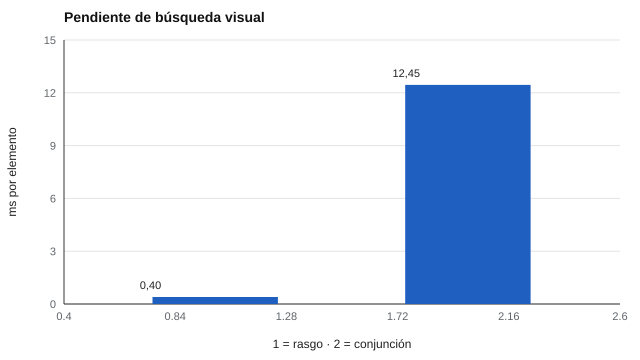

# 092 — Atención selectiva y dividida


<!-- NAV -->
[← 091 — Atención sostenida y vigilancia](../091-atencion-sostenida-y-vigilancia/README.md) · [📚 Parte 09](../README.md) · [🗺️ Índice 001–200](../../../PROGRAMA.md) · [093 — Tiempo de reacción y su medición digital →](../093-tiempo-de-reaccion-y-su-medicion-digital/README.md)
<!-- /NAV -->

**Parte 09 — Atención, memoria y funciones ejecutivas** · Nivel intermedio · 4 h · Estado `escrita`
**Pensada para:** quien interpreta pruebas de atención, y quien se pregunta qué mide cada una.
**Prerrequisitos:** clase 091.

> Material educativo. Los resultados de laboratorio no son diagnósticos.

## ¿Para qué te sirve esto?

«Atención» no es una sola cosa. Encontrar a tu amigo en una multitud (atención **selectiva**) es distinto de conducir mientras conversas (atención **dividida**). Un «test de atención» mide la combinación específica que pide su tarea, y no la atención «en general». Esta clase te muestra, con dos experimentos simulados, por qué las tareas difieren y cómo cada una se resume en un indicador distinto.

## Al terminar esta clase podrás

- Distinguir búsqueda de rasgo y de conjunción.
- Calcular pendientes tiempo–tamaño del conjunto.
- Interpretar el costo de doble tarea.
- Elegir qué tarea corresponde a qué pregunta.

## La idea en palabras simples

En la **búsqueda visual** se pide encontrar un elemento objetivo entre distractores. Treisman y Gelade (1980):

- **Búsqueda de rasgo** (por ejemplo, un círculo rojo entre cuadrados verdes): el objetivo «salta a la vista»; el tiempo casi no depende de cuántos elementos haya (**paralela**).
- **Búsqueda de conjunción** (un círculo rojo entre círculos verdes y cuadrados rojos): hay que mirar **uno por uno**; el tiempo crece con el número de elementos (**serial**).

La **pendiente** (milisegundos por elemento adicional) es el indicador.

En la **atención dividida**, hacer dos tareas a la vez cuesta más si ambas **compiten por el mismo recurso** (Wickens, 2002).

## Cómo funciona, paso a paso

**1. Medir** el tiempo de respuesta con distintos tamaños de conjunto.

**2. Calcular la pendiente** por persona.

**3. En doble tarea,** comparar el rendimiento solo y combinado.

**Ejemplo resuelto.** Con pendiente 12 ms/elemento, pasar de 8 a 32 elementos suma 24 · 12 = 288 ms.



*Figura 1.* La búsqueda de conjunción es serial; la de rasgo, casi paralela.

## Si construyes el instrumento

- Declara qué tipo de atención mide cada tarea y no la llames «atención» a secas.
- Recuerda que las pendientes son medidas diferenciales con fiabilidad individual limitada (clase 097).
- No uses una tarea de laboratorio para inferir conducta en el aula sin evidencia ecológica (clase 037).
- En doble tarea, controla qué recursos comparten las tareas.

## Si eres evaluado

- Una tarea de búsqueda visual mide algo específico, no tu atención en la vida diaria.
- Hacer dos cosas a la vez cuesta más cuando ambas usan lo mismo (por ejemplo, dos tareas verbales).
- Si un resultado te preocupa, consulta a un profesional.

## Qué muestra el laboratorio

`lab.py` simula 100 personas.

| Medida | Valor |
|---|---:|
| Pendiente de búsqueda de rasgo | 0,40 ms/elemento (DE entre personas 0,87) |
| Pendiente de búsqueda de conjunción | 12,45 ms/elemento (DE 0,72) |
| Costo de doble tarea con recursos distintos | 4,0 % |
| Costo de doble tarea con el mismo recurso | 35,4 % |

**Análisis.** (1) «Atención» no es una sola cosa. (2) La búsqueda de rasgo es casi paralela; la de conjunción exige atención serial. (3) El costo de doble tarea depende de si las tareas compiten por el mismo recurso. (4) Un «test de atención» mide la combinación específica que pide la tarea; los parámetros del laboratorio son ilustrativos.

## Errores frecuentes

- Hablar de «atención» como un solo constructo.
- Usar una tarea de laboratorio para inferir conducta en el aula sin evidencia.
- Interpretar pendientes individuales con pocos ensayos.
- Ignorar qué recursos comparten las tareas.

## Lo mínimo que debes llevarte

1. La atención tiene varias formas: selectiva, sostenida, dividida.
2. Búsqueda de rasgo: paralela; de conjunción: serial.
3. La doble tarea cuesta más si comparten recurso.
4. Cada test mide una combinación específica.

## Ejercicios

- **Inicial.** ¿Qué indica una pendiente cercana a 0? *Solución: una búsqueda casi paralela.*
- **Intermedio.** Si el RT base es 500 ms y la pendiente 12 ms, ¿RT esperado con 20 elementos? *Solución: 740 ms.*
- **Avanzado.** Añade en `lab.py` un costo asimétrico (la tarea A cuesta más que la B) y descríbelo.
- **Aplicación.** Elige una situación de la vida diaria que exija atención dividida y explica qué recursos comparten sus tareas.

## Glosario

- **Atención selectiva:** enfocarse en un estímulo ignorando otros.
- **Atención dividida:** hacer dos tareas a la vez.
- **Búsqueda de conjunción:** búsqueda de un objetivo definido por la combinación de rasgos.
- **Pendiente de búsqueda:** ms adicionales por cada elemento.

## Laboratorio

```bash
python classes/part-09-atencion-memoria-y-funciones-ejecutivas/092-atencion-selectiva-y-dividida/lab.py
python classes/part-09-atencion-memoria-y-funciones-ejecutivas/figuras.py
```

## Autoevaluación y criterios

1. ¿Qué tareas de la vida diaria requieren atención dividida? 2. ¿Qué prueba de «atención» usarías para una pregunta concreta? 3. ¿Qué limita la generalización?
Se logra la clase si puedes vincular cada indicador con un tipo de atención.

## Bibliografía

- Treisman, A. M., & Gelade, G. (1980). A feature-integration theory of attention. *Cognitive Psychology*, 12(1), 97-136. ✅ [DOI](https://doi.org/10.1016/0010-0285(80)90005-5)
- Wickens, C. D. (2002). Multiple resources and performance prediction. *Theoretical Issues in Ergonomics Science*, 3(2), 159-177. ✅ [DOI](https://doi.org/10.1080/14639220210123806)

Leyenda: ✅ existe en Crossref con título y año coincidentes (enlace al DOI); ⚠️ hay una obra de título parecido con otro año (no se enlaza: comprobar la edición); 🔎 no verificada automáticamente (libros sin DOI, normas y sitios web). Crossref confirma la existencia de la fuente, no que respalde cada afirmación de la clase. Ver [`docs/VERIFICACION_BIBLIOGRAFIA.md`](../../../docs/VERIFICACION_BIBLIOGRAFIA.md).

---

<!-- NAV -->
[← 091 — Atención sostenida y vigilancia](../091-atencion-sostenida-y-vigilancia/README.md)  
[📚 Parte 09](../README.md) · [🗺️ Índice 001–200](../../../PROGRAMA.md)  
[093 — Tiempo de reacción y su medición digital →](../093-tiempo-de-reaccion-y-su-medicion-digital/README.md)
<!-- /NAV -->
