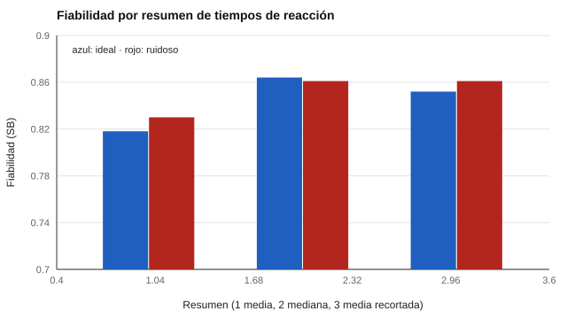

# 093 — Tiempo de reacción y su medición digital


<!-- NAV -->
[← 092 — Atención selectiva y dividida](../092-atencion-selectiva-y-dividida/README.md) · [📚 Parte 09](../README.md) · [🗺️ Índice 001–200](../../../PROGRAMA.md) · [094 — Memoria visual y auditiva →](../094-memoria-visual-y-auditiva/README.md)
<!-- /NAV -->

**Parte 09 — Atención, memoria y funciones ejecutivas** · Nivel intermedio · 4 h · Estado `escrita`
**Pensada para:** quien programa o interpreta tareas cronometradas, y quien las realiza en pantalla.
**Prerrequisitos:** clases 026 y 089.

## ¿Para qué te sirve esto?

Casi todas las tareas cognitivas modernas registran **tiempos de reacción**. Pero los tiempos tienen dos particularidades que complican su análisis: una **cola larga** (algunas respuestas muy lentas, por distracción) y el **ruido del dispositivo** (la pantalla y el teclado no son relojes perfectos). Esta clase te enseña a elegir un resumen **robusto** (mediana o media recortada), a decidir cómo tratar los extremos y a no olvidar registrar el dispositivo.

## Al terminar esta clase podrás

- Describir la distribución ex-Gaussiana de los tiempos de reacción.
- Evaluar el efecto del ruido del dispositivo.
- Elegir y declarar de antemano un resumen robusto.
- Registrar los metadatos de medición.

## La idea en palabras simples

Los tiempos de reacción tienen **asimetría positiva**: hay un cuerpo de respuestas rápidas y una cola de respuestas muy lentas. Se modelan con una **ex-Gaussiana** (una normal más una exponencial). La **media** es sensible a la cola; la **mediana** y la **media recortada** (que descarta ensayos fuera de un rango fijado de antemano) son más robustas (Whelan, 2008; Ratcliff, 1993).

Además, el dispositivo agrega ruido: la frecuencia de refresco de la pantalla y la latencia del teclado alteran los tiempos (Anwyl-Irvine et al., 2021).

## Cómo funciona, paso a paso

**1. Registrar** el tiempo de cada ensayo y el dispositivo.

**2. Elegir de antemano** el resumen (mediana o media recortada) y el criterio de recorte.

**3. Calcular** la fiabilidad del resumen (por mitades con Spearman-Brown).

**Ejemplo resuelto.** Con RT 280, 300, 310, 320 y 1.400 ms: media = 522; mediana = 310. Un solo ensayo distraído desplaza la media 210 ms.



*Figura 1.* Recortar o usar la mediana mejora la fiabilidad.

## Si construyes el instrumento

- Declara el criterio de recorte antes de ver los datos.
- Registra el tipo de dispositivo y el navegador, y calibra los equipos.
- Informa cuántos ensayos descartaste.
- Considera las implicancias de privacidad de la telemetría (parte 07).

## Si eres evaluado

- Los tiempos que se registran dependen también de tu equipo: si es posible, usa el dispositivo indicado.
- Una distracción puntual produce un tiempo muy largo; no «arruina» el resultado si se usa un resumen robusto.
- Pregunta qué datos de tu dispositivo se guardan.

## Qué muestra el laboratorio

`lab.py` simula 300 personas × 40 ensayos con un dispositivo ideal y uno ruidoso.

| Dispositivo | Media | Mediana | Media recortada |
|---|---:|---:|---:|
| Ideal | 0,818 | 0,864 | 0,852 |
| Ruidoso (refresco + latencia) | 0,830 | 0,861 | 0,861 |

(Fiabilidad por mitades con Spearman-Brown.)

**Análisis.** (1) La cola larga de los RT hace que la media sea inestable; recortar o usar la mediana mejora la fiabilidad (0,818 → 0,864). (2) El ruido del dispositivo, en este diseño, cambia poco porque es pequeño frente a la variabilidad de la persona; puede importar más con tareas cortas. (3) Recortar es una decisión que se declara de antemano, no después de ver los datos. (4) Los parámetros de la ex-Gaussiana y del ruido son supuestos.

## Errores frecuentes

- Elegir el criterio de recorte después de ver los datos.
- Mezclar dispositivos sin registrar su tipo.
- Descartar ensayos sin informar cuántos.
- Usar solo la media en datos con cola larga.

## Lo mínimo que debes llevarte

1. Los RT tienen cola larga.
2. Mediana y media recortada son más robustas que la media.
3. El dispositivo agrega ruido: se registra y se calibra.
4. El criterio de recorte se declara antes.

## Ejercicios

- **Inicial.** ¿Por qué la media sobrestima el RT típico? *Solución: por la cola de respuestas muy lentas.*
- **Intermedio.** Calcula la media recortada (150–1.000 ms) de 120, 280, 300, 310, 1.400. *Solución: 296,7.*
- **Avanzado.** Aumenta el ruido de latencia a 80 ms y reporta el efecto sobre cada resumen.
- **Aplicación.** Escribe el protocolo de registro de dispositivos para una tarea en línea.

## Glosario

- **Tiempo de reacción (RT):** tiempo entre un estímulo y la respuesta.
- **Ex-Gaussiana:** distribución normal más una cola exponencial.
- **Media recortada:** media tras descartar valores fuera de un rango.
- **Latencia:** retraso entre el evento real y su registro.

## Laboratorio

```bash
python classes/part-09-atencion-memoria-y-funciones-ejecutivas/093-tiempo-de-reaccion-y-su-medicion-digital/lab.py
python classes/part-09-atencion-memoria-y-funciones-ejecutivas/figuras.py
```

## Autoevaluación y criterios

1. ¿Qué metadatos del dispositivo registrarías? 2. ¿Cómo justificas el recorte? 3. ¿Qué implica la telemetría para la privacidad (parte 07)?
Se logra la clase si puedes elegir y justificar un resumen y declarar el efecto del dispositivo.

## Bibliografía

- Whelan, R. (2008). Effective analysis of reaction time data. *The Psychological Record*, 58(3), 475-482.
- Ratcliff, R. (1993). Methods for dealing with reaction time outliers. *Psychological Bulletin*, 114(3), 510-532.
- Anwyl-Irvine, A., Dalmaijer, E. S., Hodges, N., & Evershed, J. K. (2021). Realistic precision and accuracy of online experiment platforms, web browsers, and devices. *Behavior Research Methods*, 53, 1407-1425.

---

<!-- NAV -->
[← 092 — Atención selectiva y dividida](../092-atencion-selectiva-y-dividida/README.md)  
[📚 Parte 09](../README.md) · [🗺️ Índice 001–200](../../../PROGRAMA.md)  
[094 — Memoria visual y auditiva →](../094-memoria-visual-y-auditiva/README.md)
<!-- /NAV -->
