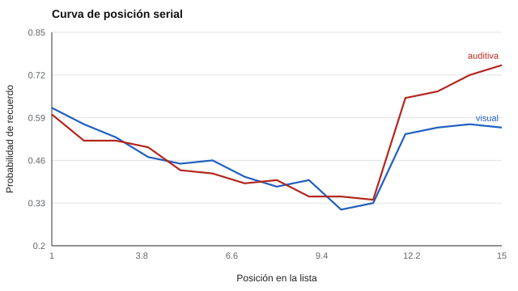

# 094 — Memoria visual y auditiva


<!-- NAV -->
[← 093 — Tiempo de reacción y su medición digital](../093-tiempo-de-reaccion-y-su-medicion-digital/README.md) · [📚 Parte 09](../README.md) · [🗺️ Índice 001–200](../../../PROGRAMA.md) · [095 — Memoria de trabajo →](../095-memoria-de-trabajo/README.md)
<!-- /NAV -->

**Parte 09 — Atención, memoria y funciones ejecutivas** · Nivel intermedio · 4 h · Estado `escrita`
**Pensada para:** quien interpreta pruebas de memoria, y quien las rinde.
**Prerrequisitos:** clases 026 y 091.

> Material educativo. Los resultados de memoria en una prueba no constituyen diagnóstico.

## ¿Para qué te sirve esto?

Si te leen una lista de 15 palabras y te piden recordarlas, ¿cuáles recuerdas mejor? Típicamente, **las primeras y las últimas**. Eso se llama la **curva de posición serial**, y muestra que un puntaje total de memoria **mezcla procesos distintos**. Esta clase te enseña a leer esa curva, a distinguir recuerdo inmediato y diferido y a no atribuir a «el sentido» (vista u oído) lo que es del procedimiento.

## Al terminar esta clase podrás

- Interpretar la curva de posición serial (primacía y recencia).
- Entender el efecto de modalidad.
- Separar recuerdo inmediato y diferido.
- Evitar el mito de los «estilos de aprendizaje».

## La idea en palabras simples

En el recuerdo libre de una lista:

- **Primacía:** las primeras palabras se recuerdan mejor; se asocia con repaso y almacenamiento a largo plazo.
- **Recencia:** las últimas también; se asocia con memoria a corto plazo (Glanzer & Cunitz, 1966).

La curva resultante tiene forma de **U**. Además, la recencia suele ser **mayor con presentación auditiva** que visual (efecto de modalidad).

La memoria de trabajo (Baddeley & Hitch, 1974) suele describirse con componentes separados para información verbal y visual.

## Cómo funciona, paso a paso

**1. Presentar** una lista (visual o auditiva).

**2. Pedir** recuerdo libre inmediato (y, si procede, diferido tras una tarea de interferencia).

**3. Calcular** la probabilidad de recuerdo por posición.

**Ejemplo resuelto.** Sumando las probabilidades de las 15 posiciones se obtiene la media esperada de palabras recordadas; la diferencia entre modalidades (0,5 palabras) proviene casi toda de las últimas cuatro posiciones.



*Figura 1.* La recencia (últimas posiciones) es mayor en la modalidad auditiva.

## Si construyes el instrumento

- Separa recuerdo inmediato y diferido: miden procesos distintos.
- Controla las condiciones al comparar modalidades (misma duración, mismo ritmo).
- Con niños pequeños, elige material adecuado (imágenes, palabras familiares).
- No atribuyas diferencias de modalidad al «estilo de aprendizaje»: la evidencia de que adaptar la enseñanza a estilos ayude es débil (Pashler et al., 2008).

## Si eres evaluado

- Es normal recordar mejor el principio y el final de una lista: no indica un problema.
- Tu rendimiento puede variar según la modalidad; eso no define cómo debes estudiar.
- El cansancio, la ansiedad y la distracción afectan el resultado.

## Qué muestra el laboratorio

`lab.py` usa un modelo simple de dos componentes (parámetros ilustrativos).

| Posición | 1 | 5 | 10 | 12 | 15 |
|---|---:|---:|---:|---:|---:|
| Visual | 0,62 | 0,45 | 0,31 | 0,54 | 0,56 |
| Auditiva | 0,60 | 0,43 | 0,35 | 0,65 | 0,75 |

Palabras recordadas (de 15): visual **7,20**; auditiva **7,72**.

**Análisis.** (1) La curva en U (primacía y recencia) muestra que el puntaje total mezcla procesos. (2) Un índice de recuerdo inmediato sube con la recencia; uno diferido (tras interferencia) depende de la consolidación. (3) Por eso las pruebas de lista separan inmediato y diferido; comparar modalidades sin igualar condiciones atribuye al sentido lo que es del procedimiento. (4) Los parámetros son ilustrativos, no datos empíricos.

## Errores frecuentes

- Atribuir diferencias de modalidad al «estilo de aprendizaje» de la persona.
- Comparar puntajes totales sin distinguir inmediato y diferido.
- Mezclar material verbal y visual sin separar los procesos.
- Interpretar una curva plana sin considerar el procedimiento.

## Lo mínimo que debes llevarte

1. La curva de posición serial tiene primacía y recencia.
2. El puntaje total mezcla procesos.
3. Inmediato y diferido miden cosas distintas.
4. Los «estilos de aprendizaje» no están bien respaldados.

## Ejercicios

- **Inicial.** ¿Qué proceso explica la recencia? *Solución: la memoria a corto plazo.*
- **Intermedio.** Si la recencia desaparece tras 30 s de interferencia, ¿qué posiciones se afectan más? *Solución: las últimas.*
- **Avanzado.** Cambia el parámetro de repaso (0,93) en `lab.py` y describe la primacía.
- **Aplicación.** Diseña una prueba de lista para niños de 6 años y explica cómo separarías inmediato y diferido.

## Glosario

- **Curva de posición serial:** probabilidad de recuerdo según la posición en la lista.
- **Primacía / recencia:** ventaja de los primeros / últimos elementos.
- **Efecto de modalidad:** diferencia de recuerdo según vista u oído.
- **Interferencia:** actividad que dificulta el recuerdo.

## Laboratorio

```bash
python classes/part-09-atencion-memoria-y-funciones-ejecutivas/094-memoria-visual-y-auditiva/lab.py
python classes/part-09-atencion-memoria-y-funciones-ejecutivas/figuras.py
```

## Autoevaluación y criterios

1. ¿Por qué separar inmediato y diferido? 2. ¿Qué material usarías en niños pequeños? 3. ¿Qué indica una curva plana?
Se logra la clase si puedes interpretar la curva y distinguir procesos.

## Bibliografía

- Glanzer, M., & Cunitz, A. R. (1966). Two storage mechanisms in free recall. *Journal of Verbal Learning and Verbal Behavior*, 5(4), 351-360. ✅ [DOI](https://doi.org/10.1016/s0022-5371(66)80044-0)
- Baddeley, A. D., & Hitch, G. (1974). Working memory. En G. H. Bower (Ed.), *The Psychology of Learning and Motivation* (Vol. 8). Academic Press. ✅ [DOI](https://doi.org/10.1016/s0079-7421(08)60452-1)
- Pashler, H., McDaniel, M., Rohrer, D., & Bjork, R. (2008). Learning styles: Concepts and evidence. *Psychological Science in the Public Interest*, 9(3), 105-119. 🔎 sin verificar (libro, norma o sitio no hallado en Crossref: comprobar a mano)

Leyenda: ✅ existe en Crossref con título y año coincidentes (enlace al DOI); ⚠️ hay una obra de título parecido con otro año (no se enlaza: comprobar la edición); 🔎 no verificada automáticamente (libros sin DOI, normas y sitios web). Crossref confirma la existencia de la fuente, no que respalde cada afirmación de la clase. Ver [`docs/VERIFICACION_BIBLIOGRAFIA.md`](../../../docs/VERIFICACION_BIBLIOGRAFIA.md).

---

<!-- NAV -->
[← 093 — Tiempo de reacción y su medición digital](../093-tiempo-de-reaccion-y-su-medicion-digital/README.md)  
[📚 Parte 09](../README.md) · [🗺️ Índice 001–200](../../../PROGRAMA.md)  
[095 — Memoria de trabajo →](../095-memoria-de-trabajo/README.md)
<!-- /NAV -->
