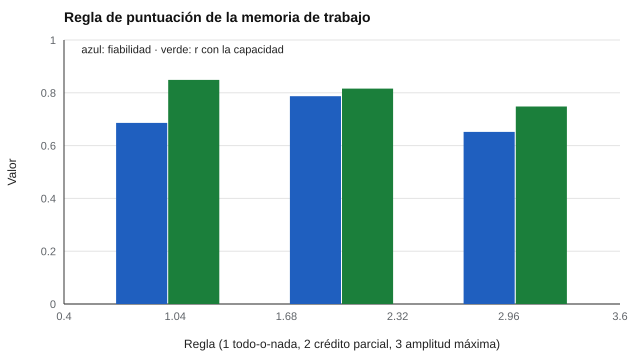

# 095 — Memoria de trabajo


<!-- NAV -->
[← 094 — Memoria visual y auditiva](../094-memoria-visual-y-auditiva/README.md) · [📚 Parte 09](../README.md) · [🗺️ Índice 001–200](../../../PROGRAMA.md) · [096 — Memoria verbal y aprendizaje de listas →](../096-memoria-verbal-y-aprendizaje-de-listas/README.md)
<!-- /NAV -->

**Parte 09 — Atención, memoria y funciones ejecutivas** · Nivel intermedio · 4 h · Estado `escrita`
**Pensada para:** quien diseña o interpreta tareas de memoria de trabajo, y quien las rinde.
**Prerrequisitos:** clases 021 y 094.

> Material educativo. No es evaluación neuropsicológica.

## ¿Para qué te sirve esto?

Hacer cálculo mental, seguir instrucciones de varios pasos o entender una frase larga exige **mantener y manipular información** por unos segundos: la **memoria de trabajo**. Medirla bien depende de una decisión que parece de detalle y no lo es: **cómo se puntúa**. Esta clase te enseña a comparar reglas de puntuación (todo-o-nada, crédito parcial, amplitud máxima) y a ver que la regla cambia la fiabilidad del resultado.

## Al terminar esta clase podrás

- Describir la memoria de trabajo y las tareas de amplitud.
- Comparar reglas de puntuación.
- Reconocer que la regla de puntuación afecta la fiabilidad.
- Justificar una regla con datos de la tarea real.

## La idea en palabras simples

La **memoria de trabajo** mantiene y manipula información de forma temporal (Baddeley & Hitch, 1974). A diferencia de la memoria a corto plazo (solo guardar), implica también **procesar**. Las **tareas de amplitud complejas** (*complex span*) piden recordar elementos **mientras se hace otra tarea** (por ejemplo, resolver una suma entre palabra y palabra) (Conway et al., 2005).

Tres formas de puntuar:

- **Todo-o-nada:** solo cuentan los ensayos recordados perfectos.
- **Crédito parcial:** se cuenta la proporción de elementos correctos de cada ensayo.
- **Amplitud máxima:** el tamaño del mayor ensayo recordado.

## Cómo funciona, paso a paso

**1. Aplicar** ensayos de tamaño creciente.

**2. Puntuar** con cada regla.

**3. Calcular** la fiabilidad por mitades (Spearman-Brown) y la correlación con la capacidad verdadera (conocida en la simulación).

**Ejemplo resuelto.** Ensayos de tamaño 4, 5 y 6 con 4, 3 y 5 elementos correctos: parcial = (4/4 + 3/5 + 5/6) / 3 = 0,81; todo-o-nada = 4 (solo el ensayo perfecto de tamaño 4).



*Figura 1.* El crédito parcial es el más fiable; la amplitud máxima, el menos.

## Si construyes el instrumento

- No interpretes la amplitud de dígitos directa como memoria de trabajo: la inversa y las tareas complejas involucran más control ejecutivo.
- Elige la regla de puntuación con datos de tu tarea real.
- Considera las estrategias (agrupar, repasar) y la fatiga.
- No apliques el mismo criterio en niños y adultos sin evidencia.

## Si eres evaluado

- Usar estrategias (agrupar elementos, repasar mentalmente) es normal y legítimo salvo que la consigna indique lo contrario.
- La fatiga y la ansiedad afectan el rendimiento en estas tareas.
- Un puntaje en una tarea no resume tu memoria en la vida diaria.

## Qué muestra el laboratorio

`lab.py` simula 600 personas con 12 ensayos de tamaño 2 a 7 (capacidad verdadera conocida).

| Puntuación | Fiabilidad por mitades (SB) | r con la capacidad verdadera |
|---|---:|---:|
| Todo-o-nada | 0,686 | 0,849 |
| Crédito parcial | 0,787 | 0,816 |
| Amplitud máxima | 0,652 | 0,748 |

**Análisis.** (1) La amplitud máxima aprovecha un solo ensayo y es la menos fiable; el crédito parcial es el más fiable (usa toda la información). (2) En **esta** simulación el todo-o-nada se acerca algo más a la capacidad verdadera porque el recuerdo de los ítems sostenidos es casi determinístico: el resultado depende del modelo de respuesta. (3) La regla de puntuación es una decisión de medición, no un detalle, y se justifica con datos de la tarea real. (4) Los parámetros son ilustrativos.

## Errores frecuentes

- Interpretar la amplitud de dígitos directa como memoria de trabajo.
- Ignorar las estrategias.
- Aplicar el mismo criterio en niños y adultos sin evidencia.
- Elegir la regla de puntuación sin datos.

## Lo mínimo que debes llevarte

1. La memoria de trabajo mantiene y procesa.
2. La regla de puntuación afecta la fiabilidad.
3. El crédito parcial usa toda la información.
4. La regla se elige con datos de la tarea real.

## Ejercicios

- **Inicial.** ¿Qué diferencia hay entre memoria a corto plazo y de trabajo? *Solución: la de trabajo, además de mantener, manipula la información.*
- **Intermedio.** Calcula el crédito parcial de 3/3, 4/5 y 2/6. *Solución: (1 + 0,8 + 0,33) / 3 = 0,71.*
- **Avanzado.** Cambia la probabilidad de recordar lo no sostenido (0,25) a 0,05 y observa el cambio.
- **Aplicación.** Propón una tarea de amplitud para escolares y justifica su regla de puntuación.

## Glosario

- **Memoria de trabajo:** mantener y manipular información de forma temporal.
- **Tarea de amplitud compleja:** recordar elementos mientras se realiza otra tarea.
- **Crédito parcial:** puntuación proporcional a los elementos correctos.
- **Todo-o-nada:** puntuación que solo cuenta ensayos perfectos.

## Laboratorio

```bash
python classes/part-09-atencion-memoria-y-funciones-ejecutivas/095-memoria-de-trabajo/lab.py
python classes/part-09-atencion-memoria-y-funciones-ejecutivas/figuras.py
```

## Autoevaluación y criterios

1. ¿Qué regla de puntuación elegirías y por qué? 2. ¿Cómo evitas efectos de fatiga? 3. ¿Qué otras tareas medirían el mismo constructo?
Se logra la clase si puedes comparar reglas con evidencia de fiabilidad y validez.

## Bibliografía

- Baddeley, A. D., & Hitch, G. (1974). Working memory. En G. H. Bower (Ed.), *The Psychology of Learning and Motivation* (Vol. 8). Academic Press.
- Conway, A. R. A., Kane, M. J., Bunting, M. F., Hambrick, D. Z., Wilhelm, O., & Engle, R. W. (2005). Working memory span tasks: A methodological review and user's guide. *Psychonomic Bulletin & Review*, 12(5), 769-786.

---

<!-- NAV -->
[← 094 — Memoria visual y auditiva](../094-memoria-visual-y-auditiva/README.md)  
[📚 Parte 09](../README.md) · [🗺️ Índice 001–200](../../../PROGRAMA.md)  
[096 — Memoria verbal y aprendizaje de listas →](../096-memoria-verbal-y-aprendizaje-de-listas/README.md)
<!-- /NAV -->
