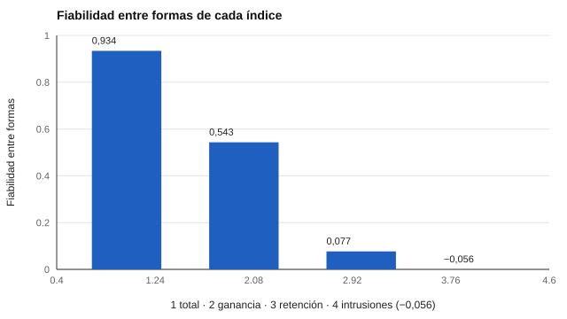

# 096 — Memoria verbal y aprendizaje de listas


<!-- NAV -->
[← 095 — Memoria de trabajo](../095-memoria-de-trabajo/README.md) · [📚 Parte 09](../README.md) · [🗺️ Índice 001–200](../../../PROGRAMA.md) · [097 — Flexibilidad cognitiva e inhibición →](../097-flexibilidad-cognitiva-e-inhibicion/README.md)
<!-- /NAV -->

**Parte 09 — Atención, memoria y funciones ejecutivas** · Nivel intermedio · 4 h · Estado `escrita`
**Pensada para:** quien interpreta pruebas de aprendizaje de listas, y quien las responde.
**Prerrequisitos:** clases 087 y 094.

> Material educativo. En contextos clínicos, la interpretación corresponde a profesionales habilitados.

## ¿Para qué te sirve esto?

Las pruebas de **aprendizaje de listas** (se leen varias veces las mismas palabras y se pide recordarlas, luego tras un intervalo y con reconocimiento) producen muchos números: total aprendido, ganancia, retención, intrusiones. Es tentador interpretar cada uno («tuvo poca retención»). Pero **no todos son igual de fiables**. Esta clase te muestra cuáles lo son y cuáles no, y por qué un índice derivado individual casi siempre requiere cautela.

## Al terminar esta clase podrás

- Calcular los índices de una tarea de aprendizaje de listas.
- Estimar su fiabilidad con formas paralelas.
- Distinguir índices básicos de índices derivados.
- Informar cada índice con su error.

## La idea en palabras simples

Los índices típicos son:

- **Aprendizaje total:** suma de palabras recordadas en todos los ensayos.
- **Ganancia:** último ensayo − primero.
- **Retención:** recuerdo diferido ÷ recuerdo del último ensayo.
- **Intrusiones:** palabras dichas que no estaban en la lista.

Los **básicos** (el total) usan mucha información; los **derivados** (diferencias y cocientes) heredan el problema de la clase 087: restar o dividir medidas relacionadas deja sobre todo error (Cronbach & Furby, 1970). Y los eventos raros (intrusiones) casi no son fiables.

## Cómo funciona, paso a paso

**1. Aplicar** dos formas paralelas de una lista de 15 palabras en 5 ensayos.

**2. Calcular** cada índice en ambas formas.

**3. Correlacionar** los índices entre formas (fiabilidad entre formas paralelas).

**Ejemplo resuelto.** Ensayos 6, 9, 11, 12, 13 y diferido 9: total = 51; ganancia = 7; retención = 9/13 = 0,69.



*Figura 1.* El total es fiable; los índices derivados y los eventos raros, no.

## Si construyes el instrumento

- Reporta cada índice con su fiabilidad.
- No uses formas alternativas sin evidencia de equivalencia.
- Para fines diagnósticos, reporta más que un puntaje total.
- En contextos clínicos hay normas y criterios que corresponden a profesionales habilitados.

## Si eres evaluado

- Un «puntaje de retención» o de «intrusiones» individual es muy poco fiable: no debería usarse solo para sacar conclusiones.
- Que recuerdes pocas palabras un día no define tu memoria.
- Pregunta qué índices se usaron y con qué fiabilidad.

## Qué muestra el laboratorio

`lab.py` simula 800 personas con dos formas paralelas (sintético).

| Índice | Media | DE | Fiabilidad entre formas |
|---|---:|---:|---:|
| Aprendizaje total | 28,14 | 14,17 | 0,934 |
| Ganancia | 5,75 | 3,23 | 0,543 |
| Retención | 0,76 | 0,37 | 0,077 |
| Intrusiones | 0,21 | 0,44 | −0,056 |

**Análisis.** (1) El aprendizaje total es el índice más fiable porque usa todos los ensayos. (2) La ganancia y la retención (diferencias y cocientes) pierden fiabilidad. (3) Las intrusiones, por ser eventos raros, casi no son fiables. (4) Se informa cada índice con su error y se evita interpretar índices derivados individualmente sin evidencia (clases 025 y 087).

## Errores frecuentes

- Interpretar la retención individual como «olvido».
- Reportar solo un puntaje total cuando el propósito es diagnóstico.
- Usar formas sin evidencia de equivalencia.
- Interpretar índices poco fiables sin su error.

## Lo mínimo que debes llevarte

1. El aprendizaje total es el más fiable.
2. Ganancia y retención son poco fiables individualmente.
3. Las intrusiones casi no son fiables.
4. Cada índice se informa con su fiabilidad.

## Ejercicios

- **Inicial.** ¿Qué índice es más fiable y por qué? *Solución: el aprendizaje total, porque usa todos los ensayos.*
- **Intermedio.** Calcula el total y la ganancia de 5, 8, 10, 11, 13. *Solución: 47 y 8.*
- **Avanzado.** Aumenta a 8 ensayos en `lab.py` y observa la fiabilidad de la ganancia.
- **Aplicación.** Escribe cómo informarías un índice poco fiable a una familia.

## Glosario

- **Aprendizaje de listas:** tarea de aprender una lista de palabras en varios ensayos.
- **Ganancia:** diferencia entre el último y el primer ensayo.
- **Retención:** proporción recordada tras un intervalo.
- **Intrusión:** palabra dicha que no estaba en la lista.

## Laboratorio

```bash
python classes/part-09-atencion-memoria-y-funciones-ejecutivas/096-memoria-verbal-y-aprendizaje-de-listas/lab.py
python classes/part-09-atencion-memoria-y-funciones-ejecutivas/figuras.py
```

## Autoevaluación y criterios

1. ¿Por qué las intrusiones son poco fiables? 2. ¿Qué evidencia necesitas para usar formas alternativas? 3. ¿Cómo informarías un índice poco fiable?
Se logra la clase si puedes reportar cada índice con su fiabilidad.

## Bibliografía

- Lezak, M. D., Howieson, D. B., Bigler, E. D., & Tranel, D. (2012). *Neuropsychological Assessment* (5.ª ed.). Oxford University Press.
- Cronbach, L. J., & Furby, L. (1970). How we should measure «change»—or should we? *Psychological Bulletin*, 74(1), 68-80.

---

<!-- NAV -->
[← 095 — Memoria de trabajo](../095-memoria-de-trabajo/README.md)  
[📚 Parte 09](../README.md) · [🗺️ Índice 001–200](../../../PROGRAMA.md)  
[097 — Flexibilidad cognitiva e inhibición →](../097-flexibilidad-cognitiva-e-inhibicion/README.md)
<!-- /NAV -->
