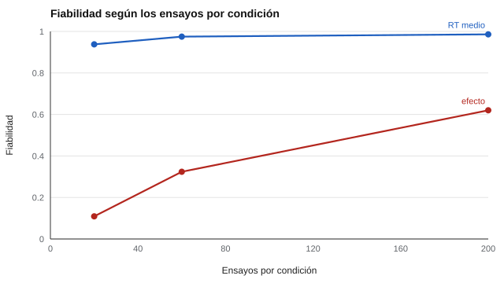

# 097 — Flexibilidad cognitiva e inhibición


<!-- NAV -->
[← 096 — Memoria verbal y aprendizaje de listas](../096-memoria-verbal-y-aprendizaje-de-listas/README.md) · [📚 Parte 09](../README.md) · [🗺️ Índice 001–200](../../../PROGRAMA.md) · [098 — Planificación y control ejecutivo →](../098-planificacion-y-control-ejecutivo/README.md)
<!-- /NAV -->

**Parte 09 — Atención, memoria y funciones ejecutivas** · Nivel intermedio · 4 h · Estado `escrita`
**Pensada para:** quien usa tareas como Stroop o cambio de tarea como medidas individuales, y quien lee estudios que las correlacionan.
**Prerrequisitos:** clases 087 y 093.

> Material educativo. No es evaluación clínica.

## ¿Para qué te sirve esto?

El efecto Stroop (nombrar el color de una palabra que dice otro color tarda más) es uno de los hallazgos más sólidos de la psicología. Todos los grupos lo muestran. Se podría pensar que, por eso, es una **buena medida** de la capacidad de inhibición de cada persona. **No necesariamente.** Esta clase te enseña la «**paradoja de la fiabilidad**»: un efecto muy robusto en el promedio del grupo puede ser una **mala medida de diferencias individuales**. Es crucial para leer estudios que correlacionan tareas ejecutivas.

## Al terminar esta clase podrás

- Describir la paradoja de la fiabilidad.
- Estimar la fiabilidad de un efecto de diferencia.
- Determinar el número de ensayos necesario.
- Entender por qué la baja fiabilidad puede ocultar relaciones reales.

## La idea en palabras simples

Las tareas de inhibición (Stroop, flancos) y de flexibilidad (cambio de tarea) producen **efectos** muy robustos en el promedio, pero su fiabilidad como **diferencias individuales** suele ser baja (Hedge et al., 2018): la variación **entre personas** en el efecto es pequeña frente al **ruido de cada ensayo**. Y el efecto es una **diferencia** entre dos condiciones, con los problemas de fiabilidad de cualquier diferencia.

Consecuencia: si las medidas son poco fiables, las correlaciones entre ellas **se atenúan**, y se puede concluir erróneamente que «no hay un factor ejecutivo común» (Miyake et al., 2000, plantearon unidad y diversidad de las funciones ejecutivas).

## Cómo funciona, paso a paso

**1. Simular** un efecto individual (M = 60 ms; DE = 15 ms) con ruido de ensayo DE = 120 ms.

**2. Variar** el número de ensayos por condición.

**3. Calcular** la fiabilidad del tiempo medio y la del efecto.

**Ejemplo resuelto.** Con DE entre personas del efecto = 15 ms (varianza 225) y ruido del efecto por mitad = 2 · 120² / n: con n = 30 por condición y mitad, ruido = 960; fiabilidad de la mitad = 225 / (225 + 960) = 0,19; con Spearman-Brown, ≈ 0,32.



*Figura 1.* El RT medio es fiable con pocos ensayos; el efecto necesita cientos.

## Si construyes el instrumento

- Estima la fiabilidad del efecto antes de usarlo como rasgo.
- Usa muchos ensayos (cientos por condición) o modelos que estimen el efecto con *pooling* (por ejemplo, jerárquicos o de difusión).
- No correlaciones efectos de varias tareas sin corregir por atenuación.
- Informa la fiabilidad.

## Si eres evaluado

- Un resultado individual en una tarea tipo Stroop tiene un margen de error grande.
- Que «todo el mundo muestra el efecto» no implica que tu valor sea un buen indicador tuyo.
- Los resultados de una tarea breve no resumen tu «control ejecutivo».

## Qué muestra el laboratorio

`lab.py` simula 1.000 personas (efecto individual M = 60, DE = 15 ms; ruido de ensayo DE = 120 ms).

| Ensayos por condición | Efecto medio (ms) | Fiabilidad del RT medio | Fiabilidad del **efecto** |
|---:|---:|---:|---:|
| 20 | 59,2 | 0,938 | 0,109 |
| 60 | 60,2 | 0,975 | 0,324 |
| 200 | 59,8 | 0,986 | 0,620 |

**Análisis.** (1) El efecto promedio es estable (~60 ms) y el RT medio es fiable. (2) Pero el efecto individual necesita cientos de ensayos para ser aceptable (0,62 con 200). (3) Un efecto que nadie discute en el grupo puede ser una mala medida diferencial; no se interpreta como rasgo sin esa evidencia. (4) Los parámetros son supuestos del laboratorio.

## Errores frecuentes

- Correlacionar efectos de varias tareas ejecutivas y concluir que «no hay un factor ejecutivo» cuando las medidas no son fiables.
- Usar un efecto como rasgo sin fiabilidad.
- Creer que robustez en el grupo implica fiabilidad individual.
- Usar pocos ensayos.

## Lo mínimo que debes llevarte

1. Un efecto robusto puede ser una mala medida individual.
2. El efecto es una diferencia: hereda su baja fiabilidad.
3. Se necesitan cientos de ensayos o modelos jerárquicos.
4. La baja fiabilidad atenúa las correlaciones.

## Ejercicios

- **Inicial.** ¿Por qué un efecto robusto puede ser una mala medida individual? *Solución: porque la variación entre personas es pequeña frente al ruido de los ensayos.*
- **Intermedio.** ¿Cuántos ensayos por condición para una fiabilidad ~0,60? *Solución: del orden de 200 en este diseño.*
- **Avanzado.** Aumenta la DE del efecto individual a 30 ms en `lab.py` y observa.
- **Aplicación.** Lee un estudio que correlacione tareas ejecutivas y señala si informó la fiabilidad de los efectos.

## Glosario

- **Paradoja de la fiabilidad:** efectos robustos en el grupo con baja fiabilidad individual.
- **Efecto Stroop:** mayor tiempo cuando color y palabra son incongruentes.
- **Atenuación:** reducción de una correlación por la baja fiabilidad.
- **Pooling:** estimación que comparte información entre personas.

## Laboratorio

```bash
python classes/part-09-atencion-memoria-y-funciones-ejecutivas/097-flexibilidad-cognitiva-e-inhibicion/lab.py
python classes/part-09-atencion-memoria-y-funciones-ejecutivas/figuras.py
```

## Autoevaluación y criterios

1. ¿Qué es la atenuación por baja fiabilidad? 2. ¿Cómo diseñarías una tarea más fiable? 3. ¿Qué informarías sobre la fiabilidad?
Se logra la clase si puedes estimar la fiabilidad de un efecto y decidir el número de ensayos.

## Bibliografía

- Hedge, C., Powell, G., & Sumner, P. (2018). The reliability paradox: Why robust cognitive tasks do not produce reliable individual differences. *Behavior Research Methods*, 50(3), 1166-1186.
- Miyake, A., et al. (2000). The unity and diversity of executive functions and their contributions to complex «frontal lobe» tasks: A latent variable analysis. *Cognitive Psychology*, 41(1), 49-100.

---

<!-- NAV -->
[← 096 — Memoria verbal y aprendizaje de listas](../096-memoria-verbal-y-aprendizaje-de-listas/README.md)  
[📚 Parte 09](../README.md) · [🗺️ Índice 001–200](../../../PROGRAMA.md)  
[098 — Planificación y control ejecutivo →](../098-planificacion-y-control-ejecutivo/README.md)
<!-- /NAV -->
