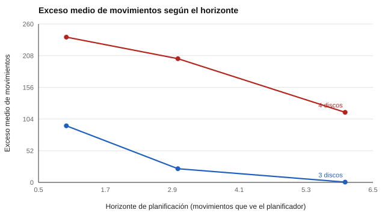

# 098 — Planificación y control ejecutivo


<!-- NAV -->
[← 097 — Flexibilidad cognitiva e inhibición](../097-flexibilidad-cognitiva-e-inhibicion/README.md) · [📚 Parte 09](../README.md) · [🗺️ Índice 001–200](../../../PROGRAMA.md) · [099 — Tareas clásicas: Stroop, Go/No-Go, n-back →](../099-tareas-clasicas-stroop-go-no-go-n/README.md)
<!-- /NAV -->

**Parte 09 — Atención, memoria y funciones ejecutivas** · Nivel intermedio · 5 h · Estado `escrita`
**Pensada para:** quien diseña o interpreta tareas de planificación (tipo Torre de Hanoi o de Londres), y quien las resuelve.
**Prerrequisitos:** clases 083 y 097.

> Material educativo. Un mal desempeño en una tarea no es un diagnóstico de «función ejecutiva».

## ¿Para qué te sirve esto?

Planificar es decidir una secuencia de pasos para llegar a una meta. Las tareas tipo **Torre de Hanoi** o **Torre de Londres** lo evalúan pidiendo mover piezas con reglas. Una pregunta clave para diseñar un banco de problemas: **¿qué tan difícil es cada uno?** La respuesta no hace falta suponerla: **se puede calcular**. Esta clase te muestra cómo, y cómo interpretar el «exceso de movimientos» sin concluir demasiado.

## Al terminar esta clase podrás

- Calcular la dificultad objetiva de problemas de planificación.
- Generar y calificar automáticamente un banco original.
- Interpretar el exceso de movimientos como indicador de plan.
- Reconocer otras explicaciones de un mal desempeño.

## La idea en palabras simples

Las tareas tipo Torre de Hanoi piden planificar una secuencia de movimientos hasta una meta (Shallice, 1982). La **dificultad objetiva** de un problema es el **número mínimo de movimientos** necesario, que se calcula con una búsqueda sobre todas las configuraciones posibles. Con *n* discos hay 3ⁿ configuraciones, y la dificultad máxima es 2ⁿ − 1 movimientos (Hinz & Klavžar, 2013). Crece **exponencialmente** con el número de discos.

El **exceso de movimientos** (movimientos usados − óptimo) mide la calidad del plan. En el laboratorio, un «planificador miope» solo ve la solución si está a *h* movimientos o menos; si no, se mueve al azar.

## Cómo funciona, paso a paso

**1. Enumerar** todas las configuraciones (3ⁿ).

**2. Calcular** la distancia mínima a la meta de cada una (dificultad objetiva).

**3. Simular** planificadores con distinto horizonte y medir el exceso.

**Ejemplo resuelto.** Con 3 discos hay 3³ = 27 estados; el estado más lejano de la meta está a 7 movimientos (2³ − 1).



*Figura 1.* Con mayor horizonte de planificación, el exceso cae.

## Si construyes el instrumento

- Calibra la dificultad del banco con el cálculo objetivo, no con la intuición.
- No supongas que la dificultad crece linealmente con el número de discos.
- Estandariza instrucciones y reglas de puntuación.
- No midas la planificación con una sola tarea (clase 097).

## Si eres evaluado

- Tu desempeño en una tarea de planificación puede depender de comprender las reglas, de la motivación o de la impulsividad, no solo de «planificar».
- Practicar con problemas similares mejora el resultado.
- Pide que te expliquen las reglas con un ejemplo antes de empezar.

## Qué muestra el laboratorio

`lab.py` calcula la dificultad objetiva y el exceso de movimientos de un planificador miope.

| Discos | Configuraciones | Óptimo máximo | Exceso medio (horizonte h = 1 / 3 / 6) |
|---:|---:|---:|---|
| 3 | 27 | 7 | 92,9 / 22,5 / 0,5 |
| 4 | 81 | 15 | 238,4 / 203,1 / 115,0 |

**Análisis.** (1) La dificultad de un problema de planificación se puede calcular, no suponer. (2) El exceso de movimientos mide la calidad del plan, pero depende de la estrategia y de la regla de puntuación (tope de 400 movimientos en la simulación). (3) Con 4 discos el exceso es mucho mayor para los mismos horizontes: la dificultad crece de forma exponencial. (4) La tarea sola no es un diagnóstico de «función ejecutiva».

## Errores frecuentes

- Asumir que la dificultad crece linealmente con el número de discos.
- Interpretar el exceso como «déficit ejecutivo» sin descartar impulsividad, motivación o comprensión de reglas.
- Creer que el planificador simulado representa a las personas.
- Medir la planificación con una sola tarea.

## Lo mínimo que debes llevarte

1. La dificultad objetiva se calcula con una búsqueda.
2. Crece exponencialmente con el número de discos.
3. El exceso de movimientos mide la calidad del plan.
4. Un mal desempeño tiene muchas explicaciones.

## Ejercicios

- **Inicial.** ¿Cuántos estados tiene el problema de 4 discos? *Solución: 81.*
- **Intermedio.** ¿Cuántos movimientos óptimos tiene el caso más difícil de 4 discos? *Solución: 15.*
- **Avanzado.** Agrega la restricción de «no deshacer el último movimiento» y observa el exceso.
- **Aplicación.** Diseña un banco de 10 problemas de planificación ordenados por dificultad objetiva.

## Glosario

- **Planificación:** decidir una secuencia de pasos hacia una meta.
- **Dificultad objetiva:** número mínimo de movimientos para resolver el problema.
- **Exceso de movimientos:** movimientos usados menos los óptimos.
- **Horizonte de planificación:** cuántos pasos adelante «ve» el planificador.

## Laboratorio

```bash
python classes/part-09-atencion-memoria-y-funciones-ejecutivas/098-planificacion-y-control-ejecutivo/lab.py
python classes/part-09-atencion-memoria-y-funciones-ejecutivas/figuras.py
```

## Autoevaluación y criterios

1. ¿Cómo calibrarías la dificultad de un banco de problemas? 2. ¿Qué otras explicaciones tiene un mal desempeño? 3. ¿Cómo estandarizar las instrucciones?
Se logra la clase si puedes calcular dificultades objetivas y usarlas para diseñar un banco.

## Bibliografía

- Shallice, T. (1982). Specific impairments of planning. *Philosophical Transactions of the Royal Society of London B*, 298, 199-209.
- Miyake, A., et al. (2000). The unity and diversity of executive functions and their contributions to complex «frontal lobe» tasks: A latent variable analysis. *Cognitive Psychology*, 41(1), 49-100.
- Hinz, A., & Klavžar, S. (2013). *The Tower of Hanoi — Myths and Maths*. Birkhäuser.

---

<!-- NAV -->
[← 097 — Flexibilidad cognitiva e inhibición](../097-flexibilidad-cognitiva-e-inhibicion/README.md)  
[📚 Parte 09](../README.md) · [🗺️ Índice 001–200](../../../PROGRAMA.md)  
[099 — Tareas clásicas: Stroop, Go/No-Go, n-back →](../099-tareas-clasicas-stroop-go-no-go-n/README.md)
<!-- /NAV -->
