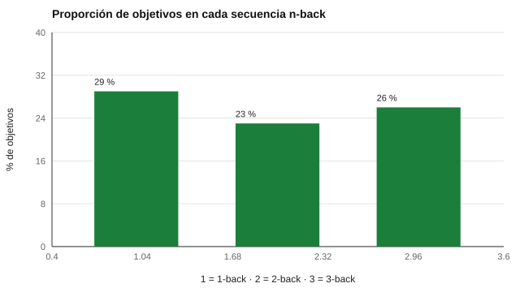

# 099 — Tareas clásicas: Stroop, Go/No-Go, n-back


<!-- NAV -->
[← 098 — Planificación y control ejecutivo](../098-planificacion-y-control-ejecutivo/README.md) · [📚 Parte 09](../README.md) · [🗺️ Índice 001–200](../../../PROGRAMA.md) · [100 — Límites de la evaluación neuropsicológica no… →](../100-limites-de-la-evaluacion-neuropsicologica-no-clinica/README.md)
<!-- /NAV -->

**Parte 09 — Atención, memoria y funciones ejecutivas** · Nivel intermedio · 4 h · Estado `escrita`
**Pensada para:** quien programa o aplica tareas cognitivas clásicas, y quien las realiza.
**Prerrequisitos:** clases 091, 095 y 097.

> Material educativo. Estas tareas son procedimientos, no instrumentos con normas por el solo hecho de existir.

## ¿Para qué te sirve esto?

Stroop, Go/No-Go y n-back son tareas famosas, pero **no son «tests» con ítems fijos**: son **procedimientos**. Su calidad depende de cómo se construye la **secuencia** de estímulos: cuántos objetivos hay, si hay rachas, si se repite un estímulo seguido. Una secuencia mal hecha (puramente aleatoria, sin verificar) puede dar resultados incomparables. Esta clase te enseña a **generar secuencias con restricciones verificables** y a puntuar con d′.

## Al terminar esta clase podrás

- Generar secuencias con restricciones de diseño verificables.
- Puntuar con d′ y errores de comisión.
- Entender por qué el diseño es parte de la medición.
- Reconocer que existir una tarea no equivale a tener baremo.

## La idea en palabras simples

- **Stroop:** nombrar el color de la tinta de una palabra; los ensayos pueden ser **congruentes** (la palabra «ROJO» en rojo) o **incongruentes**.
- **Go/No-Go:** responder a algunos estímulos («Go») y **abstenerse** en otros («No-Go»); mide inhibición.
- **n-back:** indicar si el estímulo actual es igual al de *n* posiciones atrás; carga la memoria de trabajo.

En cada una, las **proporciones** (de objetivos, de No-Go, de congruentes), las **rachas** y las **repeticiones inmediatas** deben controlarse por diseño y **verificarse por código**.

## Cómo funciona, paso a paso

**1. Definir** las restricciones del diseño.

**2. Generar** la secuencia con semilla.

**3. Verificar** que cumple las restricciones.

**Ejemplo resuelto.** Secuencia B C B: en 2-back, el tercer ítem es objetivo (igual al de 2 atrás). La verificación recorre toda la secuencia y comprueba que la etiqueta de objetivo coincide con esa regla.



*Figura 1.* Proporción de objetivos de cada secuencia n-back generada.

## Si construyes el instrumento

- Verifica por código las restricciones (proporciones, rachas, repeticiones).
- No compares puntajes de versiones con proporciones distintas.
- Puntúa con d′ para separar sensibilidad de sesgo (clase 091).
- Considera librerías abiertas (jsPsych, PsychoPy, PEBL) y revisa su licencia (clase 190).

## Si eres evaluado

- Los resultados en estas tareas dependen de cómo se diseñó la secuencia: no son comparables entre versiones distintas.
- Un puntaje de una sola tarea no resume tu «control ejecutivo».
- Pregunta si hay baremo para la versión que realizaste.

## Qué muestra el laboratorio

`lab.py` genera secuencias con semilla fija y verifica sus restricciones.

| Paradigma | Resultado de la verificación |
|---|---|
| 1-back | 35/119 objetivos (29 %); secuencia coherente; d′ simulado 1,99 |
| 2-back | 27/118 (23 %); coherente; d′ 1,82 |
| 3-back | 30/117 (26 %); coherente; d′ 1,49 |
| Go/No-Go | 18/100 No-Go; sin rachas de 4; primeros dos ensayos Go |
| Stroop | 50 % congruentes; 0 repeticiones inmediatas de palabra |

**Análisis.** (1) Las restricciones (proporciones, rachas, repeticiones) forman parte del diseño y deben verificarse por código. (2) El d′ sube la utilidad del n-back frente a «aciertos» porque separa sensibilidad de sesgo (clase 091). (3) El d′ baja con *n* (1,99 → 1,49): más carga de memoria. (4) Los d′ simulados dependen de supuestos; en datos reales se estiman.

## Errores frecuentes

- Usar secuencias aleatorias sin verificar restricciones.
- Comparar puntajes de versiones con proporciones distintas.
- Dar por norma lo que es un procedimiento.
- No usar d′ en n-back.

## Lo mínimo que debes llevarte

1. Stroop, Go/No-Go y n-back son procedimientos.
2. El diseño de la secuencia es parte de la medición.
3. Se verifican las restricciones por código.
4. d′ separa sensibilidad de sesgo.

## Ejercicios

- **Inicial.** ¿Qué es un objetivo accidental en n-back? *Solución: un estímulo que coincide con el de n posiciones atrás pero no estaba planificado como objetivo.*
- **Intermedio.** Si aciertos = 0,85 y falsas alarmas = 0,10, ¿d′? *Solución: ≈ 1,04 + 1,28 = 2,32.*
- **Avanzado.** Añade al generador de Stroop una restricción de no más de 3 congruentes seguidos.
- **Aplicación.** Revisa qué librerías abiertas implementan estos paradigmas y bajo qué licencia (consultar la fuente oficial).

## Glosario

- **Stroop:** tarea de nombrar colores con interferencia de palabras.
- **Go/No-Go:** tarea de responder o inhibir según el estímulo.
- **n-back:** tarea de comparar el estímulo actual con el de n atrás.
- **Ensayo congruente:** ensayo en que los dos aspectos coinciden.

## Laboratorio

```bash
python classes/part-09-atencion-memoria-y-funciones-ejecutivas/099-tareas-clasicas-stroop-go-no-go-n/lab.py
python classes/part-09-atencion-memoria-y-funciones-ejecutivas/figuras.py
```

## Autoevaluación y criterios

1. ¿Por qué evitar repeticiones inmediatas? 2. ¿Qué mide cada tarea y qué no? 3. ¿Qué librerías abiertas (jsPsych, PsychoPy, PEBL) implementan estos paradigmas y bajo qué licencia?
Se logra la clase si puedes generar y verificar secuencias y puntuar con d′.

## Bibliografía

- MacLeod, C. M. (1991). Half a century of research on the Stroop effect: An integrative review. *Psychological Bulletin*, 109(2), 163-203.
- Kane, M. J., Conway, A. R. A., Miura, T. K., & Colflesh, G. J. H. (2007). Working memory, attention control, and the n-back task: A question of construct validity. *Journal of Experimental Psychology: Learning, Memory, and Cognition*, 33(3), 615-622.
- Macmillan, N. A., & Creelman, C. D. (2005). *Detection Theory: A User's Guide* (2.ª ed.). Lawrence Erlbaum.

---

<!-- NAV -->
[← 098 — Planificación y control ejecutivo](../098-planificacion-y-control-ejecutivo/README.md)  
[📚 Parte 09](../README.md) · [🗺️ Índice 001–200](../../../PROGRAMA.md)  
[100 — Límites de la evaluación neuropsicológica no… →](../100-limites-de-la-evaluacion-neuropsicologica-no-clinica/README.md)
<!-- /NAV -->
