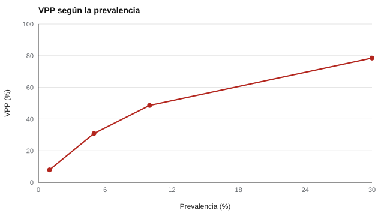

# 100 — Límites de la evaluación neuropsicológica no clínica


<!-- NAV -->
[← 099 — Tareas clásicas: Stroop, Go/No-Go, n-back](../099-tareas-clasicas-stroop-go-no-go-n/README.md) · [📚 Parte 09](../README.md) · [🗺️ Índice 001–200](../../../PROGRAMA.md) · [101 — Modelo de los cinco factores y sus facetas →](../../part-10-personalidad-temperamento-y-conducta/101-modelo-de-los-cinco-factores-y-sus/README.md)
<!-- /NAV -->

**Parte 09 — Atención, memoria y funciones ejecutivas** · Nivel intermedio · 4 h · Estado `escrita`
**Pensada para:** quien aplica cribados en escuelas o programas, quien los interpreta y las familias que reciben resultados.
**Prerrequisitos:** clases 035 y 095.

> Material educativo. El diagnóstico corresponde a profesionales habilitados; ante dudas, deriva.

## ¿Para qué te sirve esto?

Un cribado escolar «marca» a algunos niños como en riesgo. ¿Cuántos de ellos realmente lo están? Sorprendentemente, **depende de qué tan frecuente sea la condición**: si es poco común, **la mayoría de los positivos son falsos positivos**, aunque la prueba sea buena. Además, si aplicas una batería de muchas pruebas, **casi todo el mundo** obtiene algún puntaje «bajo» solo por azar. Esta clase te da dos cálculos simples que evitan interpretaciones alarmistas y errores de uso.

## Al terminar esta clase podrás

- Calcular el valor predictivo de un cribado según la prevalencia.
- Calcular la probabilidad de un hallazgo bajo por azar en una batería.
- Delimitar qué puede y qué no puede hacerse fuera del contexto clínico.
- Comunicar un cribado positivo sin alarmar ni minimizar.

## La idea en palabras simples

Un cribado **no diagnostica**. Con **sensibilidad S** (detecta a los que sí tienen), **especificidad E** (descarta a los que no) y **prevalencia p**, el **valor predictivo positivo** (VPP) es la probabilidad de que un positivo sea real:

```
VPP = S·p / ( S·p + (1 − E)·(1 − p) )
```

Con prevalencias bajas, la mayoría de los positivos son falsos, aunque S y E sean buenas.

Por otra parte, en una batería de varias pruebas, la probabilidad de que **al menos una** resulte «baja» por azar crece rápido: si cada prueba tiene probabilidad *q* de dar un puntaje bajo, con *k* pruebas independientes es 1 − (1 − q)ᵏ (Ingraham & Aiken, 1996).

## Cómo funciona, paso a paso

**1. Fijar** S, E y la prevalencia.

**2. Calcular** el VPP y los falsos positivos por cada 100 positivos.

**3. Calcular** la probabilidad de algún hallazgo bajo por azar en la batería.

**Ejemplo resuelto.** p = 0,05: verdaderos = 0,85 · 0,05 = 0,0425; falsos = 0,10 · 0,95 = 0,095; VPP = 0,0425 / 0,1375 = **0,309**.



*Figura 1.* Con baja prevalencia, la mayoría de los positivos son falsos.

## Si construyes el instrumento

- No informes un puntaje bajo aislado como hallazgo.
- Diseña los cribados masivos con un protocolo de seguimiento y derivación (parte 16).
- Considera la prevalencia al decidir qué hacer con un positivo.
- Fuera del contexto clínico, limita la evaluación a cribado, investigación y apoyo educativo.

## Si eres evaluado

- Un cribado positivo es una señal para mirar con más detalle, no una conclusión.
- Si en una batería sacas algún puntaje bajo, es esperable por azar: se interpreta en conjunto.
- Si un resultado te preocupa, consulta a un profesional habilitado.

## Qué muestra el laboratorio

`lab.py` tiene dos partes.

**Parte 1: VPP de un cribado (S = 0,85; E = 0,90).**

| Prevalencia | VPP | Falsos por cada 100 positivos |
|---:|---:|---:|
| 1 % | 7,9 % | 92 |
| 5 % | 30,9 % | 69 |
| 10 % | 48,6 % | 51 |
| 30 % | 78,5 % | 22 |

**Parte 2:** batería de 10 pruebas independientes con q = P(z < −1,5) = 0,067 por prueba: P(al menos un puntaje bajo) = **0,499** (teórico y simulado).

**Análisis.** (1) Una evaluación neuropsicológica no clínica (cribado, investigación, escuela) no diagnostica. (2) Un puntaje bajo aislado es esperable por azar, y la probabilidad de que un positivo sea real depende de la prevalencia. (3) Con pruebas correlacionadas la cifra baja, pero sigue siendo alta. (4) Los hallazgos se interpretan en conjunto, con historia clínica y derivación a un profesional habilitado.

## Errores frecuentes

- Informar un puntaje bajo aislado como hallazgo.
- Cribados escolares masivos sin protocolo de seguimiento y derivación.
- Ignorar la prevalencia al interpretar un positivo.
- Usar una batería como diagnóstico sin evidencia.

## Lo mínimo que debes llevarte

1. Un cribado no diagnostica.
2. Con baja prevalencia, la mayoría de los positivos son falsos.
3. En una batería, casi todos tienen algún puntaje bajo por azar.
4. Se interpreta en conjunto y se deriva.

## Ejercicios

- **Inicial.** ¿Qué es el valor predictivo positivo? *Solución: la probabilidad de que un positivo sea real.*
- **Intermedio.** Con 6 pruebas y q = 0,067, P(al menos un bajo). *Solución: 1 − 0,933⁶ = 0,34.*
- **Avanzado.** Introduce correlación 0,5 entre pruebas en `lab.py` y estima la nueva probabilidad.
- **Aplicación.** Redacta cómo comunicarías un cribado positivo a una familia.

## Glosario

- **Sensibilidad / especificidad:** capacidad de detectar a quien sí / de descartar a quien no tiene la condición.
- **Prevalencia:** frecuencia de la condición en la población.
- **VPP:** valor predictivo positivo.
- **Falso positivo:** resultado positivo en alguien que no tiene la condición.

## Laboratorio

```bash
python classes/part-09-atencion-memoria-y-funciones-ejecutivas/100-limites-de-la-evaluacion-neuropsicologica-no-clinica/lab.py
python classes/part-09-atencion-memoria-y-funciones-ejecutivas/figuras.py
```

## Autoevaluación y criterios

1. ¿Qué haces ante un cribado positivo? 2. ¿Cómo comunicas un resultado de cribado a una familia? 3. ¿Qué evidencia necesitarías para usar una batería como diagnóstico?
Se logra la clase si puedes aplicar Bayes y rechazar interpretaciones diagnósticas sin respaldo.

## Bibliografía

- Ingraham, L. J., & Aiken, C. B. (1996). An empirical approach to determining criteria for abnormality in test batteries with multiple measures. *Neuropsychology*, 10(1), 120-124. ✅ [DOI](https://doi.org/10.1037/0894-4105.10.1.120)
- Streiner, D. L., & Norman, G. R. (2008). *Health Measurement Scales: A Practical Guide to Their Development and Use* (4.ª ed.). Oxford University Press. 🔎 sin verificar (libro, norma o sitio no hallado en Crossref: comprobar a mano)
- AERA, APA, & NCME (2014). *Standards for Educational and Psychological Testing*. 🔎 sin verificar (libro, norma o sitio no hallado en Crossref: comprobar a mano)

Leyenda: ✅ existe en Crossref con título y año coincidentes (enlace al DOI); ⚠️ hay una obra de título parecido con otro año (no se enlaza: comprobar la edición); 🔎 no verificada automáticamente (libros sin DOI, normas y sitios web). Crossref confirma la existencia de la fuente, no que respalde cada afirmación de la clase. Ver [`docs/VERIFICACION_BIBLIOGRAFIA.md`](../../../docs/VERIFICACION_BIBLIOGRAFIA.md).

---

<!-- NAV -->
[← 099 — Tareas clásicas: Stroop, Go/No-Go, n-back](../099-tareas-clasicas-stroop-go-no-go-n/README.md)  
[📚 Parte 09](../README.md) · [🗺️ Índice 001–200](../../../PROGRAMA.md)  
[101 — Modelo de los cinco factores y sus facetas →](../../part-10-personalidad-temperamento-y-conducta/101-modelo-de-los-cinco-factores-y-sus/README.md)
<!-- /NAV -->
