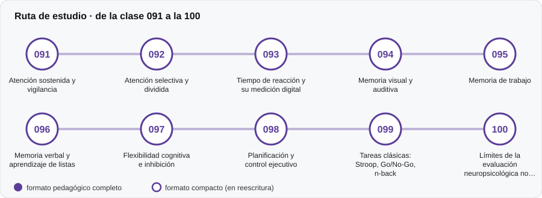

# ⏱️ Parte 09 — Atención, memoria y funciones ejecutivas

**Nivel:** intermedio · **Duración estimada:** 3-4 semanas · **Clases:** 10

## De qué trata

Tareas experimentales de atención, memoria y control ejecutivo y su traducción a pruebas.

## Por qué importa

Muchas decisiones educativas y clínicas se apoyan en estas tareas, con medidas de menor fiabilidad de lo que se cree.

## Según tu papel

- **Si construyes o aplicas instrumentos:** Cómo se miden tiempos de reacción, memoria de trabajo, flexibilidad e inhibición, y cómo se programan estas tareas.
- **Si eres evaluado o recibes resultados:** Entenderás por qué el cansancio, el dispositivo o el ruido afectan estos resultados.

## Al terminar esta parte podrás

- Describir las tareas clásicas (Stroop, Go/No-Go, n-back).
- Interpretar tiempos de respuesta con cautela.

## Cómo estudiarla

Parte de aplicación; los laboratorios simulan tareas, no las reemplazan.

## Ruta de estudio

## Clases en orden de estudio

Las clases están numeradas de forma consecutiva (001 a 200) en el orden de estudio: sigue el número.

| Orden | ID | Clase | Qué aprenderás | Formato | Horas |
|---:|---|---|---|---|---:|
| 1 | 091 | [Atención sostenida y vigilancia](091-atencion-sostenida-y-vigilancia/README.md) | Describir una tarea de desempeño continuo y el decremento de vigilancia. | ✅ pedagógico | 4 |
| 2 | 092 | [Atención selectiva y dividida](092-atencion-selectiva-y-dividida/README.md) | Distinguir búsqueda de rasgo y de conjunción. | ✅ pedagógico | 4 |
| 3 | 093 | [Tiempo de reacción y su medición digital](093-tiempo-de-reaccion-y-su-medicion-digital/README.md) | Describir la distribución ex-Gaussiana de los tiempos de reacción. | ✅ pedagógico | 4 |
| 4 | 094 | [Memoria visual y auditiva](094-memoria-visual-y-auditiva/README.md) | Interpretar la curva de posición serial (primacía y recencia). | ✅ pedagógico | 4 |
| 5 | 095 | [Memoria de trabajo](095-memoria-de-trabajo/README.md) | Describir la memoria de trabajo y las tareas de amplitud. | ✅ pedagógico | 4 |
| 6 | 096 | [Memoria verbal y aprendizaje de listas](096-memoria-verbal-y-aprendizaje-de-listas/README.md) | Calcular los índices de una tarea de aprendizaje de listas. | ✅ pedagógico | 4 |
| 7 | 097 | [Flexibilidad cognitiva e inhibición](097-flexibilidad-cognitiva-e-inhibicion/README.md) | Describir la paradoja de la fiabilidad. | ✅ pedagógico | 4 |
| 8 | 098 | [Planificación y control ejecutivo](098-planificacion-y-control-ejecutivo/README.md) | Calcular la dificultad objetiva de problemas de planificación. | ✅ pedagógico | 4 |
| 9 | 099 | [Tareas clásicas: Stroop, Go/No-Go, n-back](099-tareas-clasicas-stroop-go-no-go-n/README.md) | Generar secuencias con restricciones de diseño verificables. | ✅ pedagógico | 4 |
| 10 | 100 | [Límites de la evaluación neuropsicológica no clínica](100-limites-de-la-evaluacion-neuropsicologica-no-clinica/README.md) | Calcular el valor predictivo de un cribado según la prevalencia. | ✅ pedagógico | 4 |

[← Volver al índice del programa](../../README.md) · [Índice numérico de las 200 clases](../../PROGRAMA.md)
