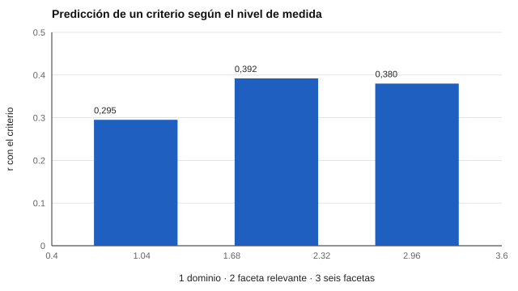

# 101 — Modelo de los cinco factores y sus facetas


<!-- NAV -->
[← 100 — Límites de la evaluación neuropsicológica no…](../../part-09-atencion-memoria-y-funciones-ejecutivas/100-limites-de-la-evaluacion-neuropsicologica-no-clinica/README.md) · [📚 Parte 10](../README.md) · [🗺️ Índice 001–200](../../../PROGRAMA.md) · [102 — Banco IPIP: historia y uso abierto →](../102-banco-ipip-historia-y-uso-abierto/README.md)
<!-- /NAV -->

**Parte 10 — Personalidad, temperamento y conducta** · Nivel intermedio · 4 h · Estado `escrita`
**Pensada para:** quien usa o interpreta inventarios de personalidad, y quien responde uno.
**Prerrequisitos:** clases 042 y 048.

## ¿Para qué te sirve esto?

Casi todos los inventarios de personalidad serios se apoyan en el **modelo de cinco factores** (los «Cinco Grandes»). Saber cómo se organiza te permite leer un informe con criterio: ¿se muestran **dominios amplios** o **facetas** específicas? ¿Para qué pregunta conviene cada nivel? Esta clase te muestra con datos que **más detalle no siempre es mejor** y que el nivel de medida debe coincidir con el de lo que se quiere predecir.

## Al terminar esta clase podrás

- Describir los cinco dominios y sus facetas.
- Plantear el dilema amplitud–fidelidad al predecir un criterio.
- Elegir el nivel de medida que corresponde a la pregunta.
- Evitar reportar perfiles de 30 facetas con muestras pequeñas.

## La idea en palabras simples

El modelo organiza la variación de rasgos en cinco **dominios** amplios: **neuroticismo, extraversión, apertura, amabilidad y responsabilidad** (Costa & McCrae, 1992; John & Srivastava, 1999). Cada dominio tiene **facetas** más específicas (por ejemplo, la responsabilidad incluye orden, sentido del deber, autodisciplina…).

El dilema **amplitud–fidelidad** (Paunonen & Ashton, 2001): los dominios son fiables y sirven para criterios **amplios**; las facetas son más específicas y sirven cuando el criterio es **específico**, pero con pocos ítems cada una es menos fiable.

## Cómo funciona, paso a paso

**1. Definir el criterio** (amplio o específico).

**2. Elegir el nivel** de medida (dominio o faceta).

**3. Validar** en una muestra distinta de aquella en que se estimó el modelo.

**Ejemplo resuelto.** Para predecir «orden en el trabajo» sirve la faceta de orden; para predecir «desempeño global», el dominio completo.



*Figura 1.* Si el criterio depende de una faceta, esa faceta predice más que el dominio.

## Si construyes el instrumento

- Ofrece puntajes de dominio y, cuando haya fiabilidad suficiente, de faceta.
- Evita reportar 30 facetas con muestras pequeñas: sobreajuste y baja fiabilidad por faceta (clase 108).
- No trates las facetas como entidades separadas si están muy correlacionadas.
- Comprueba la invarianza antes de aplicar el modelo en otras culturas (clase 065).

## Si eres evaluado

- Un informe de personalidad describe **tendencias** en un cuestionario, no lo que serás en cada situación.
- Una faceta calculada con 4 ítems tiene bastante error: no la leas como un dato exacto.
- Pregunta para qué se usará el informe y si el nivel de detalle corresponde a ese uso.

## Qué muestra el laboratorio

`lab.py` simula un dominio con 6 facetas y un criterio que depende del dominio y de una faceta (N = 3.000; validación en la segunda mitad; pesos supuestos).

| Predictor | r con el criterio |
|---|---:|
| Puntaje de dominio (promedio de 6 facetas) | 0,295 |
| Faceta 1 sola (la relevante) | 0,392 |
| 6 facetas (regresión múltiple) | 0,380 |

Pesos estimados de las facetas: 0,43; 0,01; 0,01; 0,04; −0,04; −0,06.

**Análisis.** (1) Cuando el criterio depende de una faceta específica, las facetas predicen más que el dominio. (2) Cuando el criterio es amplio, el dominio basta. (3) Más facetas = más parámetros, con riesgo de sobreajuste en muestras pequeñas (la regresión con 6 facetas, 0,380, no supera a la faceta sola). (4) Las ganancias dependen de los pesos supuestos.

## Errores frecuentes

- Reportar 30 facetas con muestras pequeñas.
- Interpretar las facetas como entidades separadas cuando están muy correlacionadas.
- Aplicar el modelo en culturas distintas sin evidencia de invarianza.
- Usar el nivel de medida sin relación con el criterio.

## Lo mínimo que debes llevarte

1. Cinco dominios, cada uno con facetas.
2. Dominios para criterios amplios; facetas para específicos.
3. Más facetas, más riesgo de sobreajuste.
4. El nivel de medida debe coincidir con el del criterio.

## Ejercicios

- **Inicial.** Nombra los cinco dominios. *Solución: neuroticismo, extraversión, apertura, amabilidad, responsabilidad.*
- **Intermedio.** ¿Qué nivel usarías para predecir «ausentismo»? Justifica.
- **Avanzado.** Reduce N a 300 en `lab.py` y compara dominio y facetas.
- **Aplicación.** Revisa un informe de personalidad y decide qué nivel de detalle sería apropiado para el uso previsto.

## Glosario

- **Cinco Grandes:** neuroticismo, extraversión, apertura, amabilidad y responsabilidad.
- **Dominio:** rasgo amplio.
- **Faceta:** componente específico de un dominio.
- **Amplitud–fidelidad:** compromiso entre generalidad y especificidad.

## Laboratorio

```bash
python classes/part-10-personalidad-temperamento-y-conducta/101-modelo-de-los-cinco-factores-y-sus/lab.py
python classes/part-10-personalidad-temperamento-y-conducta/figuras.py
```

## Autoevaluación y criterios

1. ¿Cuándo preferir dominios? 2. ¿Qué riesgo tiene un perfil de 30 facetas? 3. ¿Cómo informas una faceta con 4 ítems?
Se logra la clase si puedes elegir el nivel de medida según el criterio.

## Bibliografía

- Costa, P. T., & McCrae, R. R. (1992). *Professional Manual: Revised NEO Personality Inventory (NEO PI-R)*. Psychological Assessment Resources. ⚠️ hay una obra de título parecido en Crossref con otro año (2008): comprobar la edición a mano
- John, O. P., & Srivastava, S. (1999). The Big Five trait taxonomy: History, measurement, and theoretical perspectives. En L. A. Pervin & O. P. John (Eds.), *Handbook of Personality* (2.ª ed.). Guilford. 🔎 sin verificar (libro, norma o sitio no hallado en Crossref: comprobar a mano)
- Paunonen, S. V., & Ashton, M. C. (2001). Big Five factors and facets and the prediction of behavior. *Journal of Personality and Social Psychology*, 81(3), 524-539. ✅ [DOI](https://doi.org/10.1037/0022-3514.81.3.524)

Leyenda: ✅ existe en Crossref con título y año coincidentes (enlace al DOI); ⚠️ hay una obra de título parecido con otro año (no se enlaza: comprobar la edición); 🔎 no verificada automáticamente (libros sin DOI, normas y sitios web). Crossref confirma la existencia de la fuente, no que respalde cada afirmación de la clase. Ver [`docs/VERIFICACION_BIBLIOGRAFIA.md`](../../../docs/VERIFICACION_BIBLIOGRAFIA.md).

---

<!-- NAV -->
[← 100 — Límites de la evaluación neuropsicológica no…](../../part-09-atencion-memoria-y-funciones-ejecutivas/100-limites-de-la-evaluacion-neuropsicologica-no-clinica/README.md)  
[📚 Parte 10](../README.md) · [🗺️ Índice 001–200](../../../PROGRAMA.md)  
[102 — Banco IPIP: historia y uso abierto →](../102-banco-ipip-historia-y-uso-abierto/README.md)
<!-- /NAV -->
