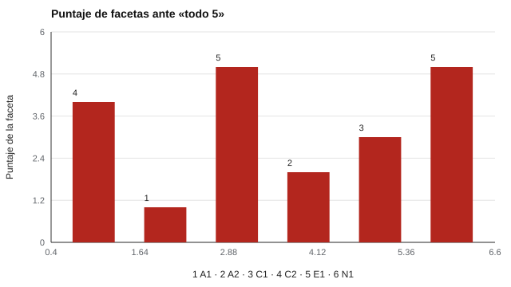

# 102 — Banco IPIP: historia y uso abierto


<!-- NAV -->
[← 101 — Modelo de los cinco factores y sus facetas](../101-modelo-de-los-cinco-factores-y-sus/README.md) · [📚 Parte 10](../README.md) · [🗺️ Índice 001–200](../../../PROGRAMA.md) · [103 — Tipologías frente a rasgos: crítica a MBTI →](../103-tipologias-frente-a-rasgos-critica-a-mbti/README.md)
<!-- /NAV -->

**Parte 10 — Personalidad, temperamento y conducta** · Nivel intermedio · 4 h · Estado `escrita`
**Pensada para:** quien quiere usar un inventario de personalidad abierto, y quien se pregunta qué significa «de dominio público».
**Prerrequisitos:** clases 005 y 101.

## ¿Para qué te sirve esto?

Muchos inventarios de personalidad son comerciales y costosos. El **IPIP** (International Personality Item Pool) es una alternativa abierta: miles de ítems y escalas de **dominio público**, que cualquiera puede usar, traducir y adaptar sin pedir permiso. Dos de los instrumentos ejecutables de este repositorio vienen de ahí. Esta clase te explica qué significa «abierto», te muestra cómo **auditar la clave** de un instrumento real y te advierte contra una confusión frecuente: **abierto no es lo mismo que validado**.

## Al terminar esta clase podrás

- Explicar qué es el IPIP y por qué es de dominio público.
- Auditar la clave de un instrumento real del repositorio.
- Distinguir «usable» de «validado».
- Respetar la procedencia y cita de un banco abierto.

## La idea en palabras simples

El IPIP (Goldberg, 1999; Goldberg et al., 2006) es una colección de ítems y escalas de personalidad de **dominio público**: se pueden usar, traducir y adaptar **sin permiso ni pago**; la fuente primaria es ipip.ori.org. El **IPIP-NEO-120** (Johnson, 2014) es una forma de 120 ítems que mide 30 facetas y 5 dominios.

«Dominio público» dice **quién puede usar** los ítems; no dice que el instrumento tenga **normas** ni que esté **validado** para tus decisiones. Y todo banco tiene su propia clave (qué ítems son directos o invertidos). Auditarla permite ver qué pasaría ante una respuesta sin sentido.

## Cómo funciona, paso a paso

**1. Cargar** el instrumento real del repositorio (`ipip-neo-120`: 120 ítems y 35 escalas).

**2. Simular** una persona que responde siempre 5, siempre 3 y siempre 1, con reflejo de ítems invertidos.

**3. Observar** el puntaje por faceta.

**Ejemplo resuelto.** Persona que marca 5 en todo: N1 (todo directo) → 5,0; A2 (todo invertido) → 1,0. Un perfil así parece «muy neurótica y muy poco amable» solo por estilo de respuesta.



*Figura 1.* Ante aquiescencia pura, las facetas se desvían en sentidos opuestos.

## Si construyes el instrumento

- Respeta siempre la procedencia y la cita del banco (`procedencia` en el YAML).
- Audita la clave de cualquier instrumento antes de usarlo.
- Reporta puntajes de faceta con cautela: 4 ítems por faceta dan poca precisión.
- Las versiones traducidas necesitan su propia evidencia (clase 065).

## Si eres evaluado

- Que un cuestionario sea abierto y gratuito no significa que sirva para decidir sobre ti.
- Un perfil muy extremo en ciertas facetas puede deberse a cómo se redactaron los ítems y a tu estilo de respuesta.
- Pregunta qué evidencia local respalda el uso que se hará del resultado.

## Qué muestra el laboratorio

`lab.py` carga `ipip-neo-120` (120 ítems; 35 escalas; licencia declarada: dominio público) y puntúa respuestas constantes.

| Faceta | Ítems | Invertidos | Todo 5 | Todo 3 | Todo 1 |
|---|---:|---:|---:|---:|---:|
| A1 | 4 | 1 | 4,00 | 3,00 | 2,00 |
| A2 | 4 | 4 | 1,00 | 3,00 | 5,00 |
| C1 | 4 | 0 | 5,00 | 3,00 | 1,00 |
| C2 | 4 | 3 | 2,00 | 3,00 | 4,00 |
| E1 | 4 | 2 | 3,00 | 3,00 | 3,00 |
| N1 | 4 | 0 | 5,00 | 3,00 | 1,00 |

Desvío medio de las facetas respecto del punto medio ante «todo 5»: **0,97** (0 = clave perfectamente equilibrada).

**Análisis.** (1) El IPIP-NEO-120 **no** tiene clave equilibrada dentro de cada faceta (por ejemplo, N1 todo directo y A2 todo invertido). (2) Ante aquiescencia pura, las facetas se desvían de 3 en sentidos opuestos. (3) El equilibrio solo se logra, si acaso, a nivel de dominio. (4) El banco es de dominio público; eso no lo valida ni le da normas.

## Errores frecuentes

- Creer que «dominio público» significa «validado» o «con normas».
- Reportar puntajes de faceta con 4 ítems como si fueran precisos.
- Ignorar que las versiones traducidas necesitan evidencia propia.
- Omitir la procedencia y cita del banco.

## Lo mínimo que debes llevarte

1. El IPIP es abierto: se puede usar sin permiso.
2. Abierto no es validado.
3. La clave del IPIP-NEO-120 no es equilibrada por faceta.
4. Se respeta la procedencia y cita.

## Ejercicios

- **Inicial.** ¿Qué licencia tiene el IPIP? *Solución: dominio público.*
- **Intermedio.** ¿Qué puntaje da «todo 5» en una faceta con 2 directos y 2 invertidos? *Solución: 3,0.*
- **Avanzado.** Calcula el desvío medio por dominio (no por faceta) y compara con el de facetas.
- **Aplicación.** Escribe la ficha de procedencia de un banco abierto que quieras usar.

## Glosario

- **IPIP:** International Personality Item Pool.
- **Dominio público:** sin derechos reservados; uso libre.
- **Clave:** indicación de qué ítems son directos o invertidos.
- **Procedencia:** origen y condiciones de uso de un instrumento.

## Laboratorio

```bash
python classes/part-10-personalidad-temperamento-y-conducta/102-banco-ipip-historia-y-uso-abierto/lab.py
python classes/part-10-personalidad-temperamento-y-conducta/figuras.py
```

## Autoevaluación y criterios

1. ¿Qué significa «uso abierto»? 2. ¿Qué evidencia local reunirías antes de usarlo en un proceso con consecuencias? 3. ¿Cómo mitigarías la aquiescencia?
Se logra la clase si puedes auditar la clave y distinguir lo abierto de lo validado.

## Bibliografía

- Goldberg, L. R. (1999). A broad-bandwidth, public domain, personality inventory measuring the lower-level facets of several five-factor models. En I. Mervielde et al. (Eds.), *Personality Psychology in Europe* (Vol. 7). Tilburg University Press. 🔎 sin verificar (libro, norma o sitio no hallado en Crossref: comprobar a mano)
- Goldberg, L. R., et al. (2006). The International Personality Item Pool and the future of public-domain personality measures. *Journal of Research in Personality*, 40(1), 84-96. ✅ [DOI](https://doi.org/10.1016/j.jrp.2005.08.007)
- Johnson, J. A. (2014). Measuring thirty facets of the Five Factor Model with a 120-item public domain inventory: Development of the IPIP-NEO-120. *Journal of Research in Personality*, 51, 78-89. ✅ [DOI](https://doi.org/10.1016/j.jrp.2014.05.003)

Leyenda: ✅ existe en Crossref con título y año coincidentes (enlace al DOI); ⚠️ hay una obra de título parecido con otro año (no se enlaza: comprobar la edición); 🔎 no verificada automáticamente (libros sin DOI, normas y sitios web). Crossref confirma la existencia de la fuente, no que respalde cada afirmación de la clase. Ver [`docs/VERIFICACION_BIBLIOGRAFIA.md`](../../../docs/VERIFICACION_BIBLIOGRAFIA.md).

---

<!-- NAV -->
[← 101 — Modelo de los cinco factores y sus facetas](../101-modelo-de-los-cinco-factores-y-sus/README.md)  
[📚 Parte 10](../README.md) · [🗺️ Índice 001–200](../../../PROGRAMA.md)  
[103 — Tipologías frente a rasgos: crítica a MBTI →](../103-tipologias-frente-a-rasgos-critica-a-mbti/README.md)
<!-- /NAV -->
