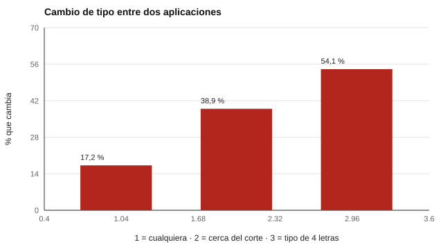

# 103 — Tipologías frente a rasgos: crítica a MBTI


<!-- NAV -->
[← 102 — Banco IPIP: historia y uso abierto](../102-banco-ipip-historia-y-uso-abierto/README.md) · [📚 Parte 10](../README.md) · [🗺️ Índice 001–200](../../../PROGRAMA.md) · [104 — Modelos de estilos conductuales: DISC y sus l… →](../104-modelos-de-estilos-conductuales-disc-y-sus/README.md)
<!-- /NAV -->

**Parte 10 — Personalidad, temperamento y conducta** · Nivel intermedio · 4 h · Estado `escrita`
**Pensada para:** quien usa o se encuentra con tests «de tipos» (como el MBTI), y quien quiere entender qué dice la evidencia.
**Prerrequisitos:** clases 024 y 101.

> El MBTI es un instrumento propietario que aquí solo se analiza conceptualmente; no se reproducen sus ítems.

## ¿Para qué te sirve esto?

«Soy un INTJ.» Los tests de tipos son muy populares en equipos y en redes sociales. Prometen ubicar a cada persona en una de unas pocas categorías. Esta clase te da un criterio psicométrico para evaluar esa promesa: si la personalidad es un **continuo** y se corta en un punto para formar categorías, **¿qué pasa con quienes están cerca del corte?** Con números simples verás por qué el «tipo» puede cambiar de una aplicación a otra, y por qué conviene usarlo como lenguaje de conversación y no como evidencia.

## Al terminar esta clase podrás

- Distinguir tipos (categorías) de rasgos (dimensiones).
- Cuantificar la inestabilidad de dicotomizar un continuo.
- Evaluar con criterios psicométricos un modelo de tipos.
- Comunicar un resultado de tipo con cautela.

## La idea en palabras simples

Un modelo de **tipos** clasifica personas en categorías a partir de puntos de corte sobre dimensiones que, empíricamente, se distribuyen como **continuos** (campana, un solo pico): la mayoría está cerca del medio y pocas en los extremos (McCrae & Costa, 1989). **Dicotomizar** un continuo pierde información y genera inestabilidad (MacCallum et al., 2002): dos personas casi iguales quedan en categorías distintas, y una misma persona puede cambiar de categoría entre dos aplicaciones, aunque el puntaje continuo sea estable.

## Cómo funciona, paso a paso

**1. Simular** un rasgo continuo medido dos veces (fiabilidad test-retest 0,85; N = 20.000).

**2. Dicotomizar** en el punto medio.

**3. Medir** cuántas personas cambian de categoría y cuántas conservan las cuatro.

**Ejemplo resuelto.** Con 4 dimensiones independientes y 83 % de consistencia en cada una, la probabilidad de conservar el tipo completo es 0,83⁴ ≈ 0,47: menos de la mitad.



*Figura 1.* Aun con fiabilidad alta, el tipo cambia con frecuencia.

## Si construyes el instrumento

- Prefiere puntajes continuos por dimensión y comunica los intervalos.
- Si usas categorías, hazlo con una zona de «cercanía al corte» y avisa que el tipo puede cambiar.
- No uses tipos para seleccionar, ubicar o excluir personas.
- No trates un modelo propietario como evidencia por ser popular.

## Si eres evaluado

- Un «tipo» no es un destino ni explica por sí solo cómo actuarás.
- Si estás cerca del corte en una dimensión, es normal que otra aplicación te dé una letra distinta.
- Úsalo como lenguaje para conversar, no como definición de lo que eres.

## Qué muestra el laboratorio

`lab.py` simula N = 20.000 con fiabilidad test-retest del continuo de 0,85.

| Medida | Valor |
|---|---:|
| Test-retest del puntaje continuo | 0,850 |
| Cambian de tipo entre dos aplicaciones | 17,2 % |
| …entre quienes están cerca del corte (±0,3 DE; 23 % de la muestra) | 38,9 % |
| Conservan los 4 rasgos dicotomizados | 45,9 % |

La distribución del puntaje es unimodal (campana), no bimodal.

**Análisis.** (1) Con una fiabilidad alta (0,85) igual cambia de tipo cerca del 17 %, y alrededor del corte casi 4 de cada 10. (2) Con cuatro dimensiones, menos de la mitad conserva su «tipo». (3) La distribución es unimodal: no hay dos tipos separados, hay un continuo. (4) Las tipologías pueden servir como lenguaje común, no como evidencia de categorías naturales.

## Errores frecuentes

- Usar tipos para seleccionar, ubicar o excluir personas.
- Considerar que «tipo» explica conducta específica.
- Tratar un modelo propietario como evidencia por ser popular.
- Ignorar la inestabilidad cerca del corte.

## Lo mínimo que debes llevarte

1. La personalidad se distribuye como un continuo.
2. Dicotomizar pierde información y crea inestabilidad.
3. Con varias dimensiones, pocos conservan su tipo.
4. Los tipos sirven como lenguaje, no como evidencia.

## Ejercicios

- **Inicial.** ¿Qué pierde la dicotomización? *Solución: información sobre cuán lejos del corte está cada persona.*
- **Intermedio.** ¿Qué esperas si la fiabilidad baja a 0,70? *Solución: más cambios de tipo.*
- **Avanzado.** Cambia RHO a 0,95 en `lab.py` y reporta el cambio de tipo.
- **Aplicación.** Escribe una frase para comunicar un resultado de tipo con cautela.

## Glosario

- **Tipología:** modelo que clasifica personas en categorías.
- **Rasgo:** dimensión continua de diferencias individuales.
- **Dicotomización:** convertir un continuo en dos categorías.
- **Taxometría:** análisis para decidir si una variable es categórica o continua.

## Laboratorio

```bash
python classes/part-10-personalidad-temperamento-y-conducta/103-tipologias-frente-a-rasgos-critica-a-mbti/lab.py
python classes/part-10-personalidad-temperamento-y-conducta/figuras.py
```

## Autoevaluación y criterios

1. ¿Qué evidencia respaldaría una tipología real? (bimodalidad, taxometría) 2. ¿Qué alternativa propones? 3. ¿Cómo comunicarías un resultado de tipo con cautela?
Se logra la clase si puedes evaluar un modelo de tipos con evidencia.

## Bibliografía

- McCrae, R. R., & Costa, P. T. (1989). Reinterpreting the Myers-Briggs Type Indicator from the perspective of the five-factor model of personality. *Journal of Personality*, 57(1), 17-40.
- MacCallum, R. C., Zhang, S., Preacher, K. J., & Rucker, D. D. (2002). On the practice of dichotomization of quantitative variables. *Psychological Methods*, 7(1), 19-40.
- Pittenger, D. J. (1993). Measuring the MBTI... and coming up short. *Journal of Career Planning and Employment*, 54(1), 48-52.
- Gardner, W. L., & Martinko, M. J. (1996). Using the Myers-Briggs Type Indicator to study managers. *Journal of Management*, 22(1), 45-83.

---

<!-- NAV -->
[← 102 — Banco IPIP: historia y uso abierto](../102-banco-ipip-historia-y-uso-abierto/README.md)  
[📚 Parte 10](../README.md) · [🗺️ Índice 001–200](../../../PROGRAMA.md)  
[104 — Modelos de estilos conductuales: DISC y sus l… →](../104-modelos-de-estilos-conductuales-disc-y-sus/README.md)
<!-- /NAV -->
