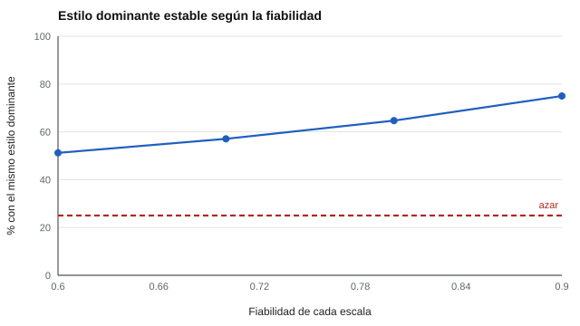

# 104 — Modelos de estilos conductuales: DISC y sus límites


<!-- NAV -->
[← 103 — Tipologías frente a rasgos: crítica a MBTI](../103-tipologias-frente-a-rasgos-critica-a-mbti/README.md) · [📚 Parte 10](../README.md) · [🗺️ Índice 001–200](../../../PROGRAMA.md) · [105 — Temperamento y desarrollo →](../105-temperamento-y-desarrollo/README.md)
<!-- /NAV -->

**Parte 10 — Personalidad, temperamento y conducta** · Nivel intermedio · 4 h · Estado `escrita`
**Pensada para:** quien usa «perfiles DISC» en equipos, y quien recibe un perfil de este tipo.
**Prerrequisitos:** clases 013 y 103.

> El DISC abierto del repositorio es de autoría propia, **sin estudio de validación**: no debe usarse para decidir sobre personas. No se reproducen productos comerciales.

## ¿Para qué te sirve esto?

Los perfiles DISC (cuatro estilos: Dominancia, Influencia, Estabilidad y Cumplimiento) son muy usados en talleres de equipos. Detrás hay una teoría antigua y muchos productos comerciales con el mismo nombre pero ítems y puntuaciones distintos. Esta clase te enseña una pregunta práctica: **si respondes dos veces, ¿te sale el mismo «estilo dominante»?** Verás con números que incluso con buenas escalas la coincidencia es limitada, y por qué rotular a alguien con un único estilo sobreafirma.

## Al terminar esta clase podrás

- Describir el modelo de cuatro estilos y su origen.
- Cuantificar la estabilidad del «estilo dominante».
- Diferenciar el DISC abierto del repositorio de los productos comerciales.
- Limitar las conclusiones de un perfil.

## La idea en palabras simples

El modelo DISC deriva de la teoría de Marston (1928): **dominancia, influencia, estabilidad y cumplimiento**. Existen muchos productos comerciales con ese nombre que difieren en ítems, formato y puntuación; su evidencia psicométrica es limitada. En este repositorio el `disc-abierto` es un instrumento **propio y sin validar**, solo para enseñar.

Si cada escala tiene error, el «estilo dominante» (el más alto de los cuatro) **cambia entre aplicaciones**, sobre todo cuando los puntajes están parecidos. Además, los formatos de elección forzada (ipsativos, clase 013) distorsionan las comparaciones entre personas (Hicks, 1970).

## Cómo funciona, paso a paso

**1. Simular** 4 escalas independientes con distinta fiabilidad (N = 20.000).

**2. Medir** la probabilidad de que el estilo dominante coincida entre dos aplicaciones (el azar es 25 %).

**3. Medir** cuántas personas tienen el primer y segundo estilo «no distinguibles» (diferencia menor que el error).

**Ejemplo resuelto.** Con fiabilidad 0,8, dos de cada tres coinciden; para tres de cada cuatro, la diferencia entre el primer y el segundo estilo es menor que el error.



*Figura 1.* Aun con fiabilidad 0,9, un cuarto de las personas cambia de estilo dominante.

## Si construyes el instrumento

- Entrega el perfil completo, no un único «tipo».
- Informa la estabilidad esperada del estilo dominante.
- No uses el estilo para decisiones de contratación o ubicación.
- No confundas un instrumento propio sin validar con un test comercial.

## Si eres evaluado

- Un perfil DISC refleja cómo respondiste en un momento; si lo repites, lo más probable es que cambie algún aspecto.
- La diferencia entre tu primer y segundo estilo suele ser menor que el error: no te encasilles.
- Si te piden usarlo para decidir sobre ti, pregunta con qué evidencia.

## Qué muestra el laboratorio

`lab.py` simula 4 escalas independientes (N = 20.000).

| Fiabilidad de cada escala | Mismo estilo dominante | 1.º y 2.º estilo no distinguibles |
|---:|---:|---:|
| 0,6 | 51,2 % | 85,0 % |
| 0,7 | 57,1 % | 82,4 % |
| 0,8 | 64,7 % | 77,0 % |
| 0,9 | 75,0 % | 64,5 % |

**Análisis.** (1) Aun con escalas de fiabilidad 0,8, el estilo dominante coincide en apenas dos de cada tres aplicaciones. (2) Para muchas personas, la diferencia entre el primer y el segundo estilo es menor que el error. (3) Rotular a alguien con UN estilo sobreafirma. (4) El umbral de «no distinguibles» es una aproximación; además, el formato ipsativo distorsiona las comparaciones entre personas.

## Errores frecuentes

- Rotular a una persona con un único estilo.
- Usar el estilo para decisiones de contratación o ubicación.
- Confundir un instrumento propio sin validar con un test comercial.
- Ignorar que el formato ipsativo distorsiona comparaciones.

## Lo mínimo que debes llevarte

1. DISC deriva de Marston (1928) y tiene muchas versiones comerciales.
2. El estilo dominante es poco estable.
3. Un perfil completo informa más que un tipo.
4. El DISC abierto del repositorio no está validado.

## Ejercicios

- **Inicial.** ¿Qué probabilidad da el azar? *Solución: 25 %.*
- **Intermedio.** ¿Qué pasaría con 6 estilos? *Solución: menos coincidencia por azar (1/6) y más ruido.*
- **Avanzado.** Compara con puntajes ipsativos en `lab.py`.
- **Aplicación.** Escribe una advertencia de uso para un taller con perfiles DISC.

## Glosario

- **DISC:** modelo de cuatro estilos: dominancia, influencia, estabilidad, cumplimiento.
- **Estilo dominante:** escala más alta del perfil.
- **Ipsativo:** formato en que las escalas suman una constante (clase 013).
- **Instrumento propio sin validar:** instrumento sin estudio de validación.

## Laboratorio

```bash
python classes/part-10-personalidad-temperamento-y-conducta/104-modelos-de-estilos-conductuales-disc-y-sus/lab.py
python classes/part-10-personalidad-temperamento-y-conducta/figuras.py
```

## Autoevaluación y criterios

1. ¿Por qué un perfil completo informa más que un tipo? 2. ¿Cómo usarías el DISC abierto para enseñar? 3. ¿Qué evidencia necesitarías para usarlo con consecuencias?
Se logra la clase si puedes cuantificar la estabilidad y limitar las conclusiones.

## Bibliografía

- Marston, W. M. (1928). *Emotions of Normal People*. Kegan Paul, Trench, Trubner. ✅ [DOI](https://doi.org/10.1037/13390-000)
- Hicks, L. E. (1970). Some properties of ipsative, normative, and forced-choice normative measures. *Psychological Bulletin*, 74(3), 167-184. ✅ [DOI](https://doi.org/10.1037/h0029780)
- AERA, APA, & NCME (2014). *Standards for Educational and Psychological Testing*. 🔎 sin verificar (libro, norma o sitio no hallado en Crossref: comprobar a mano)

Leyenda: ✅ existe en Crossref con título y año coincidentes (enlace al DOI); ⚠️ hay una obra de título parecido con otro año (no se enlaza: comprobar la edición); 🔎 no verificada automáticamente (libros sin DOI, normas y sitios web). Crossref confirma la existencia de la fuente, no que respalde cada afirmación de la clase. Ver [`docs/VERIFICACION_BIBLIOGRAFIA.md`](../../../docs/VERIFICACION_BIBLIOGRAFIA.md).

---

<!-- NAV -->
[← 103 — Tipologías frente a rasgos: crítica a MBTI](../103-tipologias-frente-a-rasgos-critica-a-mbti/README.md)  
[📚 Parte 10](../README.md) · [🗺️ Índice 001–200](../../../PROGRAMA.md)  
[105 — Temperamento y desarrollo →](../105-temperamento-y-desarrollo/README.md)
<!-- /NAV -->
