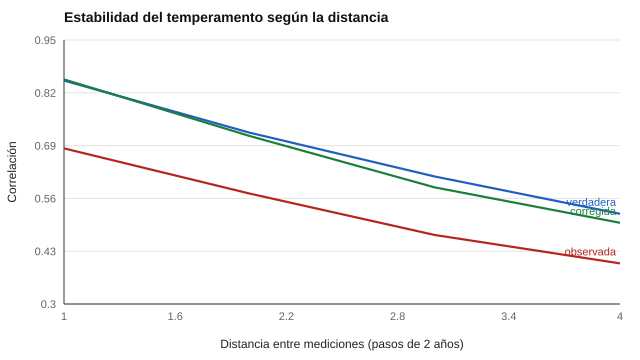

# 105 — Temperamento y desarrollo


<!-- NAV -->
[← 104 — Modelos de estilos conductuales: DISC y sus l…](../104-modelos-de-estilos-conductuales-disc-y-sus/README.md) · [📚 Parte 10](../README.md) · [🗺️ Índice 001–200](../../../PROGRAMA.md) · [106 — Autorregulación e impulsividad →](../106-autorregulacion-e-impulsividad/README.md)
<!-- /NAV -->

**Parte 10 — Personalidad, temperamento y conducta** · Nivel intermedio · 4 h · Estado `escrita`
**Pensada para:** quien evalúa niños en el tiempo, y las familias que reciben resultados sobre temperamento.
**Prerrequisitos:** clases 024 y 039.

> Material educativo. Los puntajes de temperamento no predicen por sí solos el desarrollo de un niño ni justifican etiquetas.

## ¿Para qué te sirve esto?

«Es un niño muy inquieto: siempre lo será.» ¿Qué tan estable es el temperamento? Los estudios muestran una estabilidad **moderada que decae con el tiempo**. Pero hay un detalle crucial: parte de lo que parece «cambio» es **error de medida**, sobre todo en niños pequeños, donde los puntajes son menos fiables. Esta clase te enseña a interpretar la estabilidad **corrigiendo por error** y a no hacer predicciones tempranas con una confianza que los datos no dan.

## Al terminar esta clase podrás

- Distinguir estabilidad de rango y estabilidad absoluta.
- Interpretar un patrón simplex.
- Corregir por atenuación el efecto del error de medida.
- Comunicar a una familia la estabilidad del temperamento.

## La idea en palabras simples

El **temperamento** son diferencias tempranas de reactividad y autorregulación (Thomas & Chess, 1977; Rothbart & Bates, 2006). Muestra **estabilidad moderada que decae con el intervalo**: la correlación entre dos mediciones es menor cuanto más separadas están. Ese patrón se llama **simplex**.

- **Estabilidad de rango:** si el niño conserva su posición relativa respecto de los demás.
- **Estabilidad absoluta:** si conserva su nivel (aunque todos cambien).

El error de medida **disminuye** las correlaciones observadas; se puede corregir dividiendo por la fiabilidad (clase 039). Así se ve cuánto de la «inestabilidad» es ruido.

## Cómo funciona, paso a paso

**1. Simular** un rasgo autorregresivo (paso 0,85 por intervalo de 2 años; fiabilidad 0,80; N = 5.000).

**2. Calcular** la correlación observada entre ocasiones.

**3. Corregir** por atenuación y comparar con la verdadera.

**Ejemplo resuelto.** Con r observada = 0,57 y fiabilidad 0,80: corregida = 0,57 / 0,80 = 0,71, cercana a la verdadera 0,72.



*Figura 1.* La correlación cae con la distancia; la corrección por atenuación recupera la verdadera.

## Si construyes el instrumento

- Informa la fiabilidad por edad: en niños pequeños suele ser menor.
- Usa informantes múltiples y declara sus sesgos (padres, docentes).
- No uses la misma escala en edades distintas sin evidencia de equivalencia (clase 070).
- No etiquetes tempranamente a un niño por un puntaje de temperamento.

## Si eres evaluado (o eres familia)

- Una puntuación de temperamento de un niño pequeño es una foto con margen de error.
- Que la estabilidad sea moderada significa que los niños **cambian**: el entorno y el apoyo importan.
- Un puntaje alto en «reactividad» no es una sentencia.

## Qué muestra el laboratorio

`lab.py` simula 5 ocasiones (un paso = 2 años).

| Distancia (pasos) | r observada | r verdadera | Corregida (obs/fiab.) |
|---:|---:|---:|---:|
| 1 | 0,683 | 0,850 | 0,853 |
| 2 | 0,572 | 0,722 | 0,714 |
| 3 | 0,470 | 0,614 | 0,587 |
| 4 | 0,400 | 0,522 | 0,500 |

**Análisis.** (1) La estabilidad cae con el intervalo aunque el rasgo sea «estable»: estable no es inmutable. (2) Parte de la inestabilidad aparente es error de medida: la corrección recupera el valor verdadero (0,853 frente a 0,850). (3) Los puntajes de niños pequeños suelen ser menos fiables, lo que hace que la estabilidad parezca menor de lo que es. (4) Las cifras son del modelo, no estimaciones del temperamento real.

## Errores frecuentes

- Interpretar baja estabilidad observada como «el niño cambió» sin descontar el error.
- Etiquetar tempranamente a un niño por un puntaje de temperamento.
- Usar la misma escala en edades distintas sin evidencia de equivalencia.
- Ignorar los sesgos de los informantes.

## Lo mínimo que debes llevarte

1. La estabilidad del temperamento es moderada y decae con el tiempo (simplex).
2. El error de medida disminuye las correlaciones observadas.
3. La corrección por atenuación estima la estabilidad verdadera.
4. No se etiqueta a un niño por un puntaje.

## Ejercicios

- **Inicial.** ¿Qué es un patrón simplex? *Solución: correlaciones que decaen a medida que aumenta el intervalo entre mediciones.*
- **Intermedio.** Si el paso es 0,9, ¿cuál es la estabilidad verdadera a 3 pasos? *Solución: 0,9³ = 0,729.*
- **Avanzado.** Baja la fiabilidad a 0,6 en `lab.py` y observa las correlaciones observadas.
- **Aplicación.** Redacta una explicación para una familia sobre qué significa la «estabilidad moderada» del temperamento.

## Glosario

- **Temperamento:** diferencias tempranas de reactividad y autorregulación.
- **Patrón simplex:** correlaciones que decaen con la distancia temporal.
- **Estabilidad de rango:** conservación de la posición relativa.
- **Atenuación:** reducción de una correlación por el error de medida.

## Laboratorio

```bash
python classes/part-10-personalidad-temperamento-y-conducta/105-temperamento-y-desarrollo/lab.py
python classes/part-10-personalidad-temperamento-y-conducta/figuras.py
```

## Autoevaluación y criterios

1. ¿Qué implica la estabilidad moderada para el uso de predicciones tempranas? 2. ¿Cómo comunicarías esto a una familia? 3. ¿Qué diseño separa error de cambio?
Se logra la clase si puedes interpretar la estabilidad corrigiendo por error de medida.

## Bibliografía

- Thomas, A., & Chess, S. (1977). *Temperament and Development*. Brunner/Mazel.
- Rothbart, M. K., & Bates, J. E. (2006). Temperament. En N. Eisenberg (Ed.), *Handbook of Child Psychology* (6.ª ed., Vol. 3). Wiley.
- Roberts, B. W., & DelVecchio, W. F. (2000). The rank-order consistency of personality traits from childhood to old age. *Psychological Bulletin*, 126(1), 3-25.

---

<!-- NAV -->
[← 104 — Modelos de estilos conductuales: DISC y sus l…](../104-modelos-de-estilos-conductuales-disc-y-sus/README.md)  
[📚 Parte 10](../README.md) · [🗺️ Índice 001–200](../../../PROGRAMA.md)  
[106 — Autorregulación e impulsividad →](../106-autorregulacion-e-impulsividad/README.md)
<!-- /NAV -->
