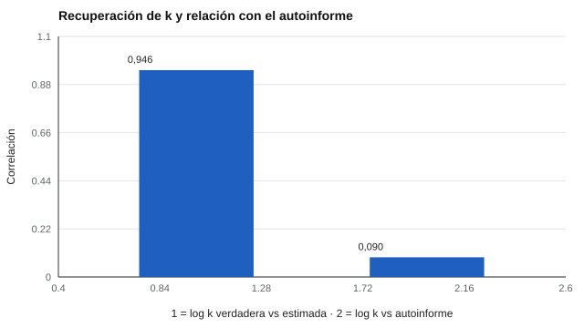

# 106 — Autorregulación e impulsividad


<!-- NAV -->
[← 105 — Temperamento y desarrollo](../105-temperamento-y-desarrollo/README.md) · [📚 Parte 10](../README.md) · [🗺️ Índice 001–200](../../../PROGRAMA.md) · [107 — Motivación, valores y preferencias →](../107-motivacion-valores-y-preferencias/README.md)
<!-- /NAV -->

**Parte 10 — Personalidad, temperamento y conducta** · Nivel intermedio · 4 h · Estado `escrita`
**Pensada para:** quien evalúa impulsividad o autorregulación, y quien recibe un puntaje de este tipo.
**Prerrequisitos:** clases 099 y 100.

> Material educativo. No es evaluación clínica; una escala de impulsividad no diagnostica.

## ¿Para qué te sirve esto?

«Impulsividad» suena a un solo rasgo, pero es un **conjunto de constructos distintos**: preferir recompensas inmediatas, dificultad para frenar una respuesta, búsqueda de sensaciones. Se miden con **cuestionarios** (como la BIS-11) y con **tareas de conducta** (como elegir entre dinero ahora o más después). Y lo sorprendente es que **casi no se relacionan entre sí**. Esta clase te muestra cómo estimar un parámetro conductual (el descuento temporal) y por qué no se debe etiquetar a alguien como «impulsivo» por una sola escala.

## Al terminar esta clase podrás

- Estimar un parámetro conductual (descuento temporal).
- Contrastar tarea conductual y autoinforme.
- Reconocer que «impulsividad» es un conjunto de constructos.
- Evitar etiquetas basadas en una escala.

## La idea en palabras simples

El **descuento temporal hiperbólico** (Mazur, 1987) describe cuánto pierde valor una recompensa con la demora:

```
V = R / (1 + k·D)
```

donde R es la recompensa, D la demora y **k** el parámetro de la persona: una *k* mayor indica preferencia por lo inmediato. Se estima a partir de elecciones («¿$30 hoy o $100 en 90 días?»).

La **BIS-11** (Patton et al., 1995) es un autoinforme de impulsividad. Pero tarea y autoinforme suelen correlacionar poco, porque miden cosas distintas (Sharma et al., 2014).

## Cómo funciona, paso a paso

**1. Presentar** 28 elecciones entre una recompensa pequeña inmediata y una mayor demorada.

**2. Estimar** *k* con un modelo de elección.

**3. Comparar** con un autoinforme.

**Ejemplo resuelto.** k = 0,03; D = 90 días: V = 100 / (1 + 2,7) = 27. Una persona prefiere $30 ahora a $100 en 90 días.



*Figura 1.* La tarea recupera bien k, pero casi no se relaciona con el autoinforme.

## Si construyes el instrumento

- Usa suficientes elecciones por persona (28 en el laboratorio) y modela el ruido de elección.
- No uses la BIS-11 como diagnóstico: es una escala de investigación.
- No asumas que la tarea y el autoinforme miden lo mismo.
- Considera el control inhibitorio y la búsqueda de sensaciones como constructos aparte.

## Si eres evaluado

- Un puntaje de impulsividad describe una tendencia en un instrumento, no cómo eres en toda situación.
- Que una tarea y un cuestionario den resultados distintos es normal.
- Si te preocupa tu control de impulsos, consulta a un profesional.

## Qué muestra el laboratorio

`lab.py` simula 300 personas con 28 elecciones cada una (*k* verdadera mediana 0,030).

| Medida | Valor |
|---|---:|
| k estimada, mediana | 0,030 |
| r (log k verdadera, log k estimada) | 0,946 |
| r (log k estimada, autoinforme simulado débilmente ligado) | 0,090 |

**Análisis.** (1) Con 28 elecciones el parámetro k se recupera bien (r = 0,946). (2) Pero la tarea y el autoinforme casi no se relacionan (0,090): «impulsividad» agrupa constructos distintos (preferencia temporal, control inhibitorio, búsqueda de sensaciones). (3) Una escala como la BIS-11 describe el autoinforme, no sustituye una tarea conductual ni un diagnóstico. (4) El modelo logístico de elección es una simplificación.

## Errores frecuentes

- Etiquetar a una persona como «impulsiva» por una escala.
- Usar la BIS-11 como diagnóstico.
- Asumir que la tarea y el autoinforme miden lo mismo.
- Tratar «impulsividad» como un único constructo.

## Lo mínimo que debes llevarte

1. Impulsividad es un conjunto de constructos.
2. *k* mide la preferencia por lo inmediato.
3. Tarea y autoinforme casi no se relacionan.
4. No se etiqueta con una escala.

## Ejercicios

- **Inicial.** ¿Qué indica una k alta? *Solución: preferencia por la recompensa inmediata.*
- **Intermedio.** Calcula V con k = 0,05, D = 30, R = 100. *Solución: 100 / 2,5 = 40.*
- **Avanzado.** Reduce las elecciones a 8 en `lab.py` y observa la recuperación de k.
- **Aplicación.** Explica a un adolescente, sin etiquetar, qué mide una tarea de descuento temporal.

## Glosario

- **Descuento temporal:** pérdida de valor de una recompensa por la demora.
- **k:** parámetro de descuento.
- **BIS-11:** escala de impulsividad de Barratt, versión 11.
- **Control inhibitorio:** capacidad de frenar una respuesta.

## Laboratorio

```bash
python classes/part-10-personalidad-temperamento-y-conducta/106-autorregulacion-e-impulsividad/lab.py
python classes/part-10-personalidad-temperamento-y-conducta/figuras.py
```

## Autoevaluación y criterios

1. ¿Qué otras tareas medirían control inhibitorio? 2. ¿Qué implica una correlación baja entre tarea y escala? 3. ¿Cuándo derivarías?
Se logra la clase si puedes estimar k y discutir la multidimensionalidad de la impulsividad.

## Bibliografía

- Mazur, J. E. (1987). An adjusting procedure for studying delayed reinforcement. En M. L. Commons et al. (Eds.), *Quantitative Analyses of Behavior* (Vol. 5). Lawrence Erlbaum. 🔎 sin verificar (libro, norma o sitio no hallado en Crossref: comprobar a mano)
- Patton, J. H., Stanford, M. S., & Barratt, E. S. (1995). Factor structure of the Barratt Impulsiveness Scale. *Journal of Clinical Psychology*, 51(6), 768-774. ✅ [DOI](https://doi.org/10.1002/1097-4679(199511)51:6<768::aid-jclp2270510607>3.0.co;2-1)
- Sharma, L., Markon, K. E., & Clark, L. A. (2014). Toward a theory of distinct types of «impulsive» behaviors: A meta-analysis of self-report and behavioral measures. *Psychological Bulletin*, 140(2), 374-408. ✅ [DOI](https://doi.org/10.1037/a0034418)

Leyenda: ✅ existe en Crossref con título y año coincidentes (enlace al DOI); ⚠️ hay una obra de título parecido con otro año (no se enlaza: comprobar la edición); 🔎 no verificada automáticamente (libros sin DOI, normas y sitios web). Crossref confirma la existencia de la fuente, no que respalde cada afirmación de la clase. Ver [`docs/VERIFICACION_BIBLIOGRAFIA.md`](../../../docs/VERIFICACION_BIBLIOGRAFIA.md).

---

<!-- NAV -->
[← 105 — Temperamento y desarrollo](../105-temperamento-y-desarrollo/README.md)  
[📚 Parte 10](../README.md) · [🗺️ Índice 001–200](../../../PROGRAMA.md)  
[107 — Motivación, valores y preferencias →](../107-motivacion-valores-y-preferencias/README.md)
<!-- /NAV -->
