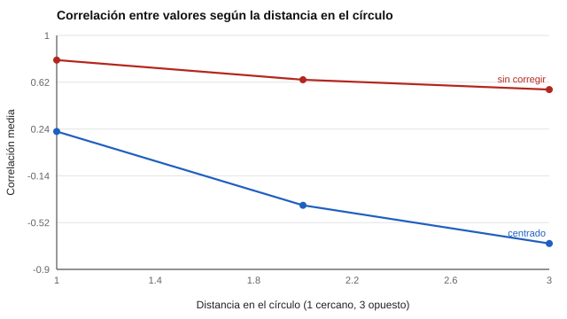

# 107 — Motivación, valores y preferencias


<!-- NAV -->
[← 106 — Autorregulación e impulsividad](../106-autorregulacion-e-impulsividad/README.md) · [📚 Parte 10](../README.md) · [🗺️ Índice 001–200](../../../PROGRAMA.md) · [108 — Fortalezas personales y carácter →](../108-fortalezas-personales-y-caracter/README.md)
<!-- /NAV -->

**Parte 10 — Personalidad, temperamento y conducta** · Nivel intermedio · 4 h · Estado `escrita`
**Pensada para:** quien evalúa valores o motivaciones (orientación, equipos), y quien responde un inventario de valores.
**Prerrequisitos:** clases 005, 013 y 044.

> El instrumento `valores-spranger` del repositorio es de autoría propia y **sin validar**: sirve para enseñar, no para decidir sobre personas.

## ¿Para qué te sirve esto?

«¿Qué valoras más: la seguridad, la libertad, el logro, la tradición?» Los inventarios de valores se usan en orientación y en equipos de trabajo. Pero tienen una trampa conocida: **quien tiende a decir «muy importante» a todo** hace que todos los valores correlacionen positivamente, y la estructura real (donde algunos valores se oponen) **desaparece**. Esta clase te enseña cómo se ve ese efecto y cómo corregirlo (centrar las respuestas), con su costo.

## Al terminar esta clase podrás

- Describir modelos de valores (Spranger, Schwartz).
- Reconocer el efecto del estilo de respuesta en la estructura de valores.
- Decidir entre puntaje bruto y centrado.
- Interpretar un puntaje centrado como relativo.

## La idea en palabras simples

Spranger (1928) describió seis tipos de valor; Allport, Vernon y Lindzey (1960) los operacionalizaron; Schwartz (1992) propuso una **estructura circular de valores universales**: valores compatibles quedan cerca en el círculo y los opuestos, lejos. Predicción: la correlación debería **bajar con la distancia** y ser **negativa entre opuestos**.

Pero el **estilo de respuesta** (decir «muy importante» a todo) suma un componente común: todos los valores correlacionan positivo. **Centrar** por persona (restar su propio promedio) lo elimina, a un costo: los puntajes pasan a ser **relativos a la persona**.

## Cómo funciona, paso a paso

**1. Simular** valores con estructura circular y estilo de respuesta (6 valores; 4.000 personas).

**2. Calcular** las correlaciones medias por distancia, sin corregir y con centrado.

**Ejemplo resuelto.** Persona con respuestas 5, 5, 4, 3, 3, 4: media 4; centradas 1, 1, 0, −1, −1, 0. Tras centrar, solo informa qué valora *más* que su propio promedio.



*Figura 1.* El centrado recupera la estructura circular.

## Si construyes el instrumento

- Decide entre puntaje bruto y centrado según la pregunta (nivel absoluto frente a prioridades).
- Declara el costo del centrado: no permite comparar el nivel absoluto entre personas.
- No reduzcas las motivaciones laborales a valores sin considerar el contexto.
- Recuerda que el instrumento propio del repositorio no está validado.

## Si eres evaluado

- Un perfil de valores dice qué priorizas **dentro** de tu propia escala de respuestas.
- Si respondiste «muy importante» a casi todo, tu perfil bruto será poco informativo.
- Los valores no definen lo que serás en un cargo.

## Qué muestra el laboratorio

`lab.py` calcula la correlación media por distancia en el círculo (6 valores; 4.000 personas).

| | Distancia 1 | Distancia 2 | Distancia 3 (opuestos) |
|---|---:|---:|---:|
| Sin corregir | 0,80 | 0,64 | 0,56 |
| Centrado por persona | 0,22 | −0,38 | −0,69 |

**Análisis.** (1) Sin corregir, el estilo de respuesta hace que todos los valores correlacionen positivo y la estructura (opuestos negativos) desaparece. (2) El centrado la recupera. (3) El costo es que los puntajes pasan a ser relativos a la propia persona: dicen que valora **más**, no **cuánto** valora. (4) Elegir entre bruto y centrado depende de la pregunta; los resultados son de simulación.

## Errores frecuentes

- Comparar el nivel absoluto de valores entre personas tras centrar.
- Interpretar «sin corregir» como estructura real.
- Reducir las motivaciones laborales a valores.
- Usar un inventario sin validar para decidir.

## Lo mínimo que debes llevarte

1. Los valores tienen una estructura circular.
2. El estilo de respuesta la oculta.
3. Centrar la recupera, pero vuelve los puntajes relativos.
4. La elección depende de la pregunta.

## Ejercicios

- **Inicial.** ¿Qué corrige el centrado? *Solución: el estilo de respuesta general (tendencia a puntuar alto o bajo en todo).*
- **Intermedio.** Centra las respuestas 2, 3, 4, 5. *Solución: −1,5; −0,5; 0,5; 1,5.*
- **Avanzado.** Incorpora un segundo estilo (extremismo) en `lab.py` y propón una corrección.
- **Aplicación.** Aplica el inventario `valores-spranger` a ti mismo y compara el perfil bruto y el centrado.

## Glosario

- **Valores:** metas de vida que guían las preferencias.
- **Estructura circular:** organización de valores donde los cercanos son compatibles y los lejanos opuestos.
- **Estilo de respuesta:** tendencia a responder de cierta forma con independencia del contenido.
- **Centrado:** restar a cada puntaje el promedio de la persona.

## Laboratorio

```bash
python classes/part-10-personalidad-temperamento-y-conducta/107-motivacion-valores-y-preferencias/lab.py
python classes/part-10-personalidad-temperamento-y-conducta/figuras.py
```

## Autoevaluación y criterios

1. ¿Cuándo prefieres puntajes brutos? 2. ¿Cómo enseñarías la estructura circular? 3. ¿Qué limita su uso en selección?
Se logra la clase si puedes corregir por estilo y explicar el costo.

## Bibliografía

- Schwartz, S. H. (1992). Universals in the content and structure of values: Theoretical advances and empirical tests in 20 countries. *Advances in Experimental Social Psychology*, 25, 1-65. ✅ [DOI](https://doi.org/10.1016/s0065-2601(08)60281-6)
- Allport, G. W., Vernon, P. E., & Lindzey, G. (1960). *Study of Values* (3.ª ed.). Houghton Mifflin. 🔎 sin verificar (libro, norma o sitio no hallado en Crossref: comprobar a mano)
- Spranger, E. (1928). *Types of Men*. Niemeyer. 🔎 sin verificar (libro, norma o sitio no hallado en Crossref: comprobar a mano)

Leyenda: ✅ existe en Crossref con título y año coincidentes (enlace al DOI); ⚠️ hay una obra de título parecido con otro año (no se enlaza: comprobar la edición); 🔎 no verificada automáticamente (libros sin DOI, normas y sitios web). Crossref confirma la existencia de la fuente, no que respalde cada afirmación de la clase. Ver [`docs/VERIFICACION_BIBLIOGRAFIA.md`](../../../docs/VERIFICACION_BIBLIOGRAFIA.md).

---

<!-- NAV -->
[← 106 — Autorregulación e impulsividad](../106-autorregulacion-e-impulsividad/README.md)  
[📚 Parte 10](../README.md) · [🗺️ Índice 001–200](../../../PROGRAMA.md)  
[108 — Fortalezas personales y carácter →](../108-fortalezas-personales-y-caracter/README.md)
<!-- /NAV -->
