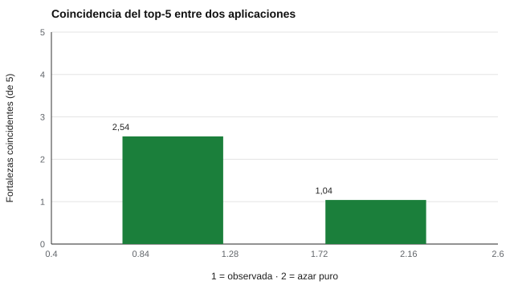

# 108 — Fortalezas personales y carácter


<!-- NAV -->
[← 107 — Motivación, valores y preferencias](../107-motivacion-valores-y-preferencias/README.md) · [📚 Parte 10](../README.md) · [🗺️ Índice 001–200](../../../PROGRAMA.md) · [109 — Estados frente a rasgos de personalidad →](../109-estados-frente-a-rasgos-de-personalidad/README.md)
<!-- /NAV -->

**Parte 10 — Personalidad, temperamento y conducta** · Nivel intermedio · 4 h · Estado `escrita`
**Pensada para:** quien usa «perfiles de fortalezas» en educación o desarrollo, y quien recibe uno.
**Prerrequisitos:** clases 014 y 102.

> El instrumento comercial asociado al modelo es propietario; aquí se usa el **IPIP-VIA-R**, de dominio público, solo para aprender y explorar.

## ¿Para qué te sirve esto?

Los perfiles de «fortalezas de carácter» (creatividad, curiosidad, gratitud, perseverancia…) son populares en educación y desarrollo personal. Suelen entregar un **top-5** de fortalezas «distintivas». ¿Es estable ese top-5? Si respondes dos veces, ¿te salen las mismas cinco? Esta clase te muestra con números que **cambia bastante** y por qué conviene presentarlo como una conversación y no como un perfil estable.

## Al terminar esta clase podrás

- Describir la clasificación de virtudes y fortalezas del carácter.
- Estimar la estabilidad del «top-5» de fortalezas.
- Usar un instrumento abierto sin sobreafirmar.
- Plantear las cautelas éticas de dar un perfil a un adolescente.

## La idea en palabras simples

Peterson y Seligman (2004) propusieron **6 virtudes** y **24 fortalezas del carácter**. En este repositorio se usa el **IPIP-VIA-R** (`instruments/ipip-via-r.yaml`: 96 ítems; 24 escalas de 4 ítems), que mide esas fortalezas con ítems de dominio público (Goldberg et al., 2006).

Cada escala de 4 ítems tiene poca fiabilidad (con r₁ = 0,3 por ítem, ≈ 0,63). Y las 24 fortalezas se parecen entre sí. Resultado: las fortalezas «más altas» de una persona **cambian mucho entre aplicaciones**.

## Cómo funciona, paso a paso

**1. Simular** dos aplicaciones paralelas de 24 escalas (N = 3.000; fiabilidad supuesta 0,63).

**2. Calcular** el top-5 de cada aplicación.

**3. Medir** cuántas fortalezas coinciden y compararlo con el azar.

**Ejemplo resuelto.** Dos aplicaciones dan top-5 {A, B, C, D, E} y {A, B, F, G, H}: coinciden 2 de 5. Es lo que cabe esperar con esta fiabilidad.



*Figura 1.* La coincidencia es mayor que el azar, pero lejos de ser completa.

## Si construyes el instrumento

- Informa el top-5 como una lectura conversacional, no como un perfil estable.
- Aumenta los ítems por escala si quieres mejorar la fiabilidad.
- No interpretes fortalezas como virtudes morales de la persona.
- No prometas mejoras por intervenciones basadas en fortalezas sin respaldo: la evidencia es mixta.

## Si eres evaluado

- Tu «top-5» probablemente cambiaría si repites la prueba: úsalo como punto de partida para reflexionar.
- Una fortaleza que no aparece en el top-5 no es una debilidad.
- Con adolescentes, evita presentar el perfil como una definición.

## Qué muestra el laboratorio

`lab.py` simula 3.000 personas con dos aplicaciones paralelas.

| Medida | Valor |
|---|---:|
| Fiabilidad supuesta por escala | 0,63 |
| Coincidencia media del top-5 entre aplicaciones | 2,54 de 5 |
| Coincidencia por azar puro (5 de 24) | 1,04 |
| Personas con ≥ 4 de 5 coincidentes | 13,6 % |

**Análisis.** (1) Las fortalezas «distintivas» de una persona cambian mucho entre aplicaciones porque las escalas tienen pocos ítems y las fortalezas se parecen entre sí. (2) El top-5 es una lectura conversacional, no un perfil estable. (3) Los instrumentos abiertos como IPIP-VIA-R sirven para aprender y explorar, no para clasificar personas. (4) La fiabilidad es supuesta; en datos reales se estima.

## Errores frecuentes

- Comunicar el top-5 como «tus fortalezas» sin matizar.
- Interpretar fortalezas como virtudes morales de la persona.
- Prometer mejoras sin respaldo.
- Usar el perfil para clasificar o seleccionar.

## Lo mínimo que debes llevarte

1. Hay 6 virtudes y 24 fortalezas.
2. Las escalas de 4 ítems son poco fiables.
3. El top-5 coincide ~2,5 de 5 entre aplicaciones.
4. Es una conversación, no un perfil estable.

## Ejercicios

- **Inicial.** ¿Cuántas fortalezas hay en el modelo? *Solución: 24.*
- **Intermedio.** Calcula la fiabilidad con r₁ = 0,3 y 6 ítems. *Solución: 1,8 / 2,5 = 0,72.*
- **Avanzado.** Estima la coincidencia del top-5 con 8 ítems por escala.
- **Aplicación.** Diseña una actividad escolar con el perfil de fortalezas que no etiquete al estudiante.

## Glosario

- **Fortaleza de carácter:** rasgo positivo moral (por ejemplo, curiosidad, gratitud).
- **Virtud:** categoría amplia que agrupa fortalezas.
- **IPIP-VIA-R:** instrumento abierto de fortalezas del repositorio.
- **Top-5:** las cinco fortalezas con mayor puntaje.

## Laboratorio

```bash
python classes/part-10-personalidad-temperamento-y-conducta/108-fortalezas-personales-y-caracter/lab.py
python classes/part-10-personalidad-temperamento-y-conducta/figuras.py
```

## Autoevaluación y criterios

1. ¿Qué lectura útil queda del top-5? 2. ¿Cómo mejorarías la fiabilidad? 3. ¿Qué cautelas éticas tiene darle a un adolescente un «perfil de fortalezas»?
Se logra la clase si puedes cuantificar la inestabilidad y matizar la interpretación.

## Bibliografía

- Peterson, C., & Seligman, M. E. P. (2004). *Character Strengths and Virtues: A Handbook and Classification*. Oxford University Press/APA.
- Goldberg, L. R., et al. (2006). The International Personality Item Pool and the future of public-domain personality measures. *Journal of Research in Personality*, 40(1), 84-96.

---

<!-- NAV -->
[← 107 — Motivación, valores y preferencias](../107-motivacion-valores-y-preferencias/README.md)  
[📚 Parte 10](../README.md) · [🗺️ Índice 001–200](../../../PROGRAMA.md)  
[109 — Estados frente a rasgos de personalidad →](../109-estados-frente-a-rasgos-de-personalidad/README.md)
<!-- /NAV -->
