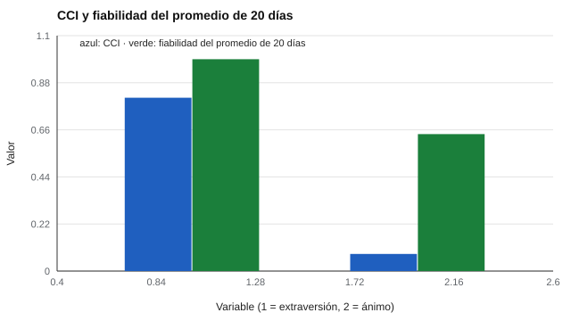

# 109 — Estados frente a rasgos de personalidad


<!-- NAV -->
[← 108 — Fortalezas personales y carácter](../108-fortalezas-personales-y-caracter/README.md) · [📚 Parte 10](../README.md) · [🗺️ Índice 001–200](../../../PROGRAMA.md) · [110 — Falseamiento, deseabilidad social y escalas d… →](../110-falseamiento-deseabilidad-social-y-escalas-de-validez/README.md)
<!-- /NAV -->

**Parte 10 — Personalidad, temperamento y conducta** · Nivel intermedio · 4 h · Estado `escrita`
**Pensada para:** quien diseña medidas repetidas (diarios, muestreo de experiencias), y quien las responde.
**Prerrequisitos:** clases 029 y 024.

## ¿Para qué te sirve esto?

Nadie se siente igual todos los días. La pregunta «¿cómo eres?» y la pregunta «¿cómo te sientes hoy?» son **mediciones distintas**: la primera apunta a un **rasgo** (lo habitual) y la segunda a un **estado** (lo pasajero). Si no se distinguen, se interpreta mal un puntaje. Esta clase te enseña a medir **cuánto de una variable es de la persona y cuánto fluctúa día a día** con el coeficiente de correlación intraclase (CCI), y a decidir cuántas mediciones hacen falta.

## Al terminar esta clase podrás

- Distinguir estados de rasgos con datos de mediciones repetidas.
- Calcular el coeficiente de correlación intraclase CCI(1).
- Elegir el marco temporal de los enunciados.
- Decidir cuántas mediciones necesitas.

## La idea en palabras simples

La personalidad puede verse como una **distribución de estados** cuyo promedio es el rasgo (Fleeson, 2001). Con mediciones repetidas (**muestreo de experiencias**) se descompone la variación en:

- **Entre personas:** diferencias estables.
- **Dentro de cada persona:** fluctuación día a día.

El **CCI(1)** es la proporción de variación que es **entre personas**. Un CCI alto = variable tipo **rasgo**; bajo = tipo **estado**. La fiabilidad del **promedio de k días** crece según Spearman-Brown: k·CCI / (1 + (k − 1)·CCI).

## Cómo funciona, paso a paso

**1. Medir** a cada persona varios días.

**2. Calcular** la varianza entre y dentro de personas, y el CCI(1).

**3. Estimar** la fiabilidad de un solo día y del promedio de k días.

**Ejemplo resuelto.** CCI = 0,08 y 20 días: fiabilidad del promedio = 20 · 0,08 / (1 + 19 · 0,08) = 1,6 / 2,52 = 0,63.



*Figura 1.* Una variable de estado necesita muchos días para estimar el nivel habitual.

## Si construyes el instrumento

- Redacta ítems con el marco temporal adecuado: «hoy» para estados, «usualmente» para rasgos.
- Calcula el CCI antes de decidir cuántas mediciones pedir.
- Considera la carga de responder repetidamente y la privacidad de los datos longitudinales (parte 07).
- No confundas «estado» con «patológico».

## Si eres evaluado

- Un solo día de una variable de estado no dice cómo eres habitualmente.
- Un ánimo bajo un día es normal.
- Pregunta qué datos de tu rutina se guardan y por cuánto tiempo.

## Qué muestra el laboratorio

`lab.py` simula 300 personas × 20 días.

| Variable | Var. entre | Var. dentro | CCI(1) | Fiabilidad de 1 día | Fiabilidad del promedio de 20 días |
|---|---:|---:|---:|---:|---:|
| Extraversión (rasgo) | 1,02 | 0,24 | 0,81 | 0,81 | 0,99 |
| Ánimo (estado) | 0,09 | 1,03 | 0,08 | 0,08 | 0,64 |

**Análisis.** (1) En la variable tipo rasgo, el 80 % de la varianza es entre personas y un solo día ya informa. (2) En la tipo estado, solo ~8 % es de la persona, y recién el promedio de muchos días estima el nivel habitual. (3) Preguntar «cómo se siente HOY» y «cómo es USUALMENTE» son mediciones distintas: se elige el marco temporal del enunciado según lo que se quiere inferir. (4) Los datos son simulados.

## Errores frecuentes

- Usar el puntaje de un solo día como «cómo es» una persona cuando el CCI es bajo.
- Confundir «estado» con «patológico».
- Instrucciones temporales ambiguas («en general» frente a «hoy»).
- Pedir mediciones repetidas sin considerar su carga y su privacidad.

## Lo mínimo que debes llevarte

1. Rasgo: estable entre personas; estado: fluctúa dentro de cada persona.
2. El CCI mide la parte entre personas.
3. El promedio de varios días es más fiable.
4. El marco temporal del enunciado importa.

## Ejercicios

- **Inicial.** ¿Qué es un CCI de 0,10? *Solución: solo el 10 % de la variación es entre personas; la variable es sobre todo estado.*
- **Intermedio.** Calcula la fiabilidad del promedio de 10 días con CCI 0,3. *Solución: 3 / (1 + 2,7) = 0,81.*
- **Avanzado.** Añade en `lab.py` una variable con tendencia semanal y comenta el efecto en el CCI.
- **Aplicación.** Redacta un ítem de estado y uno de rasgo sobre estrés.

## Glosario

- **Rasgo / estado:** característica estable / pasajera.
- **CCI(1):** proporción de varianza entre personas.
- **Muestreo de experiencias:** mediciones repetidas en la vida diaria.
- **Marco temporal:** período al que se refiere un enunciado.

## Laboratorio

```bash
python classes/part-10-personalidad-temperamento-y-conducta/109-estados-frente-a-rasgos-de-personalidad/lab.py
python classes/part-10-personalidad-temperamento-y-conducta/figuras.py
```

## Autoevaluación y criterios

1. ¿Cómo redactarías un ítem de estado y uno de rasgo? 2. ¿Cuántas mediciones necesitas? 3. ¿Qué datos de contexto recogerías?
Se logra la clase si puedes calcular el CCI y decidir el marco temporal.

## Bibliografía

- Fleeson, W. (2001). Toward a structure- and process-integrated view of personality: Traitlike density distributions of states. *Journal of Personality and Social Psychology*, 80(6), 1011-1027. ✅ [DOI](https://doi.org/10.1037/0022-3514.80.6.1011)
- Shrout, P. E., & Fleiss, J. L. (1979). Intraclass correlations: Uses in assessing rater reliability. *Psychological Bulletin*, 86(2), 420-428. ✅ [DOI](https://doi.org/10.1037/0033-2909.86.2.420)
- Bolger, N., & Laurenceau, J.-P. (2013). *Intensive Longitudinal Methods*. Guilford. 🔎 sin verificar (libro, norma o sitio no hallado en Crossref: comprobar a mano)

Leyenda: ✅ existe en Crossref con título y año coincidentes (enlace al DOI); ⚠️ hay una obra de título parecido con otro año (no se enlaza: comprobar la edición); 🔎 no verificada automáticamente (libros sin DOI, normas y sitios web). Crossref confirma la existencia de la fuente, no que respalde cada afirmación de la clase. Ver [`docs/VERIFICACION_BIBLIOGRAFIA.md`](../../../docs/VERIFICACION_BIBLIOGRAFIA.md).

---

<!-- NAV -->
[← 108 — Fortalezas personales y carácter](../108-fortalezas-personales-y-caracter/README.md)  
[📚 Parte 10](../README.md) · [🗺️ Índice 001–200](../../../PROGRAMA.md)  
[110 — Falseamiento, deseabilidad social y escalas d… →](../110-falseamiento-deseabilidad-social-y-escalas-de-validez/README.md)
<!-- /NAV -->
