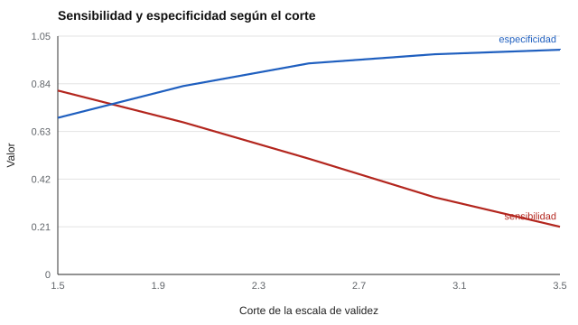

# 110 — Falseamiento, deseabilidad social y escalas de validez


<!-- NAV -->
[← 109 — Estados frente a rasgos de personalidad](../109-estados-frente-a-rasgos-de-personalidad/README.md) · [📚 Parte 10](../README.md) · [🗺️ Índice 001–200](../../../PROGRAMA.md) · [111 — Análisis de puestos y modelos de competencias →](../../part-11-psicometria-laboral-y-empleabilidad/111-analisis-de-puestos-y-modelos-de-competencias/README.md)
<!-- /NAV -->

**Parte 10 — Personalidad, temperamento y conducta** · Nivel intermedio · 4 h · Estado `escrita`
**Pensada para:** quien usa escalas de validez en procesos con consecuencias, y quien es evaluado con ellas.
**Prerrequisitos:** clases 040 y 100.

## ¿Para qué te sirve esto?

Para detectar respuestas distorsionadas, muchos inventarios incluyen **escalas de validez** (infrecuencia, «virtudes improbables», deseabilidad social). La tentación: descartar a quien «marque» en ellas. Esta clase te muestra, con la misma lógica de la clase 100, por qué eso es peligroso: **ningún corte detecta bien y a la vez evita falsos positivos**, y entre los «marcados» hay muchos **honestos**, sobre todo personas genuinamente responsables. Aprenderás a usar estas escalas como **alerta** y no como sentencia.

## Al terminar esta clase podrás

- Evaluar una escala de validez con sensibilidad, especificidad, VPP y AUC.
- Reconocer los falsos positivos y a quiénes afectan.
- Definir un uso responsable de estas escalas.
- Explicar por qué no se corrige un puntaje restando deseabilidad sin evidencia.

## La idea en palabras simples

Las escalas de validez buscan detectar protocolos distorsionados. Pero parte de la «deseabilidad social» es **rasgo sustantivo**, no sesgo (Ones et al., 1996): una persona realmente responsable puede puntuar alto en «virtudes improbables». Se evalúan como cualquier prueba de cribado:

- **Sensibilidad:** de los falseadores, cuántos marca.
- **Especificidad:** de los honestos, cuántos deja pasar.
- **VPP:** de los marcados, cuántos son realmente falseadores (depende de la prevalencia).
- **AUC:** capacidad global de discriminar.

## Cómo funciona, paso a paso

**1. Simular** una escala de 5 ítems (honestos 1,0 ± 1,0; falseadores 2,5 ± 1,2; prevalencia 20 %).

**2. Variar** el corte y calcular sensibilidad, especificidad y VPP.

**3. Contar** cuántos honestos de alta responsabilidad quedan marcados.

**Ejemplo resuelto.** Corte 2,5 con prevalencia 20 %: marcados verdaderos = 0,51 · 0,20 = 0,102; falsos = 0,07 · 0,80 = 0,056; VPP = 0,102 / 0,158 = 0,65 (≈ 0,63 en la simulación).



*Figura 1.* Subir el corte gana especificidad y pierde sensibilidad.

## Si construyes el instrumento

- Usa las escalas de validez como alerta para **examinar el protocolo**, no para descartar personas.
- Combina contramedidas (clase 040) y no confíes en una sola.
- No corrijas puntajes restando deseabilidad sin evidencia de que mejore la predicción.
- Declara los costos de error de cada corte.

## Si eres evaluado

- Si una escala «marca» tu protocolo, no significa que mientas: pueden marcarse personas honestas.
- Tienes derecho a que una decisión no se base en una escala de validez aislada.
- Responder con sinceridad sigue siendo lo mejor.

## Qué muestra el laboratorio

`lab.py` calcula las métricas según el corte (prevalencia 20 %).

| Corte (≥) | Sensibilidad | Especificidad | VPP | Honestos de alta responsabilidad marcados |
|---:|---:|---:|---:|---:|
| 1,5 | 0,81 | 0,69 | 0,39 | 0,49 |
| 2,0 | 0,67 | 0,83 | 0,50 | 0,29 |
| 2,5 | 0,51 | 0,93 | 0,63 | 0,15 |
| 3,0 | 0,34 | 0,97 | 0,75 | 0,07 |
| 3,5 | 0,21 | 0,99 | 0,85 | 0,02 |

AUC aproximado = 0,83.

**Análisis.** (1) Ningún corte detecta bien y a la vez evita falsos positivos. (2) Con prevalencia de 20 %, muchos «marcados» son honestos, entre ellos personas de alta responsabilidad (hasta 0,49 con el corte más bajo). (3) Una escala de validez es una **alerta** para examinar el protocolo, no una sentencia: por sí sola no se descarta ni se juzga a una persona. (4) Los parámetros son supuestos.

## Errores frecuentes

- Excluir a personas por una escala de validez.
- Corregir puntajes restando deseabilidad sin evidencia.
- Confiar en una sola contramedida.
- Ignorar que la deseabilidad también puede ser rasgo.

## Lo mínimo que debes llevarte

1. Las escalas de validez tienen falsos positivos y negativos.
2. Ningún corte es perfecto.
3. La deseabilidad puede ser rasgo sustantivo.
4. Son una alerta, no una sentencia.

## Ejercicios

- **Inicial.** ¿Qué es el VPP? *Solución: la proporción de marcados que realmente son falseadores.*
- **Intermedio.** Con sensibilidad 0,34, especificidad 0,97 y prevalencia 20 %, calcula el VPP. *Solución: 0,068 / (0,068 + 0,024) = 0,74.*
- **Avanzado.** Cambia la prevalencia a 5 % y reporta el VPP.
- **Aplicación.** Redacta un procedimiento para actuar cuando una escala de validez marca un protocolo.

## Glosario

- **Escala de validez:** conjunto de ítems que busca detectar respuestas distorsionadas.
- **Deseabilidad social:** tendencia a presentarse de forma favorable.
- **AUC:** área bajo la curva ROC.
- **Falso positivo:** persona honesta marcada como falseadora.

## Laboratorio

```bash
python classes/part-10-personalidad-temperamento-y-conducta/110-falseamiento-deseabilidad-social-y-escalas-de-validez/lab.py
python classes/part-10-personalidad-temperamento-y-conducta/figuras.py
```

## Autoevaluación y criterios

1. ¿Cómo usar una escala de validez de forma responsable? 2. ¿Qué otras estrategias reducen el falseamiento? 3. ¿Qué evidencia necesitas para corregir por deseabilidad?
Se logra la clase si puedes evaluar una escala de validez con sus costos de error.

## Bibliografía

- Ones, D. S., Viswesvaran, C., & Reiss, A. D. (1996). Role of social desirability in personality testing for personnel selection: The red herring. *Journal of Applied Psychology*, 81(6), 660-679.
- Paulhus, D. L. (1991). Measurement and control of response bias. En J. P. Robinson et al. (Eds.), *Measures of Personality and Social Psychological Attitudes*. Academic Press.
- Ziegler, M., MacCann, C., & Roberts, R. D. (Eds.) (2012). *New Perspectives on Faking in Personality Assessment*. Oxford University Press.

---

<!-- NAV -->
[← 109 — Estados frente a rasgos de personalidad](../109-estados-frente-a-rasgos-de-personalidad/README.md)  
[📚 Parte 10](../README.md) · [🗺️ Índice 001–200](../../../PROGRAMA.md)  
[111 — Análisis de puestos y modelos de competencias →](../../part-11-psicometria-laboral-y-empleabilidad/111-analisis-de-puestos-y-modelos-de-competencias/README.md)
<!-- /NAV -->
