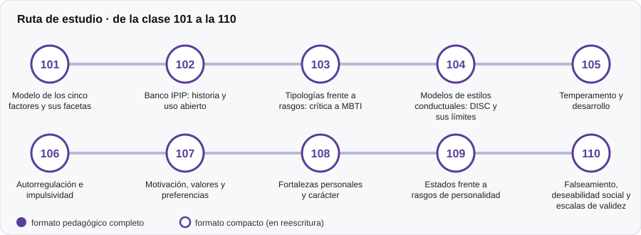

# 🙂 Parte 10 — Personalidad, temperamento y conducta

**Nivel:** intermedio · **Duración estimada:** 3-4 semanas · **Clases:** 10

## De qué trata

Modelos de rasgos, tipologías y estilos conductuales, con su evidencia y sus usos indebidos.

## Por qué importa

La personalidad es el terreno de más mitos y de más instrumentos sin respaldo. Aquí se aprende a separar evidencia de moda.

## Según tu papel

- **Si construyes o aplicas instrumentos:** Estructura de cinco factores, banco IPIP, críticas a las tipologías, DISC, motivación, valores y falseamiento.
- **Si eres evaluado o recibes resultados:** Te permite evaluar con criterio un informe de personalidad y saber cuándo no debe usarse para decidir sobre ti.

## Al terminar esta parte podrás

- Explicar el modelo de cinco factores.
- Criticar una tipología con argumentos empíricos.

## Cómo estudiarla

Aquí están los instrumentos ejecutables del repositorio (IPIP-NEO-120, IPIP-VIA-R, DISC y valores). Pruébalos desde la CLI.

## Ruta de estudio

## Clases en orden de estudio

Las clases están numeradas de forma consecutiva (001 a 200) en el orden de estudio: sigue el número.

| Orden | ID | Clase | Qué aprenderás | Formato | Horas |
|---:|---|---|---|---|---:|
| 1 | 101 | [Modelo de los cinco factores y sus facetas](101-modelo-de-los-cinco-factores-y-sus/README.md) | Describir los cinco dominios y sus facetas. | 🟡 compacto | 4 |
| 2 | 102 | [Banco IPIP: historia y uso abierto](102-banco-ipip-historia-y-uso-abierto/README.md) | Explicar qué es el International Personality Item Pool (IPIP) y por qué es de dominio público. | 🟡 compacto | 4 |
| 3 | 103 | [Tipologías frente a rasgos: crítica a MBTI](103-tipologias-frente-a-rasgos-critica-a-mbti/README.md) | Distinguir tipos (categorías) de rasgos (dimensiones). | 🟡 compacto | 4 |
| 4 | 104 | [Modelos de estilos conductuales: DISC y sus límites](104-modelos-de-estilos-conductuales-disc-y-sus/README.md) | Describir el modelo de cuatro estilos y su origen. | 🟡 compacto | 4 |
| 5 | 105 | [Temperamento y desarrollo](105-temperamento-y-desarrollo/README.md) | Distinguir estabilidad de rango y estabilidad absoluta. | 🟡 compacto | 4 |
| 6 | 106 | [Autorregulación e impulsividad](106-autorregulacion-e-impulsividad/README.md) | Estimar un parámetro conductual (descuento temporal). | 🟡 compacto | 4 |
| 7 | 107 | [Motivación, valores y preferencias](107-motivacion-valores-y-preferencias/README.md) | Describir modelos de valores (Spranger, Schwartz). | 🟡 compacto | 4 |
| 8 | 108 | [Fortalezas personales y carácter](108-fortalezas-personales-y-caracter/README.md) | Describir la clasificación de virtudes y fortalezas del carácter. | 🟡 compacto | 4 |
| 9 | 109 | [Estados frente a rasgos de personalidad](109-estados-frente-a-rasgos-de-personalidad/README.md) | Distinguir estados de rasgos con datos de mediciones repetidas. | 🟡 compacto | 4 |
| 10 | 110 | [Falseamiento, deseabilidad social y escalas de validez](110-falseamiento-deseabilidad-social-y-escalas-de-validez/README.md) | Evaluar una escala de validez con sensibilidad, especificidad, VPP y AUC. | 🟡 compacto | 4 |

[← Volver al índice del programa](../../README.md) · [Índice numérico de las 200 clases](../../PROGRAMA.md)
