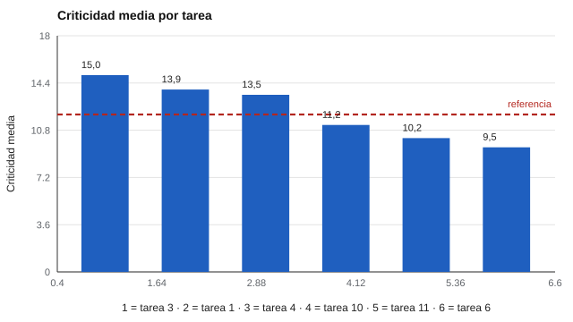

# 111 — Análisis de puestos y modelos de competencias


<!-- NAV -->
[← 110 — Falseamiento, deseabilidad social y escalas d…](../../part-10-personalidad-temperamento-y-conducta/110-falseamiento-deseabilidad-social-y-escalas-de-validez/README.md) · [📚 Parte 11](../README.md) · [🗺️ Índice 001–200](../../../PROGRAMA.md) · [112 — Validez predictiva de los métodos de selección →](../112-validez-predictiva-de-los-metodos-de-seleccion/README.md)
<!-- /NAV -->

**Parte 11 — Psicometría laboral y empleabilidad** · Nivel intermedio · 4 h · Estado `escrita`
**Pensada para:** quien diseña evaluaciones para un cargo, y quien quiere entender por qué le piden lo que le piden.
**Prerrequisitos:** clases 032 y 029.

> Material educativo. Los datos son sintéticos y el puesto es hipotético.

## ¿Para qué te sirve esto?

Antes de elegir un test o una entrevista para un cargo hay una pregunta previa: **¿qué se hace realmente en ese cargo?** Sin esa respuesta, las «competencias» son una lista genérica copiada de otra empresa. El **análisis de puestos** es el procedimiento que convierte «lo que hace el cargo» en tareas y requisitos documentados, y es la base de la validez de contenido y de la defensa de un proceso. Esta clase te enseña a calcular cuán críticas son las tareas y cuánto acuerdan los especialistas.

## Al terminar esta clase podrás

- Describir el análisis de puestos como base de cualquier evaluación laboral.
- Calcular criticidad de tareas y el acuerdo entre especialistas.
- Documentar de forma reproducible un modelo de competencias.

## La idea en palabras simples

Un procedimiento común: especialistas del puesto califican cada tarea en **importancia** y **frecuencia** (por ejemplo, de 1 a 5). La **criticidad** es el producto. Las tareas con criticidad sobre un umbral entran al modelo. Luego se pregunta qué conocimientos, habilidades y otras características hacen falta para esas tareas (Brannick, Levine y Morgeson, 2007; Sanchez y Levine, 2012).

La pregunta de calidad: **¿los especialistas están de acuerdo?** Se mide con el CCI del promedio de *k* evaluadores. Si el acuerdo es bajo, el modelo refleja opiniones y no el puesto.

## Cómo funciona, paso a paso

**1. Listar** las tareas del cargo (fuentes: observación, entrevistas, documentos, O\*NET como referencia).

**2. Calificar**: cada especialista da importancia y frecuencia a cada tarea.

**3. Calcular** criticidad = importancia × frecuencia y el CCI del promedio.

**4. Fijar** un umbral (declarado) y derivar las competencias de las tareas que entran.

**Ejemplo resuelto.** Una tarea con importancia 5 y frecuencia 3 tiene criticidad 15; otra con 4 y 2, criticidad 8. Con umbral 12, la primera entra y la segunda no.



*Figura 1.* Solo 3 de las 12 tareas superan el umbral de criticidad.

## Si construyes el instrumento

- Parte del análisis del puesto, no de una lista genérica de competencias.
- Usa varios especialistas y de más de un rol (no solo supervisores).
- Declara el umbral y quién evaluó; eso hace reproducible el modelo.
- Actualiza el análisis cuando el puesto cambie.

## Si eres evaluado

- Pregunta de qué análisis del puesto salen las competencias que te evalúan.
- Una prueba que no se relaciona con las tareas del cargo es difícil de defender.
- Las tareas críticas son las que deberían pesar más en tu evaluación.

## Qué muestra el laboratorio

`lab.py` simula 8 especialistas calificando 12 tareas sintéticas.

| Medida | Valor |
|---|---:|
| CCI(3,k): importancia / frecuencia / criticidad | 0,88 / 0,96 / 0,91 |
| Tareas con criticidad ≥ 12 (entran al modelo) | 3 de 12 (tareas 3, 1, 4) |
| Top-4 con 8 evaluadores / con 3 | [3, 1, 4, 10] / [3, 4, 1, 10] |

**Análisis.** (1) Con 8 evaluadores el promedio es fiable (CCI ≥ 0,88). (2) Con solo 3, el orden del ranking cambia. (3) El umbral es una decisión que se declara, no un dato. (4) Un modelo de competencias nace de un análisis documentado y reproducible; sin eso es opinión. Los datos son sintéticos.

## Errores frecuentes

- Definir competencias por listas genéricas sin análisis del puesto.
- Usar muy pocos especialistas, o solo supervisores.
- Olvidar que los puestos cambian.
- Presentar el umbral como si fuera un hecho.

## Lo mínimo que debes llevarte

1. El análisis de puestos precede a la evaluación.
2. Criticidad = importancia × frecuencia.
3. El acuerdo entre especialistas se mide, no se supone.
4. El modelo de competencias debe ser documentado y reproducible.

## Ejercicios

- **Inicial.** ¿Qué es la criticidad de una tarea? *Solución: el producto de su importancia y su frecuencia.*
- **Intermedio.** Importancia media 3,5 y frecuencia media 4,0. *Solución: 14,0; entra con umbral 12.*
- **Avanzado.** Aumenta a 15 evaluadores en `lab.py` y observa la estabilidad del ranking.
- **Aplicación.** Haz el análisis de un cargo que conozcas: 10 tareas, importancia y frecuencia, y deriva 3 competencias.

## Glosario

- **Análisis de puestos:** estudio sistemático de las tareas y requisitos de un cargo.
- **Criticidad:** importancia × frecuencia de una tarea.
- **CCI(3,k):** acuerdo del promedio de k evaluadores.
- **Competencia:** conjunto de conocimientos, habilidades y características necesarios para desempeñar tareas.

## Laboratorio

```bash
python classes/part-11-psicometria-laboral-y-empleabilidad/111-analisis-de-puestos-y-modelos-de-competencias/lab.py
python classes/part-11-psicometria-laboral-y-empleabilidad/figuras.py
```

## Autoevaluación y criterios

1. ¿Qué fuentes usarías además de especialistas? 2. ¿Cómo documentarías el modelo? 3. ¿Cuándo lo revisarías?
Se logra la clase si puedes construir y justificar un modelo desde un análisis documentado.

## Bibliografía

- Brannick, M. T., Levine, E. L., & Morgeson, F. P. (2007). *Job and Work Analysis* (2.ª ed.). Sage. 🔎 sin verificar (libro, norma o sitio no hallado en Crossref: comprobar a mano)
- Sanchez, J. I., & Levine, E. L. (2012). The rise and fall of job analysis and the future of work analysis. *Annual Review of Psychology*, 63, 397-425. ✅ [DOI](https://doi.org/10.1146/annurev-psych-120710-100401)

Leyenda: ✅ existe en Crossref con título y año coincidentes (enlace al DOI); ⚠️ hay una obra de título parecido con otro año (no se enlaza: comprobar la edición); 🔎 no verificada automáticamente (libros sin DOI, normas y sitios web). Crossref confirma la existencia de la fuente, no que respalde cada afirmación de la clase. Ver [`docs/VERIFICACION_BIBLIOGRAFIA.md`](../../../docs/VERIFICACION_BIBLIOGRAFIA.md).

---

<!-- NAV -->
[← 110 — Falseamiento, deseabilidad social y escalas d…](../../part-10-personalidad-temperamento-y-conducta/110-falseamiento-deseabilidad-social-y-escalas-de-validez/README.md)  
[📚 Parte 11](../README.md) · [🗺️ Índice 001–200](../../../PROGRAMA.md)  
[112 — Validez predictiva de los métodos de selección →](../112-validez-predictiva-de-los-metodos-de-seleccion/README.md)
<!-- /NAV -->
