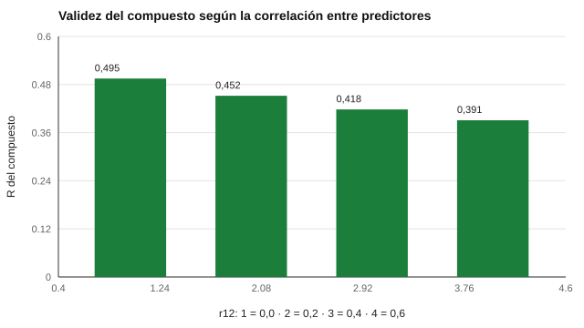

# 112 — Validez predictiva de los métodos de selección


<!-- NAV -->
[← 111 — Análisis de puestos y modelos de competencias](../111-analisis-de-puestos-y-modelos-de-competencias/README.md) · [📚 Parte 11](../README.md) · [🗺️ Índice 001–200](../../../PROGRAMA.md) · [113 — Pruebas de comprensión de instrucciones escri… →](../113-pruebas-de-comprension-de-instrucciones-escritas/README.md)
<!-- /NAV -->

**Parte 11 — Psicometría laboral y empleabilidad** · Nivel intermedio · 4 h · Estado `escrita`
**Pensada para:** quien decide qué métodos combinar en una selección, y quien quiere entender cuánto "predice" cada uno.
**Prerrequisitos:** clases 034, 039 y 111.

> Los coeficientes de esta clase son **ilustrativos**; no son los de tu proceso.

## ¿Para qué te sirve esto?

«¿Cuánto predice una entrevista? ¿Y un test cognitivo? ¿Y los dos juntos?» Se citan tablas de metaanálisis como si fueran verdades fijas. No lo son: fueron **revisadas** con tratamientos distintos de la restricción de rango, y sus números cambian (Schmidt y Hunter, 1998; Sackett et al., 2022). Esta clase te enseña a calcular la validez de un compuesto y a estimar la utilidad económica con supuestos explícitos, para no vender certezas que no existen.

## Al terminar esta clase podrás

- Calcular la validez de un compuesto de dos predictores.
- Estimar la utilidad (Brogden–Cronbach–Gleser) con supuestos explícitos.
- Reconocer que los coeficientes de la literatura se revisan y dependen del contexto.

## La idea en palabras simples

Sumar un segundo predictor aporta validez **solo en la medida en que no se repite con el primero**. Con validez v₁ y v₂ y correlación r₁₂ entre predictores:

```
R = √( (v₁² + v₂² − 2·r₁₂·v₁·v₂) / (1 − r₁₂²) )
```

La utilidad (Brogden, 1949; Cronbach y Gleser, 1965): **ΔU = N_sel · T · R · SD_y · λ − costo total**, donde SD_y es la variabilidad del valor del desempeño (difícil de estimar) y λ = φ(z)/razón de selección.

## Cómo funciona, paso a paso

**1. Fijar** las validez v₁ y v₂ (ilustrativas) y la correlación r₁₂.

**2. Calcular** R del compuesto y la ganancia sobre el mejor predictor solo.

**3. Estimar** la utilidad con supuestos de postulantes, razón de selección, SD_y, años y costos.

**Ejemplo resuelto.** r₁₂ = 0,2 y v₁ = v₂ = 0,35: R = √((0,1225 + 0,1225 − 2·0,2·0,1225) / (1 − 0,04)) = √(0,1960 / 0,96) = 0,452.



*Figura 1.* Mientras más se parecen los predictores, menos suma el segundo.

## Si construyes el instrumento

- Estima la validez en tu contexto; no copies un coeficiente de un metaanálisis.
- Elige predictores poco correlacionados entre sí.
- Presenta la utilidad como rango, con SD_y y costos declarados.
- Usa estimaciones locales y recientes.

## Si eres evaluado

- Que un método «prediga» no significa que acierte contigo: es una relación promedio.
- Combinar métodos es más justo que depender de uno solo, pero tampoco es infalible.

## Qué muestra el laboratorio

`lab.py` calcula el compuesto (v₁ = v₂ = 0,35) y una utilidad en pesos chilenos.

| r₁₂ | R del compuesto | Ganancia sobre el mejor |
|---:|---:|---:|
| 0,0 | 0,495 | 0,145 |
| 0,2 | 0,452 | 0,102 |
| 0,4 | 0,418 | 0,068 |
| 0,6 | 0,391 | 0,041 |

Utilidad (100 postulantes, selección 20 %, SD_y = 8 000 000 CLP, 2 años): solo entrevista ≈ 152,8 millones; entrevista + test ≈ 195,4 millones (considerando costos de 40 000 y 70 000 CLP por postulante).

**Análisis.** (1) El segundo predictor suma validez solo en la medida en que no esté correlacionado con el primero. (2) La utilidad depende fuertemente de SD_y, difícil de estimar: por eso se presenta como rango. (3) Las cifras son ilustrativas; en un proceso real se usan estimaciones locales. (4) Costos y SD_y son supuestos.

## Errores frecuentes

- Tomar un coeficiente de un metaanálisis como la validez de *tu* proceso.
- Proyectar utilidades con SD_y que nadie estimó localmente.
- Sumar predictores muy correlacionados esperando mucho más validez.
- Presentar un solo número de utilidad sin rango.

## Lo mínimo que debes llevarte

1. R del compuesto depende de las validez y de r₁₂.
2. A mayor r₁₂, menor ganancia del segundo predictor.
3. La utilidad depende de SD_y y de supuestos.
4. Las estimaciones de la literatura se revisan.

## Ejercicios

- **Inicial.** ¿Por qué baja la ganancia cuando sube r₁₂? *Solución: porque el segundo predictor repite información del primero.*
- **Intermedio.** Calcula R con v₁ = 0,30, v₂ = 0,20 y r₁₂ = 0. *Solución: √(0,09 + 0,04) = 0,36.*
- **Avanzado.** Calcula la utilidad con SD_y a la mitad y compara.
- **Aplicación.** Propón dos métodos poco correlacionados para un cargo y justifica.

## Glosario

- **Validez predictiva:** correlación entre el predictor y el desempeño posterior.
- **Compuesto:** combinación de varios predictores.
- **Restricción de rango:** reducción de variabilidad por haber seleccionado.
- **Utilidad:** valor económico estimado de usar un método de selección.

## Laboratorio

```bash
python classes/part-11-psicometria-laboral-y-empleabilidad/112-validez-predictiva-de-los-metodos-de-seleccion/lab.py
python classes/part-11-psicometria-laboral-y-empleabilidad/figuras.py
```

## Autoevaluación y criterios

1. ¿Por qué se revisaron las estimaciones? 2. ¿Qué evidencia local reunirías? 3. ¿Cómo presentarías un rango de utilidad?
Se logra la clase si puedes calcular compuestos y utilidades y declarar supuestos.

## Bibliografía

- Schmidt, F. L., & Hunter, J. E. (1998). The validity and utility of selection methods in personnel psychology. *Psychological Bulletin*, 124(2), 262-274. [DOI](https://doi.org/10.1037/0033-2909.124.2.262)
- Sackett, P. R., Zhang, C., Berry, C. M., & Lievens, F. (2022). Revisiting meta-analytic estimates of validity in personnel selection. *Journal of Applied Psychology*, 107(11), 2040-2068. [DOI](https://doi.org/10.1037/apl0000994)

---

<!-- NAV -->
[← 111 — Análisis de puestos y modelos de competencias](../111-analisis-de-puestos-y-modelos-de-competencias/README.md)  
[📚 Parte 11](../README.md) · [🗺️ Índice 001–200](../../../PROGRAMA.md)  
[113 — Pruebas de comprensión de instrucciones escri… →](../113-pruebas-de-comprension-de-instrucciones-escritas/README.md)
<!-- /NAV -->
