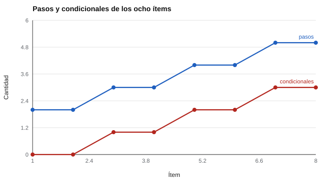

# 113 — Pruebas de comprensión de instrucciones escritas


<!-- NAV -->
[← 112 — Validez predictiva de los métodos de selección](../112-validez-predictiva-de-los-metodos-de-seleccion/README.md) · [📚 Parte 11](../README.md) · [🗺️ Índice 001–200](../../../PROGRAMA.md) · [114 — Evaluación de desempeño y criterios →](../114-evaluacion-de-desempeno-y-criterios/README.md)
<!-- /NAV -->

**Parte 11 — Psicometría laboral y empleabilidad** · Nivel intermedio · 4 h · Estado `escrita`
**Pensada para:** quien construye ítems de seguimiento de instrucciones, y quien los responde.
**Prerrequisitos:** clases 084 y 095.

## ¿Para qué te sirve esto?

Leer una instrucción y ejecutarla bien («tome el pedido, si es urgente páselo al turno, si no archívelo») es una demanda frecuente en el trabajo. Una prueba de este tipo suena simple, pero puede medir **tres cosas a la vez**: comprensión lectora, memoria de trabajo y razonamiento condicional. Esta clase te enseña a **generar ítems originales con clave calculada por código** y a controlar su dificultad por diseño, y a ser honesto sobre lo que la prueba permite concluir.

## Al terminar esta clase podrás

- Diseñar ítems originales de seguimiento de instrucciones con clave calculada.
- Controlar la dificultad por número de pasos y de condicionales.
- Delimitar qué mide (y qué no) una prueba de este tipo.

## La idea en palabras simples

Un ítem es una cadena de operaciones: «Parta con 6. Si es impar, sume 2; si es par, reste 6. Sume 5.» La respuesta correcta **se calcula**; no se escribe a mano, así se eliminan errores de transcripción. La dificultad de **diseño** se controla con dos palancas: el **número de pasos** y el **número de condicionales**. Pero la dificultad real hay que contrastarla con datos (clase 015).

## Cómo funciona, paso a paso

**1. Definir** el generador con pasos (2 a 5) y condicionales (0 a 3).

**2. Calcular** la clave con un intérprete y verificarla con otro independiente.

**3. Revisar** que el texto no agregue dificultad ajena (lectura, memoria).

**Ejemplo resuelto.** «Parta con 6. Si el número es impar, súmele 2; si es par, réstele 6. Súmele 5. Súmele 7.»: 6 es par → 0; 0 + 5 = 5; 5 + 7 = 12.



*Figura 1.* La dificultad de diseño aumenta con pasos y condicionales; la dificultad empírica debe medirse aparte.

## Si construyes el instrumento

- Calcula la clave por código y verifica con una segunda implementación.
- Controla la lectura (frases simples) y la memoria de trabajo (no encadenes demasiados pasos sin apoyo).
- Calibra la dificultad con datos reales.
- Reúne evidencia de validez para el puesto (análisis de puestos, clase 111).

## Si eres evaluado

- Lee cada paso con calma; los condicionales («si es impar…») suelen ser la trampa.
- Anota resultados intermedios si te lo permiten.
- Un mal resultado puede deberse a la memoria y no a que no entiendas el trabajo.

## Qué muestra el laboratorio

`lab.py` genera 8 ítems con semilla fija (2 a 5 pasos; 0 a 3 condicionales).

| Pasos | Condicionales | Ejemplo (resumido) | Respuesta |
|---:|---:|---|---:|
| 2 | 0 | Parta con 7. Multiplíquelo por 3. Multiplíquelo por 2. | 42 |
| 3 | 1 | Parta con 6. Si es impar, sume 2; si es par, reste 6. Sume 5. Sume 7. | 12 |

Concordancia entre intérprete y verificador: **8 / 8**.

**Análisis.** (1) La clave calculada elimina errores de transcripción. (2) La dificultad de diseño debe contrastarse con datos. (3) Más pasos exigen retener más: la prueba puede medir memoria de trabajo. (4) Un instrumento laboral requiere además evidencia de validez para el puesto.

## Errores frecuentes

- Declarar «difícil» un ítem por su número de pasos sin datos.
- Contaminar el constructo con memoria de trabajo.
- Usar una prueba de instrucciones numéricas para un puesto sin relación.
- Omitir la evidencia de validez para el cargo.

## Lo mínimo que debes llevarte

1. La clave se calcula y se verifica por código.
2. Pasos y condicionales controlan la dificultad de diseño.
3. La dificultad real se mide con datos.
4. Hay que vigilar lectura y memoria de trabajo.

## Ejercicios

- **Inicial.** Calcula: «Parta con 4. Sume 3. Multiplique por 2.» *Solución: 14.*
- **Intermedio.** Agrega una instrucción condicional y recalcula.
- **Avanzado.** Implementa un modo «con distractores textuales» y verifica que la respuesta no cambia.
- **Aplicación.** Escribe tres ítems de instrucciones relacionados con un cargo real, sin números.

## Glosario

- **Ítem generado:** ítem cuya clave y dificultad de diseño se derivan de reglas.
- **Condicional:** instrucción «si… entonces…».
- **Varianza irrelevante:** diferencia de puntajes no debida al constructo.
- **Memoria de trabajo:** capacidad de retener y manipular información a corto plazo.

## Laboratorio

```bash
python classes/part-11-psicometria-laboral-y-empleabilidad/113-pruebas-de-comprension-de-instrucciones-escritas/lab.py
python classes/part-11-psicometria-laboral-y-empleabilidad/figuras.py
```

## Autoevaluación y criterios

1. ¿Qué varianza irrelevante agrega la redacción? 2. ¿Cómo calibrarías la dificultad con datos? 3. ¿Qué evidencia para el puesto necesitas?
Se logra la clase si puedes generar y verificar ítems y limitar lo que la prueba permite concluir.

## Bibliografía

- Embretson, S. E. (1998). A cognitive design system approach to generating valid tests. *Psychological Methods*, 3(3), 380-396. [DOI](https://doi.org/10.1037/1082-989x.3.3.380)
- Haladyna, T. M., & Rodriguez, M. C. (2013). *Developing and Validating Test Items*. Routledge. [DOI](https://doi.org/10.4324/9780203850381)
- AERA, APA, & NCME (2014). *Standards for Educational and Psychological Testing*. AERA.

---

<!-- NAV -->
[← 112 — Validez predictiva de los métodos de selección](../112-validez-predictiva-de-los-metodos-de-seleccion/README.md)  
[📚 Parte 11](../README.md) · [🗺️ Índice 001–200](../../../PROGRAMA.md)  
[114 — Evaluación de desempeño y criterios →](../114-evaluacion-de-desempeno-y-criterios/README.md)
<!-- /NAV -->
