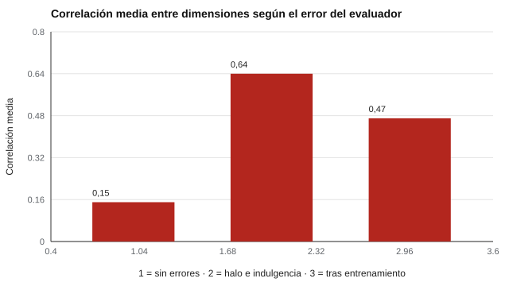

# 114 — Evaluación de desempeño y criterios


<!-- NAV -->
[← 113 — Pruebas de comprensión de instrucciones escri…](../113-pruebas-de-comprension-de-instrucciones-escritas/README.md) · [📚 Parte 11](../README.md) · [🗺️ Índice 001–200](../../../PROGRAMA.md) · [115 — Juicio situacional →](../115-juicio-situacional/README.md)
<!-- /NAV -->

**Parte 11 — Psicometría laboral y empleabilidad** · Nivel intermedio · 4 h · Estado `escrita`
**Pensada para:** quien diseña evaluaciones de desempeño o valida pruebas con ellas, y quien es evaluado por una jefatura.
**Prerrequisitos:** clases 029 y 111.

> Los efectos son simulados.

## ¿Para qué te sirve esto?

Casi todo en psicología laboral se valida contra el **desempeño**: «el test predice el desempeño». Pero el desempeño también se mide con error, y quien lo mide (la jefatura) introduce sus propias distorsiones. Si tu supervisor da 5 a todos en todo, ¿qué estás midiendo? Esta clase te enseña a reconocer **halo, indulgencia y efecto del evaluador**, a medirlos con indicadores simples y a ver cuánto ayuda el entrenamiento.

## Al terminar esta clase podrás

- Reconocer los errores del evaluador: halo, indulgencia, efecto del evaluador.
- Medirlos con indicadores simples.
- Evaluar el efecto de medidas correctivas.

## La idea en palabras simples

- **Halo:** una impresión general contamina todas las dimensiones («es simpático, así que es bueno en todo»).
- **Indulgencia / severidad:** algunos evaluadores puntúan alto o bajo a todos.
- **Efecto del evaluador:** parte de la diferencia entre empleados es en realidad diferencia entre supervisores (Saal et al., 1980).

Se miden con (a) la **correlación media entre dimensiones** (si sube mucho, hay halo) y (b) el **porcentaje de varianza atribuible al evaluador**.

## Cómo funciona, paso a paso

**1. Simular** 80 supervisores que evalúan a 10 empleados en varias dimensiones (correlación verdadera entre dimensiones 0,2).

**2. Aplicar** tres condiciones: sin errores, con halo e indulgencia, y tras entrenamiento (efectos a la mitad).

**3. Medir** la correlación media y la varianza del evaluador.

**Ejemplo resuelto.** Si un supervisor da +1 punto a todos, el CCI(1) por supervisor sube: la mitad de la diferencia entre empleados puede ser, en realidad, diferencia entre supervisores.



*Figura 1.* Con halo, las dimensiones dejan de ser distinguibles.

## Si construyes el instrumento

- Usa rúbricas con anclas conductuales.
- Entrena y calibra a los evaluadores.
- Emplea varios evaluadores por empleado cuando se pueda.
- Complementa con indicadores objetivos y estima la fiabilidad del criterio.

## Si eres evaluado

- Tu calificación depende en parte de **quién** te evalúa.
- Pide criterios claros y ejemplos de cada nivel.
- Si hay una sola evaluación y consecuencias importantes, pide que se complemente.

## Qué muestra el laboratorio

`lab.py` simula 80 supervisores × 10 empleados.

| Condición | Correlación media entre dimensiones | % varianza atribuible al evaluador |
|---|---:|---:|
| Sin errores | 0,15 | 0,7 % |
| Halo e indulgencia | 0,64 | 21,8 % |
| Tras entrenamiento (efectos a la mitad) | 0,47 | 15,8 % |

**Análisis.** (1) Con halo, la correlación sube a 0,64 y las dimensiones dejan de ser distinguibles. (2) Más de un quinto de la varianza se explica por quién evalúa. (3) El entrenamiento reduce los errores, sin eliminarlos. (4) Un criterio de desempeño también tiene fiabilidad.

## Errores frecuentes

- Usar una evaluación de jefatura como «verdad» sin estimar su fiabilidad.
- Forzar distribuciones sin evidencia.
- Validar el test con el desempeño y evaluar el desempeño con el test (circularidad).
- Ignorar el efecto del evaluador.

## Lo mínimo que debes llevarte

1. El desempeño se mide con error.
2. Halo, indulgencia y efecto del evaluador son medibles.
3. El entrenamiento ayuda, pero no elimina.
4. Varios evaluadores y anclas conductuales mejoran la fiabilidad.

## Ejercicios

- **Inicial.** ¿Qué es el efecto halo? *Solución: una impresión general que contamina todas las dimensiones.*
- **Intermedio.** Si el 20 % de la varianza es del evaluador, ¿qué hacer? *Solución: usar varios evaluadores y calibrar.*
- **Avanzado.** Aumenta a 3 evaluadores por empleado en `lab.py` y compara.
- **Aplicación.** Redacta anclas conductuales para tres niveles de una dimensión de desempeño.

## Glosario

- **Halo:** contaminación entre dimensiones por impresión general.
- **Indulgencia:** tendencia a puntuar alto a todos.
- **Efecto del evaluador:** varianza de las notas debida a quien evalúa.
- **Anclas conductuales:** descripciones de conductas que ilustran cada nivel.

## Laboratorio

```bash
python classes/part-11-psicometria-laboral-y-empleabilidad/114-evaluacion-de-desempeno-y-criterios/lab.py
python classes/part-11-psicometria-laboral-y-empleabilidad/figuras.py
```

## Autoevaluación y criterios

1. ¿Qué rúbrica con anclas conductuales propondrías? 2. ¿Cómo calibrarías evaluadores? 3. ¿Qué indicadores objetivos complementan?
Se logra la clase si puedes cuantificar errores del evaluador y proponer medidas.

## Bibliografía

- Saal, F. E., Downey, R. G., & Lahey, M. A. (1980). Rating the ratings: Assessing the psychometric quality of rating data. *Psychological Bulletin*, 88(2), 413-428. ✅ [DOI](https://doi.org/10.1037/0033-2909.88.2.413)
- Murphy, K. R., & Cleveland, J. N. (1995). *Understanding Performance Appraisal*. Sage. 🔎 sin verificar (libro, norma o sitio no hallado en Crossref: comprobar a mano)
- Woehr, D. J., & Huffcutt, A. I. (1994). Rater training for performance appraisal: A quantitative review. *Journal of Occupational and Organizational Psychology*, 67(3), 189-205. ✅ [DOI](https://doi.org/10.1111/j.2044-8325.1994.tb00562.x)

Leyenda: ✅ existe en Crossref con título y año coincidentes (enlace al DOI); ⚠️ hay una obra de título parecido con otro año (no se enlaza: comprobar la edición); 🔎 no verificada automáticamente (libros sin DOI, normas y sitios web). Crossref confirma la existencia de la fuente, no que respalde cada afirmación de la clase. Ver [`docs/VERIFICACION_BIBLIOGRAFIA.md`](../../../docs/VERIFICACION_BIBLIOGRAFIA.md).

---

<!-- NAV -->
[← 113 — Pruebas de comprensión de instrucciones escri…](../113-pruebas-de-comprension-de-instrucciones-escritas/README.md)  
[📚 Parte 11](../README.md) · [🗺️ Índice 001–200](../../../PROGRAMA.md)  
[115 — Juicio situacional →](../115-juicio-situacional/README.md)
<!-- /NAV -->
