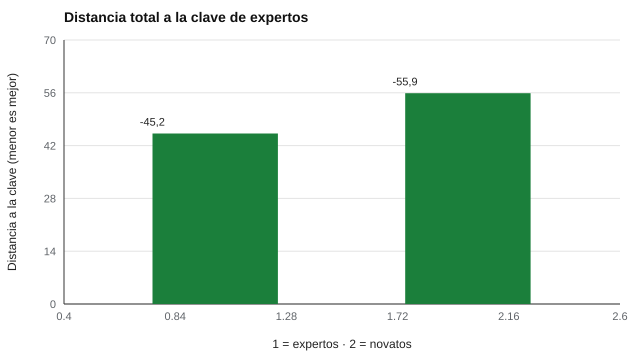

# 115 — Juicio situacional


<!-- NAV -->
[← 114 — Evaluación de desempeño y criterios](../114-evaluacion-de-desempeno-y-criterios/README.md) · [📚 Parte 11](../README.md) · [🗺️ Índice 001–200](../../../PROGRAMA.md) · [116 — Personalidad de vendedores y evaluación comer… →](../116-personalidad-de-vendedores-y-evaluacion-comercial/README.md)
<!-- /NAV -->

**Parte 11 — Psicometría laboral y empleabilidad** · Nivel intermedio · 4 h · Estado `escrita`
**Pensada para:** quien construye pruebas de juicio situacional (SJT), y quien las responde en un proceso.
**Prerrequisitos:** clases 022 y 111.

> Los novatos simulados incluyen un sesgo de amabilidad supuesto.

## ¿Para qué te sirve esto?

«Un cliente se queja delante de otros. ¿Qué haces: (a) ignorarlo, (b) llevarlo aparte, (c) llamar a tu jefe, (d) pedir disculpas públicas?» Es una **prueba de juicio situacional**: presenta situaciones laborales y pide valorar cursos de acción. Es popular porque se parece al trabajo real. Pero tiene una rareza que sorprende: su **alfa de Cronbach es muy bajo** y aun así es válida. Esta clase te enseña por qué, y cómo se construye y evalúa la **clave de expertos** (qué es «lo correcto»).

## Al terminar esta clase podrás

- Describir las pruebas de juicio situacional y sus formatos.
- Construir y evaluar una clave de expertos.
- Interpretar su consistencia interna modesta.

## La idea en palabras simples

Un SJT mide un conjunto **heterogéneo** de conocimiento procedimental y rasgos (McDaniel et al., 2001; Christian et al., 2010). Cada situación mide algo distinto, por eso el alfa es bajo, y eso no es necesariamente un defecto.

La **clave** se construye con expertos (consenso). Una puntuación común es la **distancia a la clave**: mientras más cerca de lo que valoran los expertos, mejor. Formatos de respuesta: valorar cada opción, elegir la mejor, o elegir la mejor y la peor.

## Cómo funciona, paso a paso

**1. Escribir** situaciones y opciones (idealmente a partir de incidentes críticos del puesto).

**2. Reunir** valoraciones de expertos y promediarlas para formar la clave.

**3. Puntuar** a cada examinado por su distancia a la clave.

**4. Evaluar** acuerdo entre expertos, discriminación entre expertos y novatos, y consistencia interna.

**Ejemplo resuelto.** Un examinado valora una opción con 4 y la clave es 2,5: diferencia absoluta 1,5; se suma a las de las demás opciones de la situación y se resta del máximo.



*Figura 1.* La clave discrimina: los expertos quedan más cerca de ella.

## Si construyes el instrumento

- Forma la clave con varios expertos, de perfiles distintos, y documenta su composición.
- Revisa sesgos culturales: «lo correcto» depende del contexto.
- No uses el alfa como criterio único de calidad.
- Reúne evidencia de validez (criterio, contenido).

## Si eres evaluado

- No hay una respuesta «obvia»: se espera que elijas como lo haría una persona con experiencia en el puesto.
- Piensa en las políticas y valores del contexto laboral, no en lo que harías en casa.
- Si el contexto cultural es distinto al tuyo, la clave puede no reflejar tu experiencia.

## Qué muestra el laboratorio

`lab.py` simula 20 situaciones × 4 opciones, 10 expertos y novatos.

| Medida | Valor |
|---|---:|
| Acuerdo entre dos mitades de expertos | 0,95 |
| Puntaje medio expertos / novatos | −45,2 / −55,9 |
| d de Cohen (expertos − novatos) | 2,39 |
| Alfa de Cronbach (novatos, 20 situaciones) | 0,08 |

**Análisis.** (1) La clave es estable (0,95) y discrimina entre expertos y novatos (d = 2,39). (2) El alfa es muy bajo (0,08), como cabe esperar de un instrumento heterogéneo. (3) Quienes elaboran la clave definen «lo correcto»: su composición debe documentarse. (4) Los novatos simulados tienen un sesgo supuesto de amabilidad.

## Errores frecuentes

- Fijar la clave con un solo experto o un grupo homogéneo.
- Ignorar sesgos culturales.
- Interpretar el puntaje como un único rasgo.
- Usar el alfa como juicio único de calidad.

## Lo mínimo que debes llevarte

1. Un SJT mide un conjunto heterogéneo.
2. La clave se forma con expertos y se documenta.
3. Un alfa bajo es esperable, no necesariamente un defecto.
4. La validez se establece con otras evidencias.

## Ejercicios

- **Inicial.** ¿Qué es una clave de expertos? *Solución: la valoración consensuada de expertos que define lo correcto.*
- **Intermedio.** ¿Por qué el alfa de un SJT es bajo? *Solución: porque las situaciones son heterogéneas.*
- **Avanzado.** Agrega un tercer grupo («supervisores con 1 año») y compara su puntaje.
- **Aplicación.** Escribe una situación con cuatro opciones basada en un incidente real de un cargo.

## Glosario

- **SJT:** prueba de juicio situacional.
- **Clave de expertos:** respuestas consideradas correctas por consenso experto.
- **Heterogeneidad:** diversidad de lo que miden los ítems.
- **Incidente crítico:** hecho laboral real que distingue el buen del mal desempeño.

## Laboratorio

```bash
python classes/part-11-psicometria-laboral-y-empleabilidad/115-juicio-situacional/lab.py
python classes/part-11-psicometria-laboral-y-empleabilidad/figuras.py
```

## Autoevaluación y criterios

1. ¿Cómo reunirías evidencia de validez? 2. ¿Cómo se documenta la composición de los expertos? 3. ¿Qué formatos de respuesta existen?
Se logra la clase si puedes construir una clave y evaluarla.

## Bibliografía

- McDaniel, M. A., Morgeson, F. P., Finnegan, E. B., Campion, M. A., & Braverman, E. P. (2001). Use of situational judgment tests to predict job performance. *Journal of Applied Psychology*, 86(4), 730-740. [DOI](https://doi.org/10.1037/0021-9010.86.4.730)
- Weekley, J. A., & Ployhart, R. E. (Eds.) (2006). *Situational Judgment Tests*. Lawrence Erlbaum.
- Christian, M. S., Edwards, B. D., & Bradley, J. C. (2010). Situational judgment tests: Constructs assessed and a meta-analysis of their criterion-related validities. *Personnel Psychology*, 63(1), 83-117. [DOI](https://doi.org/10.1111/j.1744-6570.2009.01163.x)

---

<!-- NAV -->
[← 114 — Evaluación de desempeño y criterios](../114-evaluacion-de-desempeno-y-criterios/README.md)  
[📚 Parte 11](../README.md) · [🗺️ Índice 001–200](../../../PROGRAMA.md)  
[116 — Personalidad de vendedores y evaluación comer… →](../116-personalidad-de-vendedores-y-evaluacion-comercial/README.md)
<!-- /NAV -->
