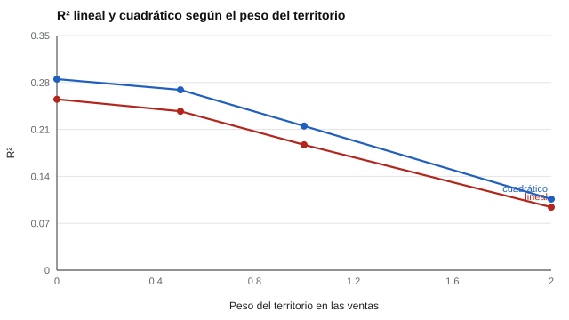

# 116 — Personalidad de vendedores y evaluación comercial


<!-- NAV -->
[← 115 — Juicio situacional](../115-juicio-situacional/README.md) · [📚 Parte 11](../README.md) · [🗺️ Índice 001–200](../../../PROGRAMA.md) · [117 — Percepción y prevención de riesgos laborales →](../117-percepcion-y-prevencion-de-riesgos-laborales/README.md)
<!-- /NAV -->

**Parte 11 — Psicometría laboral y empleabilidad** · Nivel intermedio · 4 h · Estado `escrita`
**Pensada para:** quien evalúa fuerzas de venta, y quien es evaluado con un «perfil de vendedor».
**Prerrequisitos:** clases 034, 101 y 114.

> Los parámetros son supuestos del laboratorio.

## ¿Para qué te sirve esto?

«Buscamos un vendedor con perfil extrovertido.» Muchas empresas usan un «perfil ideal de vendedor». Esta clase muestra dos problemas que suelen ignorarse: (1) la relación entre un rasgo y las ventas **puede no ser una línea recta**: más extraversión ayuda hasta cierto punto y luego deja de ayudar; (2) el criterio «ventas» está **contaminado** por cosas ajenas al vendedor, como el territorio. Si el criterio es malo, ninguna validación es confiable.

## Al terminar esta clase podrás

- Reconocer relaciones no lineales entre rasgos y desempeño.
- Evaluar la calidad del criterio «ventas».
- Evitar perfiles genéricos de «vendedor ideal».

## La idea en palabras simples

Los metaanálisis encuentran relaciones **modestas** entre rasgos como extraversión y responsabilidad y el desempeño de vendedores (Barrick y Mount, 1991; Vinchur et al., 1998). Hay evidencia de relaciones **curvilíneas** («demasiado de algo bueno», Le et al., 2011). Y el criterio «ventas» depende del territorio, la cartera, el producto, la temporada: factores que el vendedor no controla.

## Cómo funciona, paso a paso

**1. Simular** un efecto del rasgo que se aplana sobre 0,5 DE.

**2. Construir** el criterio sumando un componente de territorio con peso creciente.

**3. Ajustar** un modelo lineal y uno cuadrático y comparar su R².

**Ejemplo resuelto.** Con peso del territorio 2,0, solo ~9 % de la varianza se explica aun con el modelo correcto: la validez observada refleja la calidad del criterio tanto como la del predictor.



*Figura 1.* El modelo cuadrático explica más, pero un criterio contaminado hunde a ambos.

## Si construyes el instrumento

- Examina la linealidad antes de fijar puntos de corte.
- Depura el criterio: ventas ajustadas por territorio o evaluación de conductas.
- Valida con evidencia local, no con un perfil genérico.
- No construyas el «vendedor ideal» a partir de los vendedores actuales (circularidad).

## Si eres evaluado

- Un perfil de personalidad no define tu capacidad para vender.
- Tus ventas dependen también de tu territorio y cartera; pide que se consideren.
- Pregunta qué evidencia hay de que el perfil se relaciona con el desempeño en ese cargo.

## Qué muestra el laboratorio

| Peso del territorio | R² lineal | R² cuadrático |
|---:|---:|---:|
| 0,0 | 0,255 | 0,285 |
| 0,5 | 0,237 | 0,269 |
| 1,0 | 0,187 | 0,215 |
| 2,0 | 0,094 | 0,106 |

**Análisis.** (1) Con una relación que se aplana, el modelo cuadrático explica más que el lineal: el efecto no es constante. (2) Cuando el criterio incluye más territorio, el R² de ambos cae. (3) La validez mide también la calidad del criterio. (4) Evaluar personalidad de vendedores exige un criterio depurado y evidencia local.

## Errores frecuentes

- Perfil de «vendedor ideal» basado en un solo estudio o en los vendedores actuales.
- Ventas brutas como criterio sin ajustar por territorio.
- Asumir linealidad sin examinarla.
- Concluir que un rasgo «no sirve» por un criterio contaminado.

## Lo mínimo que debes llevarte

1. Las relaciones rasgo-desempeño pueden ser curvas.
2. El criterio «ventas» incluye factores ajenos al vendedor.
3. Un criterio malo reduce cualquier validez observada.
4. Se necesita evidencia local, no perfiles genéricos.

## Ejercicios

- **Inicial.** ¿Qué es una relación curvilínea? *Solución: una relación que no es una línea recta (por ejemplo, que se aplana o se invierte).*
- **Intermedio.** Propón un criterio alternativo a «ventas totales». *Solución posible: ventas ajustadas por territorio o evaluación de conductas comerciales.*
- **Avanzado.** Ajusta un modelo con tope (min) en `lab.py` y compáralo con el cuadrático.
- **Aplicación.** Diseña una evaluación de conductas comerciales con tres anclas.

## Glosario

- **Relación curvilínea:** relación no lineal entre dos variables.
- **Criterio:** variable que se quiere predecir (aquí, desempeño comercial).
- **Contaminación del criterio:** parte del criterio que no depende de la persona.
- **R²:** proporción de varianza explicada.

## Laboratorio

```bash
python classes/part-11-psicometria-laboral-y-empleabilidad/116-personalidad-de-vendedores-y-evaluacion-comercial/lab.py
python classes/part-11-psicometria-laboral-y-empleabilidad/figuras.py
```

## Autoevaluación y criterios

1. ¿Cómo depurarías el criterio? 2. ¿Qué dice la literatura sobre personalidad y ventas (a verificar en las fuentes)? 3. ¿Qué alternativas a un test de personalidad existen?
Se logra la clase si examinas linealidad y calidad del criterio.

## Bibliografía

- Barrick, M. R., & Mount, M. K. (1991). The Big Five personality dimensions and job performance: A meta-analysis. *Personnel Psychology*, 44(1), 1-26. ✅ [DOI](https://doi.org/10.1111/j.1744-6570.1991.tb00688.x)
- Vinchur, A. J., Schippmann, J. S., Switzer, F. S., & Roth, P. L. (1998). A meta-analytic review of predictors of job performance for salespeople. *Journal of Applied Psychology*, 83(4), 586-597. ✅ [DOI](https://doi.org/10.1037/0021-9010.83.4.586)
- Le, H., Oh, I.-S., Robbins, S. B., Ilies, R., Holland, E., & Westrick, P. (2011). Too much of a good thing: Curvilinear relationships between personality traits and job performance. *Journal of Applied Psychology*, 96(1), 113-133. ✅ [DOI](https://doi.org/10.1037/a0021016)

Leyenda: ✅ existe en Crossref con título y año coincidentes (enlace al DOI); ⚠️ hay una obra de título parecido con otro año (no se enlaza: comprobar la edición); 🔎 no verificada automáticamente (libros sin DOI, normas y sitios web). Crossref confirma la existencia de la fuente, no que respalde cada afirmación de la clase. Ver [`docs/VERIFICACION_BIBLIOGRAFIA.md`](../../../docs/VERIFICACION_BIBLIOGRAFIA.md).

---

<!-- NAV -->
[← 115 — Juicio situacional](../115-juicio-situacional/README.md)  
[📚 Parte 11](../README.md) · [🗺️ Índice 001–200](../../../PROGRAMA.md)  
[117 — Percepción y prevención de riesgos laborales →](../117-percepcion-y-prevencion-de-riesgos-laborales/README.md)
<!-- /NAV -->
