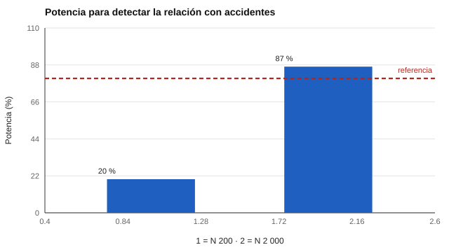

# 117 — Percepción y prevención de riesgos laborales


<!-- NAV -->
[← 116 — Personalidad de vendedores y evaluación comer…](../116-personalidad-de-vendedores-y-evaluacion-comercial/README.md) · [📚 Parte 11](../README.md) · [🗺️ Índice 001–200](../../../PROGRAMA.md) · [118 — Ajuste persona-puesto: qué se puede y qué no… →](../118-ajuste-persona-puesto-que-se-puede-y/README.md)
<!-- /NAV -->

**Parte 11 — Psicometría laboral y empleabilidad** · Nivel intermedio · 4 h · Estado `escrita`
**Pensada para:** quien evalúa percepción de riesgos en el trabajo, y quien es evaluado con estas pruebas.
**Prerrequisitos:** clases 091 y 112.

> La normativa de prevención (por ejemplo, Ley 16.744 y sus reglamentos) se consulta en su texto vigente. Esta clase no es asesoría jurídica.

## ¿Para qué te sirve esto?

«Queremos contratar gente que no tenga accidentes.» Suena razonable, pero tiene un problema estadístico serio: los accidentes son **eventos raros**, y por eso casi ningún test puede validarse contra ellos con muestras normales. Y tiene un problema ético: culpar al trabajador por un puntaje. Esta clase te enseña a medir la **detección de peligros** con teoría de detección de señales, a ver por qué validar contra accidentes es tan difícil y a ubicar la evaluación individual dentro de un enfoque de **sistema** de prevención.

## Al terminar esta clase podrás

- Medir la detección de peligros con teoría de detección de señales.
- Entender el problema estadístico de validar contra accidentes.
- Ubicar la evaluación individual dentro de un enfoque de sistema.

## La idea en palabras simples

Una tarea de detección de peligros muestra imágenes con y sin peligro. El índice **d′** separa la **capacidad de discriminar** de la **cautela** (clase 091). Pero ¿predice accidentes? Con una tasa de 0,05 accidentes por trabajador-año, casi todos tienen cero, y la correlación posible es mínima: se necesitan miles de casos. Los criterios **proximales** (conductas seguras observadas, cuasi-accidentes) son más viables. Y el enfoque de sistema (Reason, 1990) recuerda que los accidentes se explican por más que el individuo.

## Cómo funciona, paso a paso

**1. Medir** d′ por trabajador con 20 imágenes con peligro y 20 sin peligro.

**2. Simular** accidentes (eventos raros) y conductas seguras (frecuentes) con un efecto real moderado.

**3. Estimar** la correlación y la potencia con N = 200 y N = 2 000.

**Ejemplo resuelto.** Para detectar r = −0,07 con 80 % de potencia se requieren ≈ 1 600 personas (n ≈ 7,85/r² + 3).



*Figura 1.* Con 200 trabajadores casi nunca se detecta la relación con accidentes.

## Si construyes el instrumento

- Valida contra criterios proximales (conductas seguras observadas).
- Informa d′ con su incertidumbre; con 40 imágenes es ruidoso.
- No uses el puntaje para cribar a postulantes por «propensión a accidentes»: la evidencia de ese constructo es limitada.
- Integra la evaluación en un sistema: peligros, procedimientos, supervisión.

## Si eres evaluado

- Un puntaje de percepción de riesgos no explica un accidente, y no debería usarse para culparte.
- Pregunta cómo se usará el resultado y qué otras medidas de prevención existen.

## Qué muestra el laboratorio

| Medida | Valor |
|---|---:|
| d′ estimado (20 + 20 imágenes): media / DE | 1,51 / 0,70 (DE verdadera de d′ = 0,5) |
| N = 200: r con accidentes / con conductas seguras / potencia | −0,079 / 0,468 / 20 % |
| N = 2 000: r con accidentes / con conductas seguras / potencia | −0,071 / 0,449 / 87 % |

**Análisis.** (1) Con eventos raros, la correlación con accidentes es minúscula y exige miles de trabajadores. (2) Las conductas seguras observadas son un criterio proximal más útil. (3) La DE estimada de d′ (0,70) supera la verdadera (0,5) por el ruido de medición. (4) Es una advertencia contra culpar al trabajador.

## Errores frecuentes

- Culpar al trabajador con base en un puntaje de percepción.
- Validar solo con accidentes.
- Cribar postulantes por «propensión a accidentes» sin evidencia.
- Ignorar el sistema de prevención.

## Lo mínimo que debes llevarte

1. d′ separa capacidad de cautela.
2. Los accidentes son eventos raros: validar contra ellos exige muestras enormes.
3. Los criterios proximales son más viables.
4. La prevención es un sistema, no un puntaje.

## Ejercicios

- **Inicial.** ¿Por qué es difícil usar accidentes como criterio? *Solución: porque son raros y la correlación observable es mínima.*
- **Intermedio.** Calcula n para r = 0,10 y 80 % de potencia. *Solución: ≈ 785 + 3.*
- **Avanzado.** Aumenta la tasa a 0,5 accidentes por trabajador-año y observa la potencia.
- **Aplicación.** Propón tres conductas seguras observables para un puesto de bodega.

## Glosario

- **d′:** índice de sensibilidad de la teoría de detección de señales.
- **Criterio proximal:** criterio cercano a la conducta, más frecuente que el evento final.
- **Evento raro:** suceso de muy baja frecuencia.
- **Enfoque de sistema:** explica los errores por condiciones de la organización, no solo por la persona.

## Laboratorio

```bash
python classes/part-11-psicometria-laboral-y-empleabilidad/117-percepcion-y-prevencion-de-riesgos-laborales/lab.py
python classes/part-11-psicometria-laboral-y-empleabilidad/figuras.py
```

## Autoevaluación y criterios

1. ¿Qué criterio proximal propones? 2. ¿Qué parte de la prevención no es individual? 3. ¿Qué cautelas éticas hay?
Se logra la clase si eliges criterios viables y ubicas la evaluación en un enfoque de sistema.

## Bibliografía

- Reason, J. (1990). *Human Error*. Cambridge University Press. ✅ [DOI](https://doi.org/10.1017/cbo9781139062367)
- Clarke, S. (2006). The relationship between safety climate and safety performance: A meta-analytic review. *Journal of Occupational Health Psychology*, 11(4), 315-327. ✅ [DOI](https://doi.org/10.1037/1076-8998.11.4.315)
- Macmillan, N. A., & Creelman, C. D. (2005). *Detection Theory: A User's Guide* (2.ª ed.). Lawrence Erlbaum. 🔎 sin verificar (libro, norma o sitio no hallado en Crossref: comprobar a mano)

Leyenda: ✅ existe en Crossref con título y año coincidentes (enlace al DOI); ⚠️ hay una obra de título parecido con otro año (no se enlaza: comprobar la edición); 🔎 no verificada automáticamente (libros sin DOI, normas y sitios web). Crossref confirma la existencia de la fuente, no que respalde cada afirmación de la clase. Ver [`docs/VERIFICACION_BIBLIOGRAFIA.md`](../../../docs/VERIFICACION_BIBLIOGRAFIA.md).

---

<!-- NAV -->
[← 116 — Personalidad de vendedores y evaluación comer…](../116-personalidad-de-vendedores-y-evaluacion-comercial/README.md)  
[📚 Parte 11](../README.md) · [🗺️ Índice 001–200](../../../PROGRAMA.md)  
[118 — Ajuste persona-puesto: qué se puede y qué no… →](../118-ajuste-persona-puesto-que-se-puede-y/README.md)
<!-- /NAV -->
