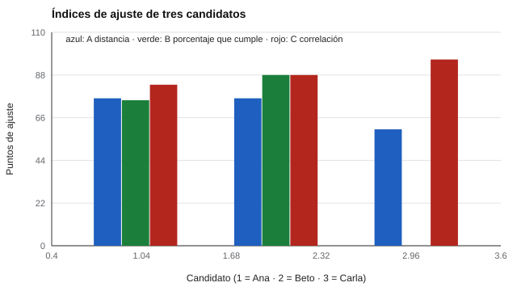

# 118 — Ajuste persona-puesto: qué se puede y qué no afirmar


<!-- NAV -->
[← 117 — Percepción y prevención de riesgos laborales](../117-percepcion-y-prevencion-de-riesgos-laborales/README.md) · [📚 Parte 11](../README.md) · [🗺️ Índice 001–200](../../../PROGRAMA.md) · [119 — Dominio del inglés laboral: evaluación de idi… →](../119-dominio-del-ingles-laboral-evaluacion-de-idioma/README.md)
<!-- /NAV -->

**Parte 11 — Psicometría laboral y empleabilidad** · Nivel intermedio · 4 h · Estado `escrita`
**Pensada para:** quien entrega o lee informes de «% de ajuste», y quien recibe uno.
**Prerrequisitos:** clases 031, 074 y 112.

## ¿Para qué te sirve esto?

«Usted tiene un 85 % de ajuste con el cargo.» Esa frase aparece en muchos informes. ¿Qué significa? ¿Es una probabilidad de éxito? ¿Quién fijó la fórmula y los pesos? Esta clase te muestra con tres candidatos que **el mismo perfil puede dar 60, 0 o 96 puntos de ajuste según la fórmula elegida**, y que un porcentaje de ajuste no es una probabilidad. Aprenderás a informar el ajuste de una forma defendible: mostrar los datos, no inventar porcentajes.

## Al terminar esta clase podrás

- Calcular distintos índices de ajuste y compararlos.
- Demostrar que un «porcentaje de ajuste» depende de la fórmula.
- Formular reglas para no inventar porcentajes ni pesos.

## La idea en palabras simples

El ajuste persona-puesto compara el perfil de una persona con el requerido. Hay muchos índices (Edwards, 1993), y cada uno mide algo distinto:

- **A: distancia** al perfil requerido (qué tan cerca está, en promedio).
- **B: % que cumple** (en cuántas competencias alcanza el mínimo).
- **C: correlación** entre perfiles (la *forma*, no el nivel).

La literatura asocia el ajuste con actitudes y desempeño, con magnitudes variables (Kristof-Brown et al., 2005). Pero ningún índice tiene interpretación probabilística sin evidencia propia.

## Cómo funciona, paso a paso

**1. Definir** el perfil requerido de 8 competencias.

**2. Calcular** A, B y C para cada candidato.

**3. Comparar** los órdenes que produce cada índice.

**Ejemplo resuelto.** El índice C mide forma, no nivel: un candidato con competencias bajas pero proporcionales al requerido parece «muy ajustado» aunque no cumpla ninguna.



*Figura 1.* Carla es la última, la mejor o intermedia según el índice.

## Si construyes el instrumento

- Muestra qué competencias se cumplen y con qué margen, en vez de un porcentaje único.
- No inventes pesos ni porcentajes sin evidencia.
- Usa el mismo índice para comparar candidatos al mismo puesto.
- Trata el ajuste como insumo de una conversación, no como decisión.

## Si eres evaluado

- Un «85 % de ajuste» no es una probabilidad de éxito.
- Pide ver el detalle por competencia y la fórmula.
- Un ajuste bajo en un índice puede no serlo en otro.

## Qué muestra el laboratorio

| Candidato | A: distancia | B: % que cumple | C: correlación |
|---|---:|---:|---:|
| Ana | 76 | 75 | 83 |
| Beto | 76 | 88 | 88 |
| Carla | 60 | 0 | 96 |

Los órdenes difieren: A: Ana > Beto > Carla; B: Beto > Ana > Carla; C: Carla > Beto > Ana.

**Análisis.** (1) Carla obtiene 60, 0 o 96 según el índice, porque cada uno mide algo distinto. (2) Ninguno tiene interpretación probabilística sin evidencia de validez. (3) Lo defendible es mostrar los datos y evitar pesos y porcentajes inventados. (4) Los candidatos son sintéticos.

## Errores frecuentes

- Presentar «85 % de ajuste» como probabilidad de éxito.
- Ponderar competencias sin evidencia ni justificación.
- Comparar candidatos con índices distintos o entre puestos.
- Elegir el índice después de ver los resultados.

## Lo mínimo que debes llevarte

1. Cada índice de ajuste mide algo distinto.
2. El orden de candidatos depende del índice.
3. Un porcentaje de ajuste no es una probabilidad.
4. Lo defendible: mostrar competencias y márgenes.

## Ejercicios

- **Inicial.** ¿Qué mide el índice B? *Solución: el porcentaje de competencias cuyo mínimo se cumple.*
- **Intermedio.** Calcula B para un candidato que cumple 5 de 8. *Solución: 62,5 %.*
- **Avanzado.** Define un índice D con pesos y discute cómo lo validarías.
- **Aplicación.** Rediseña un informe de «% de ajuste» como una tabla de competencias con márgenes.

## Glosario

- **Ajuste persona-puesto:** grado de correspondencia entre una persona y los requisitos del cargo.
- **Índice de similitud de perfiles:** medida numérica de qué tan parecidos son dos perfiles.
- **Congruencia:** coincidencia entre persona y ambiente.
- **Margen:** diferencia entre el nivel de la persona y el requerido.

## Laboratorio

```bash
python classes/part-11-psicometria-laboral-y-empleabilidad/118-ajuste-persona-puesto-que-se-puede-y/lab.py
python classes/part-11-psicometria-laboral-y-empleabilidad/figuras.py
```

## Autoevaluación y criterios

1. ¿Qué estudio necesitas para calibrar un porcentaje? 2. ¿Qué información mostrarías en lugar de un porcentaje? 3. ¿Cómo evitar discriminación por «ajuste»?
Se logra la clase si muestras la dependencia del índice y propones un informe sin porcentajes inventados.

## Bibliografía

- Edwards, J. R. (1993). Problems with the use of profile similarity indices in the study of congruence in organizational research. *Personnel Psychology*, 46(3), 641-665. ✅ [DOI](https://doi.org/10.1111/j.1744-6570.1993.tb00889.x)
- Kristof-Brown, A. L., Zimmerman, R. D., & Johnson, E. C. (2005). Consequences of individuals' fit at work: A meta-analysis of person-job, person-organization, person-group, and person-supervisor fit. *Personnel Psychology*, 58(2), 281-342. ⚠️ hay una obra de título parecido en Crossref con otro año (2005): comprobar la edición a mano

Leyenda: ✅ existe en Crossref con título y año coincidentes (enlace al DOI); ⚠️ hay una obra de título parecido con otro año (no se enlaza: comprobar la edición); 🔎 no verificada automáticamente (libros sin DOI, normas y sitios web). Crossref confirma la existencia de la fuente, no que respalde cada afirmación de la clase. Ver [`docs/VERIFICACION_BIBLIOGRAFIA.md`](../../../docs/VERIFICACION_BIBLIOGRAFIA.md).

---

<!-- NAV -->
[← 117 — Percepción y prevención de riesgos laborales](../117-percepcion-y-prevencion-de-riesgos-laborales/README.md)  
[📚 Parte 11](../README.md) · [🗺️ Índice 001–200](../../../PROGRAMA.md)  
[119 — Dominio del inglés laboral: evaluación de idi… →](../119-dominio-del-ingles-laboral-evaluacion-de-idioma/README.md)
<!-- /NAV -->
