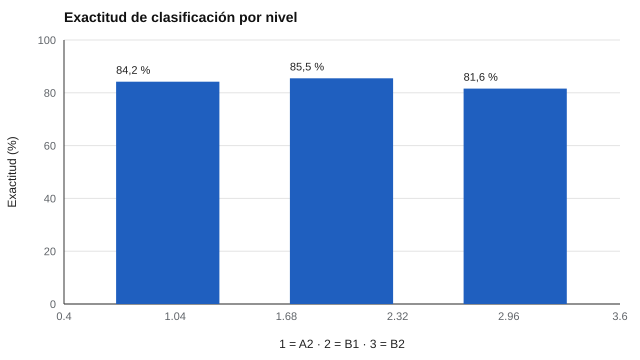

# 119 — Dominio del inglés laboral: evaluación de idioma


<!-- NAV -->
[← 118 — Ajuste persona-puesto: qué se puede y qué no…](../118-ajuste-persona-puesto-que-se-puede-y/README.md) · [📚 Parte 11](../README.md) · [🗺️ Índice 001–200](../../../PROGRAMA.md) · [120 — Impacto adverso y defensa legal de una decisi… →](../120-impacto-adverso-y-defensa-legal-de-una/README.md)
<!-- /NAV -->

**Parte 11 — Psicometría laboral y empleabilidad** · Nivel intermedio · 4 h · Estado `escrita`
**Pensada para:** quien evalúa idioma para un cargo, y quien recibe un «nivel B2» como resultado.
**Prerrequisitos:** clases 075 y 056.

> Un test propio no equivale a una certificación reconocida.

## ¿Para qué te sirve esto?

«Se requiere inglés B2.» Un nivel de idioma parece un hecho, pero es una **clasificación con incertidumbre**: alguien está justo en el borde entre B1 y B2 y un pequeño error de medida decide en qué lado cae. Esta clase te enseña a ver cuántas personas quedan mal clasificadas, dónde ocurre y cómo informar el nivel de forma honesta. También te recuerda que **comprender** (leer, escuchar) no es lo mismo que **producir** (hablar, escribir).

## Al terminar esta clase podrás

- Entender los niveles de idioma como clasificaciones con incertidumbre.
- Estimar la matriz de clasificación de un test con cortes.
- Distinguir comprensión de producción.

## La idea en palabras simples

Los marcos como el *Marco Común Europeo de Referencia* (Consejo de Europa, 2001/2020) describen niveles A1–C2. Un test estima una habilidad (θ) y la traduce en un nivel mediante **cortes** fijados por un panel de expertos (clase 075; Cizek y Bunch, 2007). Cerca de cada corte, el error de medida produce **clasificaciones erróneas**, casi siempre a un nivel adyacente.

## Cómo funciona, paso a paso

**1. Simular** 40 ítems 2PL y 4 000 personas.

**2. Fijar** cortes de θ en −0,5 y 0,7 (A2 / B1 / B2).

**3. Construir** la matriz verdadero × asignado.

**Ejemplo resuelto.** Una persona con θ = 0,65 está 0,05 por debajo del corte B2; con un error típico de ~0,3, su clasificación es casi un sorteo entre B1 y B2.



*Figura 1.* Ningún nivel supera el 86 % de exactitud.

## Si construyes el instrumento

- Informa el intervalo o la banda, no solo el nivel puntual.
- Evalúa también producción (hablar, escribir), no solo comprensión.
- Define los cortes con un procedimiento documentado.
- Analiza si el puesto realmente requiere el nivel (análisis de puestos, clase 111).

## Si eres evaluado

- Un nivel B2 es una estimación, no una medida exacta; en el borde, el resultado puede cambiar si repites.
- Si tu cargo requiere hablar, pide que se evalúe expresión oral.
- Una certificación reconocida es distinta de un test interno.

## Qué muestra el laboratorio

| Verdadero \ asignado | A2 | B1 | B2 | Exactitud |
|---|---:|---:|---:|---:|
| A2 | 1 008 | 189 | 0 | 84,2 % |
| B1 | 141 | 1 543 | 121 | 85,5 % |
| B2 | 0 | 184 | 814 | 81,6 % |

Exactitud global 84,1 %; todos los errores son a un nivel adyacente (15,9 %).

**Análisis.** (1) Casi todos los errores son adyacentes y ocurren cerca de los cortes. (2) Un nivel «B2» es una clasificación con incertidumbre. (3) Para decisiones de alto impacto se informa el intervalo y se evalúa la producción. (4) Los datos son simulados.

## Errores frecuentes

- Tratar «B2» como un hecho cuando es una categoría con error.
- Evaluar solo comprensión y concluir sobre expresión.
- Usar el nivel como filtro sin analizar si el puesto lo requiere.
- Equiparar un test propio con una certificación.

## Lo mínimo que debes llevarte

1. Un nivel de idioma es una clasificación con error.
2. Los errores se concentran cerca de los cortes.
3. Comprender no es producir.
4. Se informa con bandas o intervalos.

## Ejercicios

- **Inicial.** ¿Dónde se concentran los errores de clasificación? *Solución: cerca de los puntos de corte.*
- **Intermedio.** Si el error típico baja a la mitad, ¿qué esperas de la exactitud? *Solución: sube.*
- **Avanzado.** Añade un cuarto nivel (C1) y recalcula.
- **Aplicación.** Define qué habilidades evaluar para atención telefónica en inglés.

## Glosario

- **Nivel MCER:** categoría A1–C2 del marco europeo.
- **Corte (cut score):** valor que separa niveles.
- **Exactitud de clasificación:** proporción de personas asignadas al nivel correcto.
- **Producción:** hablar y escribir (frente a comprensión).

## Laboratorio

```bash
python classes/part-11-psicometria-laboral-y-empleabilidad/119-dominio-del-ingles-laboral-evaluacion-de-idioma/lab.py
python classes/part-11-psicometria-laboral-y-empleabilidad/figuras.py
```

## Autoevaluación y criterios

1. ¿Qué habilidades evaluarías para un puesto de atención telefónica? 2. ¿Cómo informar el nivel? 3. ¿Qué evidencia de equivalencia con un marco necesitas?
Se logra la clase si evalúas la clasificación y recomiendas cómo informarla.

## Bibliografía

- Council of Europe (2001). *Common European Framework of Reference for Languages*. Cambridge University Press (con el *Companion Volume*, 2020).
- Bachman, L. F., & Palmer, A. S. (2010). *Language Assessment in Practice*. Oxford University Press.
- Cizek, G. J., & Bunch, M. B. (2007). *Standard Setting*. Sage. [DOI](https://doi.org/10.4135/9781412985918)

---

<!-- NAV -->
[← 118 — Ajuste persona-puesto: qué se puede y qué no…](../118-ajuste-persona-puesto-que-se-puede-y/README.md)  
[📚 Parte 11](../README.md) · [🗺️ Índice 001–200](../../../PROGRAMA.md)  
[120 — Impacto adverso y defensa legal de una decisi… →](../120-impacto-adverso-y-defensa-legal-de-una/README.md)
<!-- /NAV -->
