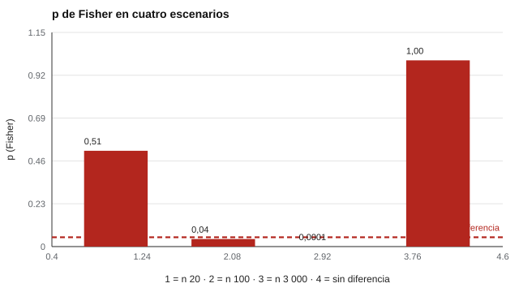

# 120 — Impacto adverso y defensa legal de una decisión de selección


<!-- NAV -->
[← 119 — Dominio del inglés laboral: evaluación de idi…](../119-dominio-del-ingles-laboral-evaluacion-de-idioma/README.md) · [📚 Parte 11](../README.md) · [🗺️ Índice 001–200](../../../PROGRAMA.md) · [121 — Teorías del liderazgo: Lewin y estilos →](../../part-12-liderazgo-equipos-y-sociometria/121-teorias-del-liderazgo-lewin-y-estilos/README.md)
<!-- /NAV -->

**Parte 11 — Psicometría laboral y empleabilidad** · Nivel intermedio · 4 h · Estado `escrita`
**Pensada para:** quien monitorea la equidad de un proceso de selección, y quien podría verse afectado por él.
**Prerrequisitos:** clases 035, 068 y 112.

> Material educativo. No es asesoría jurídica; consulta a profesionales del derecho laboral.

## ¿Para qué te sirve esto?

Si un proceso de selección contrata a 45 % de un grupo y a 30 % de otro, ¿hay discriminación? Dos herramientas se usan a menudo: la **regla de los cuatro quintos** (alerta) y una **prueba de significación** (compatibilidad con el azar). Miden cosas distintas y a veces se contradicen. Esta clase te enseña a calcular ambas, a ver cómo cambian con el tamaño de muestra y a entender por qué **ninguna sola** prueba o descarta la discriminación: hace falta analizar la justificación del proceso.

## Al terminar esta clase podrás

- Calcular razón de tasas y significación (Fisher exacto).
- Distinguir alerta estadística de conclusión de discriminación.
- Organizar la documentación que respalda un proceso.

## La idea en palabras simples

La **regla de los cuatro quintos** (razón de tasas < 0,80) proviene de las *Uniform Guidelines* de EE. UU. (1978) y se usa como **alerta orientativa**; **no** es norma chilena. Para ver si la diferencia es compatible con el azar se usa el **test exacto de Fisher** (Morris y Lobsenz, 2000, discuten pruebas e intervalos). La alerta depende de la razón; la significación, además, del tamaño de la muestra.

## Cómo funciona, paso a paso

**1. Calcular** la tasa de selección de cada grupo.

**2. Obtener** la razón (tasa del grupo menor / tasa del mayor) y aplicar la alerta de 4/5.

**3. Calcular** el p de Fisher bilateral.

**4. Interpretar** ambos juntos, no por separado.

**Ejemplo resuelto.** Con n = 20 por grupo, 9 de 20 frente a 6 de 20: razón 0,67 (alerta), pero p = 0,51, plenamente compatible con el azar.



*Figura 1.* La misma razón (0,67) es compatible con el azar con 20 por grupo, pero no con 100.

## Si construyes el instrumento

- Calcula la razón y la significación, y reporta ambas con su intervalo.
- Monitorea el impacto del proceso en el tiempo.
- Documenta el análisis del puesto, la evidencia de validez, las decisiones de corte y las alternativas consideradas.
- Busca alternativas con menor impacto cuando haya alerta.

## Si eres evaluado

- Una diferencia entre grupos no prueba por sí sola discriminación, pero tampoco se descarta con un «no significativo».
- Tienes derecho a procesos con justificación documentada y a canales de reclamo.
- Consulta el marco legal local.

## Qué muestra el laboratorio

| Escenario | Tasa G1 | Tasa G2 | Razón | Alerta 4/5 | p (Fisher) |
|---|---:|---:|---:|---|---:|
| n = 20 y 20 | 0,450 | 0,300 | 0,67 | SÍ | 0,5145 |
| n = 100 y 100 | 0,450 | 0,300 | 0,67 | SÍ | 0,0405 |
| n = 3 000 y 3 000 | 0,500 | 0,450 | 0,90 | no | 0,0001 |
| n = 300 y 300 | 0,300 | 0,300 | 1,00 | no | 1,0000 |

**Análisis.** (1) La regla de 4/5 y la significación miden cosas distintas. (2) Con n = 20, la razón 0,67 no se distingue del azar; con n = 3 000, una razón de 0,90 sí es significativa. (3) Ninguna prueba dice por sí sola si hay discriminación. (4) Se requiere analizar la validez del proceso, alternativas con menor impacto y el marco legal local.

## Errores frecuentes

- Declarar discriminación solo por una razón < 0,80, o descartarla solo por p > 0,05.
- Ignorar que con muestras grandes diferencias pequeñas son «significativas».
- No monitorear el impacto en el tiempo.
- Tratar la regla de 4/5 como norma chilena.

## Lo mínimo que debes llevarte

1. La alerta de 4/5 y la significación miden cosas distintas.
2. El tamaño de la muestra cambia el p.
3. Ninguna sola prueba concluye discriminación.
4. La documentación del proceso es la defensa.

## Ejercicios

- **Inicial.** ¿Qué dice la regla de los 4/5? *Solución: alerta cuando la razón de tasas es menor a 0,80.*
- **Intermedio.** Tasas 0,60 y 0,50. *Solución: razón 0,83; no hay alerta.*
- **Avanzado.** Calcula el p de Fisher para 12/40 frente a 6/40 en `lab.py`.
- **Aplicación.** Enumera la documentación que conservarías para defender un proceso.

## Glosario

- **Impacto adverso:** diferencia de resultados entre grupos que perjudica a uno.
- **Razón de tasas:** tasa del grupo menor dividida por la del mayor.
- **Test exacto de Fisher:** prueba para tablas 2×2 sin supuestos de muestra grande.
- **Alerta:** señal para investigar, no una conclusión.

## Laboratorio

```bash
python classes/part-11-psicometria-laboral-y-empleabilidad/120-impacto-adverso-y-defensa-legal-de-una/lab.py
python classes/part-11-psicometria-laboral-y-empleabilidad/figuras.py
```

## Autoevaluación y criterios

1. ¿Qué diferencia hay entre impacto adverso y discriminación? 2. ¿Qué documentación conservarías? 3. ¿A quién consultarías?
Se logra la clase si calculas e interpretas los indicadores sin sobreafirmar.

## Bibliografía

- Uniform Guidelines on Employee Selection Procedures (1978), 29 CFR Part 1607 (EE. UU.).
- Morris, S. B., & Lobsenz, R. E. (2000). Significance tests and confidence intervals for the adverse impact ratio. *Personnel Psychology*, 53(1), 89-111. [DOI](https://doi.org/10.1111/j.1744-6570.2000.tb00195.x)
- SIOP (2018). *Principles for the Validation and Use of Personnel Selection Procedures* (5.ª ed.). Oxford University Press.

---

<!-- NAV -->
[← 119 — Dominio del inglés laboral: evaluación de idi…](../119-dominio-del-ingles-laboral-evaluacion-de-idioma/README.md)  
[📚 Parte 11](../README.md) · [🗺️ Índice 001–200](../../../PROGRAMA.md)  
[121 — Teorías del liderazgo: Lewin y estilos →](../../part-12-liderazgo-equipos-y-sociometria/121-teorias-del-liderazgo-lewin-y-estilos/README.md)
<!-- /NAV -->
