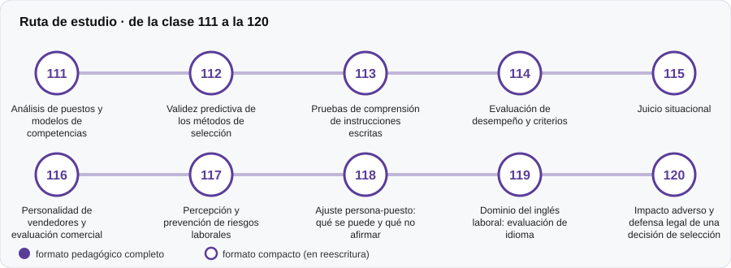

# 💼 Parte 11 — Psicometría laboral y empleabilidad

**Nivel:** intermedio · **Duración estimada:** 3-4 semanas · **Clases:** 10

## De qué trata

Evaluación en contextos de trabajo: análisis de puestos, predicción del desempeño, pruebas de instrucciones, juicio situacional y ajuste persona-puesto.

## Por qué importa

Las decisiones de selección afectan oportunidades de vida; deben ser defendibles y no discriminar.

## Según tu papel

- **Si construyes o aplicas instrumentos:** Cómo se justifica un instrumento para un puesto y cómo se mide el impacto adverso.
- **Si eres evaluado o recibes resultados:** Qué puede y qué no puede decir una evaluación sobre tus posibilidades en un cargo.

## Al terminar esta parte podrás

- Justificar una batería a partir de un análisis de puesto.
- Reconocer los límites de los instrumentos de selección.

## Cómo estudiarla

Después de las partes 02, 03 y 06. Los 15 instrumentos laborales del catálogo se tratan como fichas, sin inventar su contenido.

## Ruta de estudio

## Clases en orden de estudio

Las clases están numeradas de forma consecutiva (001 a 200) en el orden de estudio: sigue el número.

| Orden | ID | Clase | Qué aprenderás | Formato | Horas |
|---:|---|---|---|---|---:|
| 1 | 111 | [Análisis de puestos y modelos de competencias](111-analisis-de-puestos-y-modelos-de-competencias/README.md) | Describir el análisis de puestos como base de cualquier evaluación laboral. | ✅ pedagógico | 4 |
| 2 | 112 | [Validez predictiva de los métodos de selección](112-validez-predictiva-de-los-metodos-de-seleccion/README.md) | Calcular la validez de un compuesto de dos predictores. | ✅ pedagógico | 4 |
| 3 | 113 | [Pruebas de comprensión de instrucciones escritas](113-pruebas-de-comprension-de-instrucciones-escritas/README.md) | Diseñar ítems originales de seguimiento de instrucciones con clave calculada. | ✅ pedagógico | 4 |
| 4 | 114 | [Evaluación de desempeño y criterios](114-evaluacion-de-desempeno-y-criterios/README.md) | Reconocer los errores del evaluador: halo, indulgencia, efecto del evaluador. | ✅ pedagógico | 4 |
| 5 | 115 | [Juicio situacional](115-juicio-situacional/README.md) | Describir las pruebas de juicio situacional y sus formatos. | ✅ pedagógico | 4 |
| 6 | 116 | [Personalidad de vendedores y evaluación comercial](116-personalidad-de-vendedores-y-evaluacion-comercial/README.md) | Reconocer relaciones no lineales entre rasgos y desempeño. | ✅ pedagógico | 4 |
| 7 | 117 | [Percepción y prevención de riesgos laborales](117-percepcion-y-prevencion-de-riesgos-laborales/README.md) | Medir la detección de peligros con teoría de detección de señales. | ✅ pedagógico | 4 |
| 8 | 118 | [Ajuste persona-puesto: qué se puede y qué no afirmar](118-ajuste-persona-puesto-que-se-puede-y/README.md) | Calcular distintos índices de ajuste y compararlos. | ✅ pedagógico | 4 |
| 9 | 119 | [Dominio del inglés laboral: evaluación de idioma](119-dominio-del-ingles-laboral-evaluacion-de-idioma/README.md) | Entender los niveles de idioma como clasificaciones con incertidumbre. | ✅ pedagógico | 4 |
| 10 | 120 | [Impacto adverso y defensa legal de una decisión de selección](120-impacto-adverso-y-defensa-legal-de-una/README.md) | Calcular razón de tasas y significación (Fisher exacto). | ✅ pedagógico | 4 |

[← Volver al índice del programa](../../README.md) · [Índice numérico de las 200 clases](../../PROGRAMA.md)
