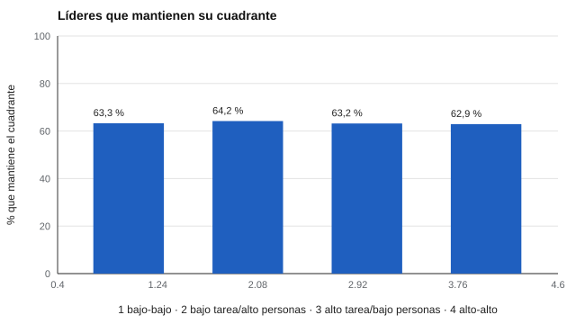

# 121 — Teorías del liderazgo: Lewin y estilos


<!-- NAV -->
[← 120 — Impacto adverso y defensa legal de una decisi…](../../part-11-psicometria-laboral-y-empleabilidad/120-impacto-adverso-y-defensa-legal-de-una/README.md) · [📚 Parte 12](../README.md) · [🗺️ Índice 001–200](../../../PROGRAMA.md) · [122 — Evaluación de la efectividad del liderazgo →](../122-evaluacion-de-la-efectividad-del-liderazgo/README.md)
<!-- /NAV -->

**Parte 12 — Liderazgo, equipos y sociometría** · Nivel intermedio · 4 h · Estado `escrita`
**Pensada para:** quien evalúa o desarrolla líderes, y quien recibe una etiqueta de «estilo de liderazgo».
**Prerrequisitos:** clases 024 y 103.

> Los parámetros del laboratorio son supuestos.

## ¿Para qué te sirve esto?

«Tu estilo es autoritario.» «Eres un líder democrático.» Los estilos de liderazgo son una forma muy popular de describir jefaturas. Esta clase te enseña de dónde vienen (Lewin y los estudios de Ohio State), y te muestra con números un problema práctico: aun con dimensiones **bastante fiables** (0,80), cerca de **un tercio de los líderes cambia de cuadrante** entre dos mediciones. Un estilo es una descripción de tendencias, no una categoría fija de la persona.

## Al terminar esta clase podrás

- Distinguir la tipología de Lewin de los modelos de dos dimensiones.
- Estimar la estabilidad de una clasificación por cuadrantes.
- Reconocer la dependencia situacional de la efectividad.

## La idea en palabras simples

Lewin, Lippitt y White (1939) compararon en grupos de niños tres climas: *autocrático, democrático y laissez-faire*. Es un marco **conceptual**, no un instrumento. Los estudios de Ohio State (Stogdill, 1948) identificaron dos dimensiones: **consideración** (orientación a las personas) y **estructura** (orientación a la tarea). Cruzando ambas se obtienen **cuatro cuadrantes**. Pero clasificar con una mediana convierte una diferencia pequeña en un cambio de categoría. Judge et al. (2004) revisan la validez de ambas dimensiones.

## Cómo funciona, paso a paso

**1. Simular** dos dimensiones (cada una con fiabilidad 0,80) en 20 000 líderes.

**2. Clasificar** por mediana en cuatro cuadrantes, en dos mediciones paralelas.

**3. Contar** cuántos cambian de cuadrante.

**Ejemplo resuelto.** Si conservar cada dimensión respecto de la mediana ocurre con probabilidad ≈ 0,80, conservar ambas es ≈ 0,64, lo que coincide con lo observado.



*Figura 1.* Solo unos 63 de cada 100 líderes mantienen su cuadrante.

## Si construyes el instrumento

- Presenta las dimensiones como continuas, con su error; evita cuadrantes cerrados.
- Informa la estabilidad esperada de la clasificación.
- Combina fuentes (equipo, pares, resultados), no solo la autoevaluación.
- Define el criterio de efectividad antes de recomendar un estilo.

## Si eres evaluado

- Un «estilo» describe una tendencia en un momento; puede cambiar al repetir la medición.
- Pregunta en qué situación y con qué criterio ese estilo sería efectivo.
- Úsalo como punto de partida para conversar, no como definición.

## Qué muestra el laboratorio

| Medida | Valor |
|---|---:|
| Test-retest observado de cada dimensión | 0,81 |
| Líderes que cambian de cuadrante entre dos mediciones | 36,6 % (con cambio totalmente aleatorio sería 75 %) |
| Mantienen el cuadrante (los cuatro) | 63–64 % |

**Análisis.** (1) Dos dimensiones con buena fiabilidad aun así clasifican distinto a cerca de un tercio de los líderes. (2) Un estilo es una descripción útil de tendencias, no una categoría estable. (3) La efectividad del estilo depende de la situación y del criterio (clase 122). (4) Los parámetros son supuestos.

## Errores frecuentes

- Etiquetar a un líder por un cuadrante («autoritario», «democrático»).
- Deducir que un estilo es «el mejor».
- Usar autoevaluaciones como única fuente (clase 129).
- Ignorar el error de medida de cada dimensión.

## Lo mínimo que debes llevarte

1. Lewin es un marco conceptual; Ohio State propone dos dimensiones.
2. Clasificar por cuadrantes pierde información.
3. Alrededor de un tercio cambia de cuadrante aun con buena fiabilidad.
4. La efectividad depende de la situación.

## Ejercicios

- **Inicial.** ¿Qué dimensiones propone el enfoque de Ohio State? *Solución: consideración y estructura.*
- **Intermedio.** Si cada dimensión se conserva con probabilidad 0,90, ¿cuánto se conserva el cuadrante? *Solución: 0,81.*
- **Avanzado.** Cambia RHO a 0,90 en `lab.py` y reporta el cambio.
- **Aplicación.** Reescribe una etiqueta de «estilo» como una descripción conductual con ejemplos.

## Glosario

- **Consideración:** orientación del líder hacia las personas.
- **Estructura:** orientación del líder hacia la tarea.
- **Cuadrante:** categoría al cruzar dos dimensiones dicotomizadas.
- **Test-retest:** correlación entre dos mediciones.

## Laboratorio

```bash
python classes/part-12-liderazgo-equipos-y-sociometria/121-teorias-del-liderazgo-lewin-y-estilos/lab.py
python classes/part-12-liderazgo-equipos-y-sociometria/figuras.py
```

## Autoevaluación y criterios

1. ¿Qué criterio de efectividad usarías? 2. ¿Por qué evitar tipologías cerradas? 3. ¿Qué información adicional pedirías?
Se logra la clase si cuantificas la estabilidad de una clasificación y la interpretas con cautela.

## Bibliografía

- Lewin, K., Lippitt, R., & White, R. K. (1939). Patterns of aggressive behavior in experimentally created "social climates". *Journal of Social Psychology*, 10(2), 271-299. ✅ [DOI](https://doi.org/10.1080/00224545.1939.9713366)
- Stogdill, R. M. (1948). Personal factors associated with leadership: A survey of the literature. *Journal of Psychology*, 25, 35-71. ✅ [DOI](https://doi.org/10.1080/00223980.1948.9917362)
- Judge, T. A., Piccolo, R. F., & Ilies, R. (2004). The forgotten ones? The validity of consideration and initiating structure in leadership research. *Journal of Applied Psychology*, 89(1), 36-51. ✅ [DOI](https://doi.org/10.1037/0021-9010.89.1.36)

Leyenda: ✅ existe en Crossref con título y año coincidentes (enlace al DOI); ⚠️ hay una obra de título parecido con otro año (no se enlaza: comprobar la edición); 🔎 no verificada automáticamente (libros sin DOI, normas y sitios web). Crossref confirma la existencia de la fuente, no que respalde cada afirmación de la clase. Ver [`docs/VERIFICACION_BIBLIOGRAFIA.md`](../../../docs/VERIFICACION_BIBLIOGRAFIA.md).

---

<!-- NAV -->
[← 120 — Impacto adverso y defensa legal de una decisi…](../../part-11-psicometria-laboral-y-empleabilidad/120-impacto-adverso-y-defensa-legal-de-una/README.md)  
[📚 Parte 12](../README.md) · [🗺️ Índice 001–200](../../../PROGRAMA.md)  
[122 — Evaluación de la efectividad del liderazgo →](../122-evaluacion-de-la-efectividad-del-liderazgo/README.md)
<!-- /NAV -->
