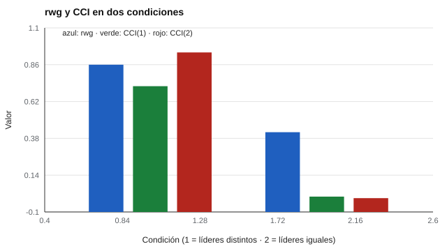

# 122 — Evaluación de la efectividad del liderazgo


<!-- NAV -->
[← 121 — Teorías del liderazgo: Lewin y estilos](../121-teorias-del-liderazgo-lewin-y-estilos/README.md) · [📚 Parte 12](../README.md) · [🗺️ Índice 001–200](../../../PROGRAMA.md) · [123 — Roles en equipos: modelo Belbin y su evidencia →](../123-roles-en-equipos-modelo-belbin-y-su/README.md)
<!-- /NAV -->

**Parte 12 — Liderazgo, equipos y sociometría** · Nivel intermedio · 4 h · Estado `escrita`
**Pensada para:** quien diseña evaluaciones 360° o de clima con opiniones del equipo, y quien es evaluado por su equipo.
**Prerrequisitos:** clases 029, 109 y 121.

## ¿Para qué te sirve esto?

Para saber si un líder es efectivo se suele preguntar a su equipo y se promedian las respuestas. Pero ese promedio solo significa algo si (a) los integrantes **coinciden** entre sí y (b) los equipos **se diferencian** unos de otros. Si cada integrante valora distinto y todos los líderes reciben lo mismo en promedio, el promedio no describe al líder: describe a quien evalúa. Esta clase te enseña los indicadores (rwg y CCI) para decidir cuándo se justifica agregar.

## Al terminar esta clase podrás

- Calcular acuerdo dentro del equipo (rwg) y CCI(1) y CCI(2).
- Decidir si se justifica agregar valoraciones al nivel del equipo.
- Interpretar un promedio de equipo como atributo del líder o del evaluador.

## La idea en palabras simples

- **rwg = 1 − s² / σ²_nula** (James, Demaree y Wolf, 1984): mide el **acuerdo** dentro del equipo frente a una distribución nula.
- **CCI(1):** proporción de varianza que está **entre equipos**. Si es alta, los líderes se diferencian.
- **CCI(2):** fiabilidad del **promedio** del equipo.

Para agregar se piden ambos: acuerdo alto **y** diferencias entre equipos (Bliese, 2000; LeBreton y Senter, 2008).

## Cómo funciona, paso a paso

**1. Calcular** rwg en cada equipo (con una distribución nula declarada).

**2. Estimar** CCI(1) y CCI(2) entre equipos.

**3. Decidir** si el promedio de equipo es interpretable.

**Ejemplo resuelto.** Varianza observada del equipo 0,60 con σ²_nula = 2,0: rwg = 1 − 0,60 / 2,0 = 0,70.



*Figura 1.* Con líderes iguales y evaluadores discrepantes, el CCI desaparece.

## Si construyes el instrumento

- Declara la distribución nula usada para rwg.
- No agregues con acuerdo bajo ni sin diferencias entre equipos.
- Complementa con criterios de resultado (rotación, resultados del equipo).
- Informa al líder con rangos, no solo con promedios.

## Si eres evaluado

- Un promedio bajo puede describir cómo te perciben, no necesariamente cómo lideras.
- Pide ver el acuerdo entre quienes te evaluaron.
- Un grupo muy dividido es información en sí misma.

## Qué muestra el laboratorio

`lab.py` simula 60 líderes con equipos de 6.

| Condición | rwg medio | CCI(1) | CCI(2) |
|---|---:|---:|---:|
| Líderes distintos, integrantes coinciden | 0,86 | 0,72 | 0,94 |
| Líderes iguales, cada uno valora distinto | 0,42 | −0,00 | −0,01 |

**Análisis.** (1) En la primera condición se justifica agregar. (2) En la segunda, el promedio del equipo casi no tiene fiabilidad: describe al evaluador, no al líder. (3) Un CCI ≈ 0 o ligeramente negativo indica varianza entre grupos ≈ 0. (4) Las convenciones (rwg > 0,70; CCI(2) > 0,70) son guías.

## Errores frecuentes

- Agregar con acuerdo bajo.
- Elegir una distribución nula sin justificarla.
- Interpretar un CCI negativo como un error de cálculo.
- Tomar las convenciones como umbrales mecánicos.

## Lo mínimo que debes llevarte

1. Agregar exige acuerdo y diferencias entre equipos.
2. rwg mide acuerdo; CCI mide diferencias entre grupos.
3. Un promedio sin fiabilidad describe al evaluador.
4. Complementa con criterios objetivos.

## Ejercicios

- **Inicial.** ¿Qué mide rwg? *Solución: el acuerdo dentro del equipo respecto de una distribución nula.*
- **Intermedio.** s² = 1,0 y σ²_nula = 2,0. *Solución: rwg = 0,50.*
- **Avanzado.** Aumenta el tamaño del equipo a 12 en `lab.py` y observa el CCI(2).
- **Aplicación.** Diseña el informe que recibiría un líder cuando el acuerdo del equipo es bajo.

## Glosario

- **rwg:** índice de acuerdo dentro del grupo.
- **CCI(1):** varianza entre grupos como proporción de la total.
- **CCI(2):** fiabilidad del promedio del grupo.
- **Agregar:** resumir las respuestas de un grupo en un valor.

## Laboratorio

```bash
python classes/part-12-liderazgo-equipos-y-sociometria/122-evaluacion-de-la-efectividad-del-liderazgo/lab.py
python classes/part-12-liderazgo-equipos-y-sociometria/figuras.py
```

## Autoevaluación y criterios

1. ¿Qué haces si el acuerdo es bajo? 2. ¿Qué otros criterios de efectividad (resultados, rotación) complementan? 3. ¿Cómo informarías a un líder?
Se logra la clase si decides agregar o no con los indicadores adecuados.

## Bibliografía

- James, L. R., Demaree, R. G., & Wolf, G. (1984). Estimating within-group interrater reliability with and without response bias. *Journal of Applied Psychology*, 69(1), 85-98. ✅ [DOI](https://doi.org/10.1037/0021-9010.69.1.85)
- Bliese, P. D. (2000). Within-group agreement, non-independence, and reliability. En K. J. Klein & S. W. J. Kozlowski (Eds.), *Multilevel Theory, Research, and Methods in Organizations*. Jossey-Bass. 🔎 sin verificar (libro, norma o sitio no hallado en Crossref: comprobar a mano)
- LeBreton, J. M., & Senter, J. L. (2008). Answers to 20 questions about interrater reliability and interrater agreement. *Organizational Research Methods*, 11(4), 815-852. ✅ [DOI](https://doi.org/10.1177/1094428106296642)

Leyenda: ✅ existe en Crossref con título y año coincidentes (enlace al DOI); ⚠️ hay una obra de título parecido con otro año (no se enlaza: comprobar la edición); 🔎 no verificada automáticamente (libros sin DOI, normas y sitios web). Crossref confirma la existencia de la fuente, no que respalde cada afirmación de la clase. Ver [`docs/VERIFICACION_BIBLIOGRAFIA.md`](../../../docs/VERIFICACION_BIBLIOGRAFIA.md).

---

<!-- NAV -->
[← 121 — Teorías del liderazgo: Lewin y estilos](../121-teorias-del-liderazgo-lewin-y-estilos/README.md)  
[📚 Parte 12](../README.md) · [🗺️ Índice 001–200](../../../PROGRAMA.md)  
[123 — Roles en equipos: modelo Belbin y su evidencia →](../123-roles-en-equipos-modelo-belbin-y-su/README.md)
<!-- /NAV -->
