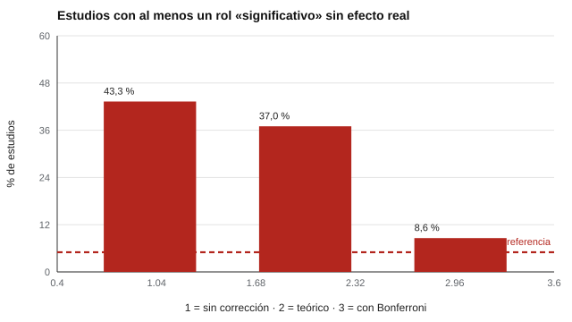

# 123 — Roles en equipos: modelo Belbin y su evidencia


<!-- NAV -->
[← 122 — Evaluación de la efectividad del liderazgo](../122-evaluacion-de-la-efectividad-del-liderazgo/README.md) · [📚 Parte 12](../README.md) · [🗺️ Índice 001–200](../../../PROGRAMA.md) · [124 — Comportamiento en equipos de trabajo →](../124-comportamiento-en-equipos-de-trabajo/README.md)
<!-- /NAV -->

**Parte 12 — Liderazgo, equipos y sociometría** · Nivel intermedio · 4 h · Estado `escrita`
**Pensada para:** quien considera usar un inventario de roles de equipo, y quien recibe su «rol Belbin».
**Prerrequisitos:** clases 040 y 068.

> El inventario de Belbin es propietario y no está incluido en este repositorio. Aquí se estudia su **estado de evidencia** y un problema estadístico general.

## ¿Para qué te sirve esto?

«Mi rol es Cerebro; el tuyo, Implementador.» El modelo de roles de equipo de Belbin se usa mucho en talleres de equipos. Esta clase no lo evalúa directamente, sino que muestra un riesgo general al buscar efectos entre muchos roles: **si pruebas 9 roles, cuatro de cada diez estudios «encuentran» un rol decisivo aunque no exista ningún efecto real**. Aprenderás qué es el problema de las comparaciones múltiples y cómo se corrige.

## Al terminar esta clase podrás

- Describir el modelo de roles de equipo y su estado de evidencia.
- Calcular la tasa de falsos positivos por comparaciones múltiples.
- Aplicar la corrección de Bonferroni.

## La idea en palabras simples

Belbin (1981) propuso nueve roles de equipo. Las revisiones psicométricas del inventario de autopercepción cuestionan su estructura y fiabilidad (Furnham, Steele y Pendleton, 1993), aunque hay trabajos que buscan sustento (Aritzeta, Swailes y Senior, 2007).

Si pruebas 9 roles al 5 % de significación sin ningún efecto real, la probabilidad de al menos un «hallazgo» es 1 − 0,95⁹ ≈ **37 %** (Simmons, Nelson y Simonsohn, 2011). **Bonferroni** divide el umbral por el número de pruebas (0,05/9).

## Cómo funciona, paso a paso

**1. Simular** 2 000 estudios de 40 equipos, sin ningún efecto real.

**2. Contar** cuántos estudios tienen al menos un rol con p < 0,05.

**3. Repetir** con el umbral corregido de Bonferroni (p < 0,05/9).

**Ejemplo resuelto.** Con 9 comparaciones independientes al 5 %, P(al menos una significativa) = 1 − 0,95⁹ = 0,37.



*Figura 1.* Sin corrección, casi cuatro de cada diez estudios encuentran un efecto inexistente.

## Si construyes el instrumento

- Preinscribe las hipótesis antes de analizar.
- Corrige por comparaciones múltiples (Bonferroni, Holm, tasa de descubrimientos falsos).
- Replica los hallazgos en otra muestra.
- No uses un modelo de roles para decidir sobre personas.

## Si eres evaluado

- Un «rol» describe cómo te ves en un momento, no lo que eres.
- Que un equipo sea «equilibrado» en roles no garantiza mejor rendimiento.
- Desconfía de resultados presentados como definitivos con un solo estudio.

## Qué muestra el laboratorio

| Medida | Valor |
|---|---:|
| Estudios con ≥ 1 rol «significativo» (p < 0,05) | 43,3 % (teórico 37,0 %) |
| Con corrección de Bonferroni (p < 0,05/9) | 8,6 % |

**Análisis.** (1) Sin efecto real, cuatro de cada diez estudios encuentran un rol «decisivo». (2) El exceso sobre el 37 % viene de la aproximación normal con muestras pequeñas; con Bonferroni la tasa baja pero no llega a 5 % por la misma razón. (3) «Equipos equilibrados» es una idea plausible, no una consecuencia demostrada. (4) Es una simulación estadística, no una evaluación empírica del modelo.

## Errores frecuentes

- Decidir sobre personas por su «rol Belbin».
- Concluir que un equipo «equilibrado» rinde más a partir de un solo estudio.
- Creer que Bonferroni resuelve todo (es conservador).
- Confundir esta simulación con una evaluación del modelo.

## Lo mínimo que debes llevarte

1. Probar muchas hipótesis produce hallazgos por azar.
2. 1 − 0,95⁹ ≈ 37 %.
3. La corrección y la replicación son necesarias.
4. El modelo de roles no debe usarse para decidir sobre personas.

## Ejercicios

- **Inicial.** ¿Por qué aparecen hallazgos por azar? *Solución: porque con muchas pruebas aumenta la probabilidad de al menos un falso positivo.*
- **Intermedio.** Con 20 comparaciones. *Solución: 1 − 0,95²⁰ = 0,64.*
- **Avanzado.** Aumenta a 200 equipos en `lab.py` y observa la tasa sin corrección.
- **Aplicación.** Escribe la preinscripción de un estudio sobre roles de equipo con dos hipótesis.

## Glosario

- **Comparaciones múltiples:** muchas pruebas sobre los mismos datos.
- **Bonferroni:** corrección que divide α por el número de pruebas.
- **Falso positivo:** efecto «encontrado» que no existe.
- **Preinscripción:** registro de hipótesis antes de ver los datos.

## Laboratorio

```bash
python classes/part-12-liderazgo-equipos-y-sociometria/123-roles-en-equipos-modelo-belbin-y-su/lab.py
python classes/part-12-liderazgo-equipos-y-sociometria/figuras.py
```

## Autoevaluación y criterios

1. ¿Qué es preinscribir hipótesis? 2. ¿Cómo evaluarías el modelo de roles con rigor? 3. ¿Qué alternativa abierta usarías para enseñar roles?
Se logra la clase si cuantificas y corriges los falsos positivos y desaconsejas el uso en decisiones.

## Bibliografía

- Belbin, R. M. (1981). *Management Teams: Why They Succeed or Fail*. Heinemann.
- Furnham, A., Steele, H., & Pendleton, D. (1993). A psychometric assessment of the Belbin Team-Role Self-Perception Inventory. *Journal of Occupational and Organizational Psychology*, 66(3), 245-257. [DOI](https://doi.org/10.1111/j.2044-8325.1993.tb00535.x)
- Aritzeta, A., Swailes, S., & Senior, B. (2007). Belbin's team role model: Development, validity and applications for team building. *Journal of Management Studies*, 44(1), 96-118. [DOI](https://doi.org/10.1111/j.1467-6486.2007.00666.x)
- Simmons, J. P., Nelson, L. D., & Simonsohn, U. (2011). False-positive psychology. *Psychological Science*, 22(11), 1359-1366. [DOI](https://doi.org/10.1177/0956797611417632)

---

<!-- NAV -->
[← 122 — Evaluación de la efectividad del liderazgo](../122-evaluacion-de-la-efectividad-del-liderazgo/README.md)  
[📚 Parte 12](../README.md) · [🗺️ Índice 001–200](../../../PROGRAMA.md)  
[124 — Comportamiento en equipos de trabajo →](../124-comportamiento-en-equipos-de-trabajo/README.md)
<!-- /NAV -->
