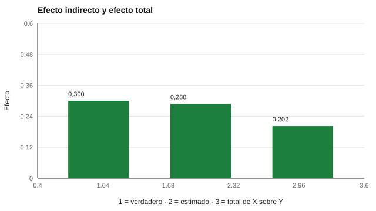

# 124 — Comportamiento en equipos de trabajo


<!-- NAV -->
[← 123 — Roles en equipos: modelo Belbin y su evidencia](../123-roles-en-equipos-modelo-belbin-y-su/README.md) · [📚 Parte 12](../README.md) · [🗺️ Índice 001–200](../../../PROGRAMA.md) · [125 — Sociometría: elecciones y rechazos →](../125-sociometria-elecciones-y-rechazos/README.md)
<!-- /NAV -->

**Parte 12 — Liderazgo, equipos y sociometría** · Nivel intermedio · 4 h · Estado `escrita`
**Pensada para:** quien investiga o evalúa procesos de equipo, y quien participa de equipos que se miden.
**Prerrequisitos:** clases 122 y 123.

> Datos sintéticos.

## ¿Para qué te sirve esto?

«Los equipos con buena comunicación rinden más.» ¿Es la comunicación lo que hace rendir al equipo? Para responder, los modelos de equipos separan **insumos** (quiénes son, qué tarea tienen), **procesos** (cómo se coordinan y comunican) y **resultados** (desempeño, satisfacción). Un **efecto indirecto** dice cuánto del efecto de un insumo pasa por un proceso. Esta clase te enseña a estimarlo con *bootstrap*, a ver que con 80 equipos el intervalo es amplio y a no confundir efecto estadístico con efecto causal.

## Al terminar esta clase podrás

- Describir el modelo insumo–proceso–resultado de equipos.
- Estimar un efecto indirecto con bootstrap.
- Distinguir efecto estadístico de efecto causal.

## La idea en palabras simples

Los modelos de equipos evolucionaron de insumo–proceso–resultado a modelos más dinámicos (Ilgen et al., 2005; Mathieu et al., 2008). Si X (insumo) influye en M (proceso) con efecto *a*, y M en Y (resultado) con efecto *b*, el **efecto indirecto** es **a·b**. El *bootstrap* (Preacher y Hayes, 2008) remuestrea los equipos para obtener un intervalo de confianza del producto a·b.

## Cómo funciona, paso a paso

**1. Simular** 80 equipos con X → M (a = 0,6) y M → Y (b = 0,5), sin efecto directo.

**2. Estimar** a y b, y el producto a·b.

**3. Remuestrear** equipos para obtener el intervalo bootstrap del 95 %.

**Ejemplo resuelto.** a = 0,6 y b = 0,5: a·b = 0,30. Con mediación total, el efecto total teórico es 0,30; el estimado (0,20) difiere por error muestral con solo 80 equipos.



*Figura 1.* El intervalo es amplio: con 80 equipos la estimación es imprecisa.

## Si construyes el instrumento

- Calcula el tamaño de muestra al nivel del equipo, no de personas.
- Mide procesos con instrumentos específicos y evidencias de acuerdo (clase 122).
- Usa modelos multinivel si hay dependencia dentro de equipos.
- Si quieres hablar de causalidad, necesitas un diseño que la sustente.

## Si eres evaluado

- Los procesos del equipo son del equipo, no solo tuyos.
- Una mediación estadística no prueba que cambiar un proceso cambie el resultado.

## Qué muestra el laboratorio

| Medida | Valor |
|---|---:|
| Efecto indirecto verdadero | 0,300 |
| Estimado | 0,288 |
| Intervalo bootstrap 95 % | [0,122; 0,491] (excluye el 0) |
| Efecto total de X sobre Y | 0,202 |

**Análisis.** (1) El intervalo es amplio con 80 equipos. (2) El análisis de equipos exige tamaños de muestra al nivel del equipo. (3) «Mediación» es una hipótesis causal: con datos transversales, otros modelos ajustan igual de bien. (4) Con datos reales, total = directo + indirecto.

## Errores frecuentes

- Analizar individuos como si fueran equipos.
- Interpretar una mediación transversal como causal.
- Omitir la dependencia dentro de equipos.
- Informar solo el estimado sin su intervalo.

## Lo mínimo que debes llevarte

1. Los modelos de equipos separan insumos, procesos y resultados.
2. El efecto indirecto es a·b.
3. El bootstrap da un intervalo.
4. La muestra efectiva es el número de equipos.

## Ejercicios

- **Inicial.** ¿Qué es un proceso de equipo? *Solución: una forma en que el equipo coordina, se comunica o resuelve conflictos.*
- **Intermedio.** Si a = 0,4 y b = 0,3. *Solución: indirecto 0,12.*
- **Avanzado.** Añade un efecto directo de 0,2 en `lab.py` y compara el indirecto y el total.
- **Aplicación.** Diseña un estudio de equipos con un proceso medible y un resultado.

## Glosario

- **Insumo / proceso / resultado:** etapas del modelo de equipos.
- **Efecto indirecto:** efecto que pasa por una variable mediadora.
- **Bootstrap:** remuestreo para estimar la incertidumbre.
- **Multinivel:** modelo que considera datos anidados (personas en equipos).

## Laboratorio

```bash
python classes/part-12-liderazgo-equipos-y-sociometria/124-comportamiento-en-equipos-de-trabajo/lab.py
python classes/part-12-liderazgo-equipos-y-sociometria/figuras.py
```

## Autoevaluación y criterios

1. ¿Qué diseño sustenta la causalidad? 2. ¿Qué tamaño de muestra de equipos necesitas? 3. ¿Cómo medirías los procesos?
Se logra la clase si estimas e interpretas un efecto indirecto con cautela.

## Bibliografía

- Ilgen, D. R., Hollenbeck, J. R., Johnson, M., & Jundt, D. (2005). Teams in organizations: From input-process-output models to IMOI models. *Annual Review of Psychology*, 56, 517-543. ✅ [DOI](https://doi.org/10.1146/annurev.psych.56.091103.070250)
- Preacher, K. J., & Hayes, A. F. (2008). Asymptotic and resampling strategies for assessing and comparing indirect effects in multiple mediator models. *Behavior Research Methods*, 40(3), 879-891. ✅ [DOI](https://doi.org/10.3758/brm.40.3.879)
- Mathieu, J., Maynard, M. T., Rapp, T., & Gilson, L. (2008). Team effectiveness 1997–2007: A review of recent advancements and a glimpse into the future. *Journal of Management*, 34(3), 410-476. ✅ [DOI](https://doi.org/10.1177/0149206308316061)

Leyenda: ✅ existe en Crossref con título y año coincidentes (enlace al DOI); ⚠️ hay una obra de título parecido con otro año (no se enlaza: comprobar la edición); 🔎 no verificada automáticamente (libros sin DOI, normas y sitios web). Crossref confirma la existencia de la fuente, no que respalde cada afirmación de la clase. Ver [`docs/VERIFICACION_BIBLIOGRAFIA.md`](../../../docs/VERIFICACION_BIBLIOGRAFIA.md).

---

<!-- NAV -->
[← 123 — Roles en equipos: modelo Belbin y su evidencia](../123-roles-en-equipos-modelo-belbin-y-su/README.md)  
[📚 Parte 12](../README.md) · [🗺️ Índice 001–200](../../../PROGRAMA.md)  
[125 — Sociometría: elecciones y rechazos →](../125-sociometria-elecciones-y-rechazos/README.md)
<!-- /NAV -->
