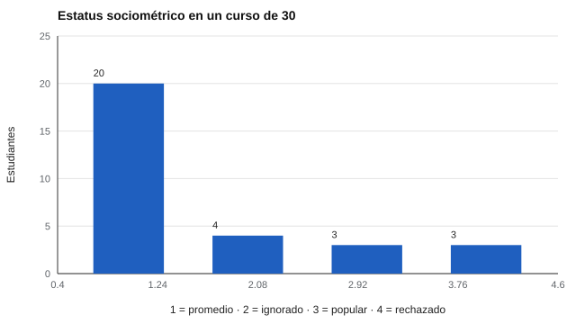

# 125 — Sociometría: elecciones y rechazos


<!-- NAV -->
[← 124 — Comportamiento en equipos de trabajo](../124-comportamiento-en-equipos-de-trabajo/README.md) · [📚 Parte 12](../README.md) · [🗺️ Índice 001–200](../../../PROGRAMA.md) · [126 — Análisis de redes sociométricas →](../126-analisis-de-redes-sociometricas/README.md)
<!-- /NAV -->

**Parte 12 — Liderazgo, equipos y sociometría** · Nivel intermedio · 4 h · Estado `escrita`
**Pensada para:** docentes y orientadores que usan sociometría, y personas que participan en ella.
**Prerrequisitos:** clases 061 y 066.

> Cuando participan menores de edad, la sociometría exige un protocolo ético y de apoyo posterior. No etiquetes a nadie.

## ¿Para qué te sirve esto?

«Escribe los nombres de tres compañeros con quienes te gustaría trabajar.» La sociometría pregunta a un grupo a quién elegiría (y a veces a quién rechazaría) en una actividad. Sirve para ver la **dinámica del grupo**: quién concentra elecciones, quién no es elegido, quién concentra rechazo. Es sencilla de calcular, pero delicada de usar. Esta clase te enseña a calcular **preferencia e impacto social** y a clasificar el estatus, siempre como algo **relativo al grupo y cambiante**.

## Al terminar esta clase podrás

- Calcular preferencia social e impacto social.
- Clasificar el estatus sociométrico con la convención de Coie et al. (1982).
- Interpretar el estatus como relativo y cambiante.

## La idea en palabras simples

Moreno (1934) introdujo la sociometría. Se cuentan las nominaciones recibidas: **LM** («me gusta más») y **LL** («me gusta menos»). Se estandarizan dentro del grupo (zLM, zLL) y se calculan:

- **Preferencia social:** SP = zLM − zLL.
- **Impacto social:** SI = zLM + zLL.

Con la convención de Coie, Dodge y Coppotelli (1982) se clasifica a cada estudiante en **popular, rechazado, ignorado, controvertido o promedio**. Cillessen (2009) revisa métodos.

## Cómo funciona, paso a paso

**1. Recoger** nominaciones (3 positivas y 3 negativas por estudiante).

**2. Contar** LM y LL, y estandarizarlas en el grupo.

**3. Calcular** SP y SI, y clasificar el estatus.

**Ejemplo resuelto.** zLM = 1,2 y zLL = −0,5: SP = 1,7 (alto) y SI = 0,7; con LM alto y LL bajo → popular.



*Figura 1.* La mayoría del curso queda en un estatus promedio.

## Si construyes el instrumento

- Explica la actividad con claridad y evita exponer resultados.
- Define quién ve los datos y cómo se resguardan.
- Prepara el apoyo posterior ante un patrón de rechazo.
- Repite la medición: el estatus cambia con el tiempo.

## Si eres evaluado

- Tu estatus describe tu lugar en **ese** grupo en **ese** momento.
- Un estatus bajo no dice nada sobre tu valor.
- Tienes derecho a que los resultados no se publiquen ni se usen para etiquetarte.

## Qué muestra el laboratorio

`lab.py` simula un curso ficticio de 30 estudiantes con 3 elecciones positivas y 3 negativas.

| Estatus | Estudiantes |
|---|---:|
| Promedio | 20 |
| Popular | 3 |
| Rechazado | 3 |
| Ignorado | 4 |

Ejemplos: estudiante 14 (LM 19, LL 0, SP 3,05) → popular; estudiante 25 (LM 0, LL 17, SP −2,80) → rechazado.

**Análisis.** (1) El estatus es relativo al curso y cambia con el tiempo. (2) Sirve para ver dinámicas de convivencia, no para etiquetar niños. (3) Quienes no son elegidos (ignorados) también necesitan atención. (4) Los datos son ficticios.

## Errores frecuentes

- Etiquetar a un niño o niña con un estatus.
- Usar la sociometría sin protocolo de apoyo posterior.
- Olvidar que los resultados dependen del grupo y de la ola de medición.
- Reducir la convivencia a un puntaje.

## Lo mínimo que debes llevarte

1. SP = zLM − zLL; SI = zLM + zLL.
2. El estatus se clasifica con la convención de Coie.
3. Es relativo al grupo y cambia.
4. Exige protocolo ético y de apoyo.

## Ejercicios

- **Inicial.** ¿Qué diferencia hay entre preferencia e impacto social? *Solución: la preferencia resta rechazos a elecciones; el impacto los suma (cuánta atención recibe).*
- **Intermedio.** zLM = −0,4 y zLL = 1,1. *Solución: SP = −1,5; candidato a «rechazado» si LL > 0 y LM < 0.*
- **Avanzado.** Cambia el número de elecciones a 5 en `lab.py` y observa la distribución.
- **Aplicación.** Escribe el protocolo de una actividad sociométrica: explicación, resguardo y apoyo.

## Glosario

- **LM / LL:** nominaciones «me gusta más» / «me gusta menos».
- **Preferencia social (SP):** zLM − zLL.
- **Impacto social (SI):** zLM + zLL.
- **Estatus sociométrico:** categoría según elecciones y rechazos.

## Laboratorio

```bash
python classes/part-12-liderazgo-equipos-y-sociometria/125-sociometria-elecciones-y-rechazos/lab.py
python classes/part-12-liderazgo-equipos-y-sociometria/figuras.py
```

## Autoevaluación y criterios

1. ¿Cómo explicas la actividad a los estudiantes? 2. ¿Quién ve los resultados y cómo se resguardan? 3. ¿Qué haces ante un patrón de rechazo?
Se logra la clase si calculas el estatus y propones un protocolo ético de uso.

## Bibliografía

- Moreno, J. L. (1934). *Who Shall Survive?* Nervous and Mental Disease Publishing.
- Coie, J. D., Dodge, K. A., & Coppotelli, H. (1982). Dimensions and types of social status: A cross-age perspective. *Developmental Psychology*, 18(4), 557-570. [DOI](https://doi.org/10.1037/0012-1649.18.4.557)
- Cillessen, A. H. N. (2009). Sociometric methods. En K. H. Rubin, W. M. Bukowski, & B. Laursen (Eds.), *Handbook of Peer Interactions, Relationships, and Groups*. Guilford.

---

<!-- NAV -->
[← 124 — Comportamiento en equipos de trabajo](../124-comportamiento-en-equipos-de-trabajo/README.md)  
[📚 Parte 12](../README.md) · [🗺️ Índice 001–200](../../../PROGRAMA.md)  
[126 — Análisis de redes sociométricas →](../126-analisis-de-redes-sociometricas/README.md)
<!-- /NAV -->
