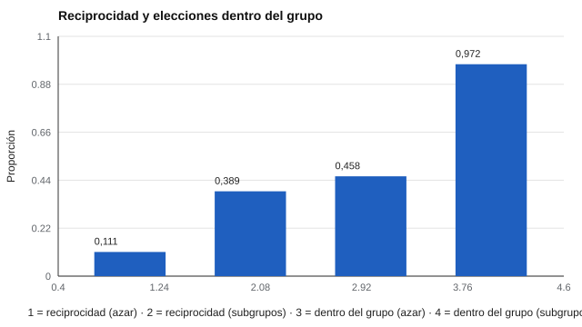

# 126 — Análisis de redes sociométricas


<!-- NAV -->
[← 125 — Sociometría: elecciones y rechazos](../125-sociometria-elecciones-y-rechazos/README.md) · [📚 Parte 12](../README.md) · [🗺️ Índice 001–200](../../../PROGRAMA.md) · [127 — Cohesión, aislamiento y liderazgo informal →](../127-cohesion-aislamiento-y-liderazgo-informal/README.md)
<!-- /NAV -->

**Parte 12 — Liderazgo, equipos y sociometría** · Nivel intermedio · 4 h · Estado `escrita`
**Pensada para:** quien analiza redes de elecciones en un grupo, y quien podría ser parte de una.
**Prerrequisitos:** clases 049 y 125.

> Las redes sintéticas no tienen la complejidad de las reales. Los gráficos de redes con menores se comparten solo anonimizados y con fin pedagógico.

## ¿Para qué te sirve esto?

Mirar la lista de quién eligió a quién no revela la estructura del grupo. Un **grafo** sí: muestra subgrupos, personas centrales y vínculos recíprocos. Pero cada métrica necesita una **referencia**: ¿0,39 de reciprocidad es mucho o poco? Esta clase te enseña a calcular densidad, reciprocidad, centralización y componentes, y a compararlas con un **modelo nulo** (un curso donde las elecciones son al azar).

## Al terminar esta clase podrás

- Calcular densidad, reciprocidad, centralización y componentes.
- Comparar contra un modelo nulo.
- Compartir resultados de redes sin vulnerar privacidad.

## La idea en palabras simples

El análisis de redes (Wasserman y Faust, 1994) describe un grupo como un **grafo dirigido**:

- **Densidad:** elecciones realizadas / elecciones posibles.
- **Reciprocidad:** fracción de elecciones que son devueltas.
- **Centralización** (Freeman, 1978): cuánto se concentran las elecciones en pocas personas.
- **Componentes:** partes del grupo conectadas entre sí.

Borgatti et al. (2009) resumen su uso en ciencias sociales.

## Cómo funciona, paso a paso

**1. Construir** la red (24 estudiantes, 3 elecciones cada uno).

**2. Calcular** las métricas en dos cursos: uno al azar y otro con subgrupos.

**3. Comparar** contra el modelo nulo.

**Ejemplo resuelto.** 24 estudiantes con 3 elecciones: 72 elecciones; densidad = 72 / (24 · 23) = 0,130 (igual en ambos cursos por diseño).



*Figura 1.* Con subgrupos, la reciprocidad se triplica y casi todas las elecciones quedan dentro del subgrupo.

## Si construyes el instrumento

- Compara siempre contra un modelo nulo.
- Define qué significa «dentro del grupo» antes de calcular.
- Anonimiza los gráficos (códigos, sin nombres ni datos reconocibles).
- Decide quién ve los resultados y con qué fin.

## Si eres evaluado

- Una red muestra tu posición, no tu valor como persona.
- Tienes derecho a que no se publiquen gráficos que te identifiquen.

## Qué muestra el laboratorio

| Métrica | Aleatorio | Con subgrupos |
|---|---:|---:|
| Densidad | 0,130 | 0,130 |
| Reciprocidad | 0,111 | 0,389 |
| Centralización (grado de entrada) | 0,190 | 0,142 |
| Componentes | 1 | 1 |
| Elecciones dentro del grupo | 0,458 | 0,972 |

**Análisis.** (1) En el curso aleatorio ~46 % de las elecciones cae dentro del grupo por azar (11 de 23 posibles). (2) Con subgrupos sube a ~97 % y la reciprocidad se triplica. (3) La estructura se detecta comparando contra un modelo nulo, no mirando la métrica aislada. (4) La densidad es igual por diseño.

## Errores frecuentes

- Interpretar la reciprocidad sin referencia al azar.
- Publicar gráficos con nombres o datos que permitan reconocer a los niños.
- Confundir popularidad (grado de entrada) con influencia.
- Concluir cohesión solo por la densidad.

## Lo mínimo que debes llevarte

1. Un grupo es un grafo dirigido.
2. Densidad, reciprocidad, centralización y componentes se calculan fácilmente.
3. Cada métrica necesita un modelo nulo.
4. Los gráficos se anonimizan.

## Ejercicios

- **Inicial.** ¿Qué es la reciprocidad? *Solución: la proporción de elecciones que son devueltas.*
- **Intermedio.** Si hay 10 elecciones devueltas de 72. *Solución: reciprocidad = 0,139.*
- **Avanzado.** Calcula la reciprocidad esperada por azar en `lab.py` mediante simulación.
- **Aplicación.** Anonimiza una red de un curso ficticio para presentarla en una reunión docente.

## Glosario

- **Grafo dirigido:** red donde cada vínculo tiene dirección.
- **Reciprocidad:** elecciones mutuas.
- **Centralización:** concentración de vínculos en pocos nodos.
- **Modelo nulo:** referencia donde los vínculos ocurren al azar.

## Laboratorio

```bash
python classes/part-12-liderazgo-equipos-y-sociometria/126-analisis-de-redes-sociometricas/lab.py
python classes/part-12-liderazgo-equipos-y-sociometria/figuras.py
```

## Autoevaluación y criterios

1. ¿Qué te indica la homofilia alta? 2. ¿Cómo anonimizas un gráfico? 3. ¿Qué librerías abiertas usarías (NetworkX u otras) y con qué licencia?
Se logra la clase si calculas métricas y las contrastas con un modelo nulo.

## Bibliografía

- Wasserman, S., & Faust, K. (1994). *Social Network Analysis: Methods and Applications*. Cambridge University Press. ✅ [DOI](https://doi.org/10.1017/cbo9780511815478)
- Freeman, L. C. (1978). Centrality in social networks: Conceptual clarification. *Social Networks*, 1(3), 215-239.90021-7) ✅ [DOI](https://doi.org/10.1016/0378-8733(78)90021-7)
- Borgatti, S. P., Mehra, A., Brass, D. J., & Labianca, G. (2009). Network analysis in the social sciences. *Science*, 323, 892-895. ✅ [DOI](https://doi.org/10.1126/science.1165821)

Leyenda: ✅ existe en Crossref con título y año coincidentes (enlace al DOI); ⚠️ hay una obra de título parecido con otro año (no se enlaza: comprobar la edición); 🔎 no verificada automáticamente (libros sin DOI, normas y sitios web). Crossref confirma la existencia de la fuente, no que respalde cada afirmación de la clase. Ver [`docs/VERIFICACION_BIBLIOGRAFIA.md`](../../../docs/VERIFICACION_BIBLIOGRAFIA.md).

---

<!-- NAV -->
[← 125 — Sociometría: elecciones y rechazos](../125-sociometria-elecciones-y-rechazos/README.md)  
[📚 Parte 12](../README.md) · [🗺️ Índice 001–200](../../../PROGRAMA.md)  
[127 — Cohesión, aislamiento y liderazgo informal →](../127-cohesion-aislamiento-y-liderazgo-informal/README.md)
<!-- /NAV -->
