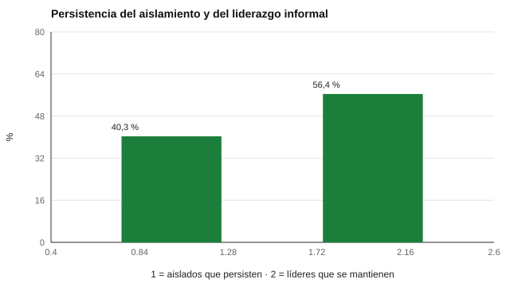

# 127 — Cohesión, aislamiento y liderazgo informal


<!-- NAV -->
[← 126 — Análisis de redes sociométricas](../126-analisis-de-redes-sociometricas/README.md) · [📚 Parte 12](../README.md) · [🗺️ Índice 001–200](../../../PROGRAMA.md) · [128 — Clima organizacional y escolar →](../128-clima-organizacional-y-escolar/README.md)
<!-- /NAV -->

**Parte 12 — Liderazgo, equipos y sociometría** · Nivel intermedio · 4 h · Estado `escrita`
**Pensada para:** quien decide intervenir a partir de datos sociométricos, y quien podría ser señalado por ellos.
**Prerrequisitos:** clases 125 y 126.

> Datos sintéticos con atractivo estable supuesto. Un resultado sociométrico nunca se comunica al grupo.

## ¿Para qué te sirve esto?

En una medición sociométrica, 5 de cada 30 estudiantes no reciben ninguna elección. ¿Hay que intervenir con esos 5? Esta clase muestra que **no necesariamente**: una sola medición sobreestima el aislamiento, porque muchos «no elegidos» de hoy son elegidos mañana. Aprenderás a medir cuánto del aislamiento es persistente, qué tan estable es el liderazgo informal, y a diseñar un **protocolo de confirmación** antes de actuar.

## Al terminar esta clase podrás

- Estimar la estabilidad del aislamiento y del liderazgo informal en dos mediciones.
- Reconocer cuánto del aislamiento puntual es azar.
- Definir un protocolo de confirmación antes de intervenir.

## La idea en palabras simples

La estabilidad del estatus sociométrico es moderada (Coie et al., 1982; Asher y Coie, 1990). El **liderazgo informal** (quienes reciben muchas elecciones) tiende a ser más estable que el **aislamiento puntual** (quienes no reciben ninguna). Cillessen (2009) recomienda mediciones repetidas.

## Cómo funciona, paso a paso

**1. Simular** 300 grupos de 30 personas con 3 elecciones cada una, en dos olas.

**2. Contar** los «no elegidos» de la ola 1 y cuántos siguen sin serlo en la ola 2.

**3. Medir** el solapamiento del 10 % con más elecciones entre olas.

**Ejemplo resuelto.** De 5,3 aislados esperados, ≈ 2,1 persisten (40,3 %); intervenir con los 5,3 desde una sola medición dirigiría apoyo a ≈ 3,2 personas que no lo necesitaban por ese motivo.



*Figura 1.* Menos de la mitad de los aislados persiste; el liderazgo es algo más estable.

## Si construyes el instrumento

- Repite la medición antes de intervenir.
- Confirma con observación o entrevista.
- Diseña un apoyo respetuoso que no estigmatice.
- Define cuándo se deriva.

## Si eres evaluado

- No haber sido elegido en una ocasión no significa estar aislado.
- Algunas personas prefieren la soledad; eso no es necesariamente un problema.
- Tu información sociométrica no debe comunicarse a tus compañeros.

## Qué muestra el laboratorio

| Medida | Valor |
|---|---:|
| Personas que nadie elige en la ola 1 | 5,3 de 30 |
| De ellas, siguen sin ser elegidas en la ola 2 | 40,3 % |
| Solapamiento del 10 % de mayor grado de entrada entre olas | 56,4 % |

**Análisis.** (1) Más de la mitad de los «no elegidos» de la primera ola sí es elegida en la segunda. (2) Una sola medición sobreestima el aislamiento. (3) El liderazgo informal es más estable que el aislamiento puntual, pero no se mantiene en la mayoría de los casos. (4) Los datos son sintéticos.

## Errores frecuentes

- Intervenir con una sola medición.
- Comunicar al grupo quiénes son «líderes» o «aislados».
- Suponer que el aislamiento aparente es siempre un problema.
- Ignorar la observación y la entrevista.

## Lo mínimo que debes llevarte

1. Una sola medición sobreestima el aislamiento.
2. El aislamiento persistente se confirma con repetición y observación.
3. El liderazgo informal es moderadamente estable.
4. Los resultados no se comunican al grupo.

## Ejercicios

- **Inicial.** ¿Por qué se repite la medición? *Solución: para distinguir el azar de un patrón persistente.*
- **Intermedio.** De 8 aislados, ¿cuántos persisten con 40 %? *Solución: 3,2.*
- **Avanzado.** Aumenta a 5 elecciones por persona en `lab.py` y observa el número de aislados.
- **Aplicación.** Escribe un protocolo de tres pasos para confirmar un patrón de aislamiento.

## Glosario

- **Ola:** una medición en el tiempo.
- **Aislamiento:** no recibir ninguna elección.
- **Liderazgo informal:** recibir muchas elecciones sin cargo formal.
- **Persistencia:** que un estatus se mantenga entre olas.

## Laboratorio

```bash
python classes/part-12-liderazgo-equipos-y-sociometria/127-cohesion-aislamiento-y-liderazgo-informal/lab.py
python classes/part-12-liderazgo-equipos-y-sociometria/figuras.py
```

## Autoevaluación y criterios

1. ¿Qué otros datos (observación, entrevista) confirman un patrón? 2. ¿Cómo apoyas sin estigmatizar? 3. ¿Cuándo derivas?
Se logra la clase si diseñas un protocolo de confirmación y apoyo respetuoso.

## Bibliografía

- Coie, J. D., Dodge, K. A., & Coppotelli, H. (1982). Dimensions and types of social status: A cross-age perspective. *Developmental Psychology*, 18(4), 557-570. [DOI](https://doi.org/10.1037/0012-1649.18.4.557)
- Asher, S. R., & Coie, J. D. (Eds.) (1990). *Peer Rejection in Childhood*. Cambridge University Press.
- Cillessen, A. H. N. (2009). Sociometric methods. En K. H. Rubin et al. (Eds.), *Handbook of Peer Interactions, Relationships, and Groups*. Guilford.

---

<!-- NAV -->
[← 126 — Análisis de redes sociométricas](../126-analisis-de-redes-sociometricas/README.md)  
[📚 Parte 12](../README.md) · [🗺️ Índice 001–200](../../../PROGRAMA.md)  
[128 — Clima organizacional y escolar →](../128-clima-organizacional-y-escolar/README.md)
<!-- /NAV -->
