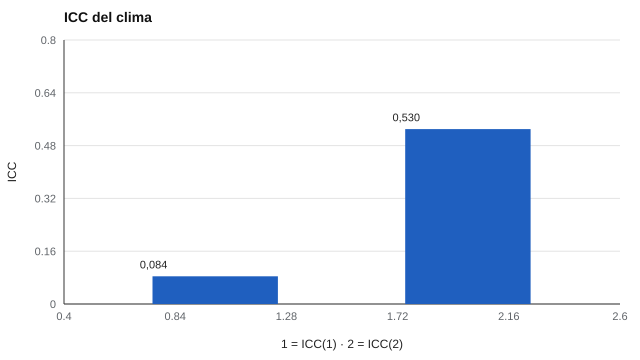

# 128 — Clima organizacional y escolar


<!-- NAV -->
[← 127 — Cohesión, aislamiento y liderazgo informal](../127-cohesion-aislamiento-y-liderazgo-informal/README.md) · [📚 Parte 12](../README.md) · [🗺️ Índice 001–200](../../../PROGRAMA.md) · [129 — Evaluación 360 y sesgos de los evaluadores →](../129-evaluacion-360-y-sesgos-de-los-evaluadores/README.md)
<!-- /NAV -->

**Parte 12 — Liderazgo, equipos y sociometría** · Nivel intermedio · 4 h · Estado `escrita`
**Pensada para:** quien aplica encuestas de clima, y quien las responde.
**Prerrequisitos:** clases 122 y 078.

> Datos sintéticos. Los umbrales de supresión varían según la política institucional y la ley.

## ¿Para qué te sirve esto?

Una encuesta de clima pregunta a cada persona cómo percibe su ambiente, y luego se reporta **por equipo o curso**. Dos problemas aparecen: (1) el clima es un constructo **de grupo**, y no cualquier promedio de grupo es fiable; (2) con grupos pequeños, reportar resultados **expone** a quienes respondieron («en el equipo de 3, dos se sienten maltratados»). Esta clase te enseña a calcular el ICC y a aplicar una **regla de supresión** que protege el anonimato.

## Al terminar esta clase podrás

- Tratar el clima como constructo de grupo (ICC).
- Aplicar una regla de supresión de grupos pequeños.
- Equilibrar utilidad estadística y protección del anonimato.

## La idea en palabras simples

El clima describe **percepciones compartidas** del ambiente (Schneider, Ehrhart y Macey, 2013; Thapa et al., 2013). Se justifica agregar si hay variación entre grupos (**ICC(1)**) y el promedio es fiable (**ICC(2)**, Bliese, 2000). Con grupos pequeños, el promedio es poco fiable y además identifica a las personas. La solución es **suprimir** (no reportar) grupos con menos de un mínimo de respuestas y reportar solo a un nivel superior.

## Cómo funciona, paso a paso

**1. Calcular** ICC(1) e ICC(2) con el tamaño medio armónico de los grupos.

**2. Fijar** un umbral mínimo de respuestas (aquí, 5).

**3. Suprimir** los grupos bajo el umbral y reportar su resultado agregado a un nivel superior.

**Ejemplo resuelto.** Un equipo de 3 personas en que 2 declaran sentirse maltratadas: reportarlo identifica a casi todos. Se agrega a un nivel superior.



*Figura 1.* El promedio por grupo es poco fiable, lo que aconseja cautela al comparar grupos.

## Si construyes el instrumento

- Informa ICC(1) e ICC(2) antes de comparar grupos.
- Define el umbral de supresión con criterios de privacidad (parte 07), no solo estadísticos.
- Triangula con otros datos (rotación, ausentismo).
- No uses el clima para sancionar jefaturas sin evidencia de validez.

## Si eres evaluado

- Tu respuesta debería ser anónima: si el grupo es muy pequeño, pregunta cómo se protege.
- Los resultados de clima describen el grupo, no a una persona.
- Pregunta qué acciones saldrán de la encuesta.

## Qué muestra el laboratorio

`lab.py` simula 40 grupos de 3 a 40 personas (504 respuestas).

| Medida | Valor |
|---|---:|
| Tamaño medio armónico | 6,9 |
| ICC(1) / ICC(2) | 0,084 / 0,530 |
| Grupos con < 5 respuestas (suprimidos) | 9 de 40 |
| Personas en grupos suprimidos | 32 (6,3 % de las respuestas) |

**Análisis.** (1) La fiabilidad del promedio por grupo es modesta (0,53). (2) Los grupos pequeños se suprimen para proteger a quienes respondieron. (3) El umbral se decide con criterios de privacidad. (4) Reportar el «clima» de un equipo de 3 personas expone a sus integrantes.

## Errores frecuentes

- Reportar a un nivel con pocos respondentes.
- Usar el clima para evaluar o sancionar a jefaturas sin evidencia.
- Interpretar diferencias entre grupos sin mirar el ICC.
- Olvidar la triangulación con otros datos.

## Lo mínimo que debes llevarte

1. El clima es un constructo de grupo.
2. Se justifica agregar con ICC(1) e ICC(2) adecuados.
3. Los grupos pequeños se suprimen.
4. El umbral es una decisión de privacidad.

## Ejercicios

- **Inicial.** ¿Por qué el clima es de grupo? *Solución: porque describe percepciones compartidas por quienes están en él.*
- **Intermedio.** ICC(1) = 0,1 y tamaño 10. *Solución: ICC(2) = 10·0,1 / (1 + 9·0,1) = 0,53 (Spearman-Brown).*
- **Avanzado.** Cambia el umbral a 8 y reporta cuántos grupos se suprimen.
- **Aplicación.** Redacta la regla de supresión para una encuesta de clima en un colegio.

## Glosario

- **Clima:** percepciones compartidas del ambiente.
- **ICC(1) / ICC(2):** varianza entre grupos / fiabilidad del promedio.
- **Supresión:** no reportar resultados de grupos pequeños.
- **Triangulación:** contrastar con otras fuentes.

## Laboratorio

```bash
python classes/part-12-liderazgo-equipos-y-sociometria/128-clima-organizacional-y-escolar/lab.py
python classes/part-12-liderazgo-equipos-y-sociometria/figuras.py
```

## Autoevaluación y criterios

1. ¿Quién ve los resultados y a qué nivel? 2. ¿Cómo comunicar un resultado suprimido? 3. ¿Qué acción derivas de una encuesta de clima?
Se logra la clase si calculas ICC y aplicas una regla de supresión justificada.

## Bibliografía

- Schneider, B., Ehrhart, M. G., & Macey, W. H. (2013). Organizational climate and culture. *Annual Review of Psychology*, 64, 361-388. [DOI](https://doi.org/10.1146/annurev-psych-113011-143809)
- Thapa, A., Cohen, J., Guffey, S., & Higgins-D'Alessandro, A. (2013). A review of school climate research. *Review of Educational Research*, 83(3), 357-385. [DOI](https://doi.org/10.3102/0034654313483907)
- Bliese, P. D. (2000). Within-group agreement, non-independence, and reliability. En K. J. Klein & S. W. J. Kozlowski (Eds.), *Multilevel Theory, Research, and Methods in Organizations*. Jossey-Bass.

---

<!-- NAV -->
[← 127 — Cohesión, aislamiento y liderazgo informal](../127-cohesion-aislamiento-y-liderazgo-informal/README.md)  
[📚 Parte 12](../README.md) · [🗺️ Índice 001–200](../../../PROGRAMA.md)  
[129 — Evaluación 360 y sesgos de los evaluadores →](../129-evaluacion-360-y-sesgos-de-los-evaluadores/README.md)
<!-- /NAV -->
