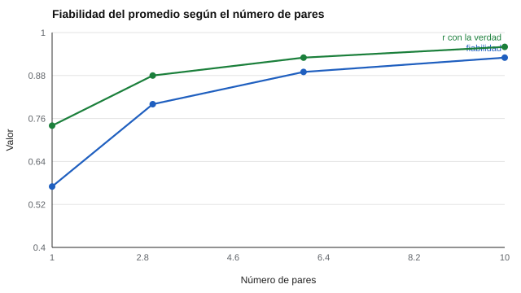

# 129 — Evaluación 360 y sesgos de los evaluadores


<!-- NAV -->
[← 128 — Clima organizacional y escolar](../128-clima-organizacional-y-escolar/README.md) · [📚 Parte 12](../README.md) · [🗺️ Índice 001–200](../../../PROGRAMA.md) · [130 — Gestión de conflictos y toma de decisiones →](../130-gestion-de-conflictos-y-toma-de-decisiones/README.md)
<!-- /NAV -->

**Parte 12 — Liderazgo, equipos y sociometría** · Nivel intermedio · 4 h · Estado `escrita`
**Pensada para:** quien diseña un 360, y quien lo recibe.
**Prerrequisitos:** clases 114 y 122.

> Parámetros supuestos del laboratorio: desempeño DE 1,0; sesgo idiosincrático DE 0,7; error DE 0,5.

## ¿Para qué te sirve esto?

Una evaluación 360 reúne opiniones de jefatura, pares, subordinados y de la propia persona. Intuitivamente, más opiniones es mejor. Pero cada opinión mezcla **tres cosas**: el desempeño real del evaluado, el **sesgo propio de quien evalúa** y el error. Esta clase te enseña a calcular cuántos evaluadores se necesitan para que el promedio sea fiable, y a interpretar la diferencia entre la autoevaluación y la valoración de otros sin concluir «falta de autoconocimiento».

## Al terminar esta clase podrás

- Descomponer la varianza de una valoración 360.
- Estimar la fiabilidad del promedio de pares.
- Interpretar diferencias entre autoevaluación y valoración de otros.

## La idea en palabras simples

Un análisis de estructura latente de valoraciones de desempeño encontró que una parte considerable de la varianza era propia del evaluador (Scullen, Mount y Goff, 2000), y los metaanálisis muestran acuerdo modesto entre fuentes (Conway y Huffcutt, 1997). El **acuerdo entre dos pares** (icc1) estima la fiabilidad de un solo evaluador. Con *k* pares, el promedio es más fiable (Spearman-Brown): **k·icc1 / (1 + (k − 1)·icc1)**.

## Cómo funciona, paso a paso

**1. Simular** 300 evaluados con desempeño, sesgo del evaluador y error.

**2. Calcular** icc1 entre dos pares y la fiabilidad del promedio para 1, 3, 6 y 10 pares.

**3. Comparar** la autoevaluación con el promedio de pares.

**Ejemplo resuelto.** icc1 = 0,57 y k = 6: 6·0,57 / (1 + 5·0,57) = 3,42 / 3,85 = 0,89.



*Figura 1.* Con 6 a 10 pares la fiabilidad es aceptable.

## Si construyes el instrumento

- Usa varios evaluadores por fuente (idealmente 6 o más para pares).
- Reporta solo con un mínimo de respondentes por fuente para proteger el anonimato.
- Úsalo para el desarrollo; si se usa para decisiones de personal, valida el instrumento.
- Define cómo se tratarán los comentarios abiertos.

## Si eres evaluado

- Un solo evaluador pesa mucho en tu resultado, pero poco en su fiabilidad.
- La diferencia entre tu autoevaluación y la de otros puede deberse a información distinta.
- Pide que el informe incluya el número de evaluadores por fuente.

## Qué muestra el laboratorio

| Pares | Fiabilidad del promedio | r (promedio, verdad) |
|---:|---:|---:|
| 1 | 0,57 | 0,74 |
| 3 | 0,80 | 0,88 |
| 6 | 0,89 | 0,93 |
| 10 | 0,93 | 0,96 |

Acuerdo entre dos pares (icc1) = 0,57. Autoevaluación frente al promedio de 6 pares: r = 0,44; diferencia media +0,74 puntos (indulgencia).

**Análisis.** (1) Un solo evaluador es poco fiable porque el sesgo idiosincrático domina. (2) Con 6 a 10 pares la fiabilidad es aceptable. (3) La autoevaluación difiere por indulgencia y por distinta información, no necesariamente por falta de autoconocimiento. (4) Los parámetros son supuestos.

## Errores frecuentes

- Basar una decisión en un solo evaluador.
- Interpretar la diferencia auto–otros como falta de autoconocimiento.
- Usar el 360 para decisiones de personal sin validar.
- Revelar quién dijo qué.

## Lo mínimo que debes llevarte

1. Cada valoración mezcla desempeño, sesgo del evaluador y error.
2. Promediar pares aumenta la fiabilidad (Spearman-Brown).
3. Auto y otros difieren por indulgencia e información.
4. El 360 es sobre todo para desarrollo.

## Ejercicios

- **Inicial.** ¿Por qué se promedian varios pares? *Solución: para reducir el sesgo idiosincrático de cada uno.*
- **Intermedio.** icc1 = 0,40 y k = 4. *Solución: 1,6 / (1 + 1,2) = 0,73.*
- **Avanzado.** Duplica el sesgo idiosincrático (DE 1,4) en `lab.py` y observa la fiabilidad.
- **Aplicación.** Escribe las reglas de anonimato y de comentarios abiertos de un 360.

## Glosario

- **360:** evaluación desde múltiples fuentes.
- **Sesgo idiosincrático:** tendencia propia del evaluador.
- **icc1:** acuerdo entre dos evaluadores.
- **Indulgencia:** puntuar más alto de lo que corresponde.

## Laboratorio

```bash
python classes/part-12-liderazgo-equipos-y-sociometria/129-evaluacion-360-y-sesgos-de-los-evaluadores/lab.py
python classes/part-12-liderazgo-equipos-y-sociometria/figuras.py
```

## Autoevaluación y criterios

1. ¿Cuántos evaluadores por fuente? 2. ¿Cómo devuelves un 360 de forma útil? 3. ¿Qué haces con comentarios abiertos hirientes?
Se logra la clase si estimas fiabilidad y propones un uso para el desarrollo, no para sanción.

## Bibliografía

- Scullen, S. E., Mount, M. K., & Goff, M. (2000). Understanding the latent structure of job performance ratings. *Journal of Applied Psychology*, 85(6), 956-970. ✅ [DOI](https://doi.org/10.1037/0021-9010.85.6.956)
- Conway, J. M., & Huffcutt, A. I. (1997). Psychometric properties of multisource performance ratings. *Human Performance*, 10(4), 331-360. ✅ [DOI](https://doi.org/10.1207/s15327043hup1004_2)
- Murphy, K. R., & Cleveland, J. N. (1995). *Understanding Performance Appraisal*. Sage. 🔎 sin verificar (libro, norma o sitio no hallado en Crossref: comprobar a mano)

Leyenda: ✅ existe en Crossref con título y año coincidentes (enlace al DOI); ⚠️ hay una obra de título parecido con otro año (no se enlaza: comprobar la edición); 🔎 no verificada automáticamente (libros sin DOI, normas y sitios web). Crossref confirma la existencia de la fuente, no que respalde cada afirmación de la clase. Ver [`docs/VERIFICACION_BIBLIOGRAFIA.md`](../../../docs/VERIFICACION_BIBLIOGRAFIA.md).

---

<!-- NAV -->
[← 128 — Clima organizacional y escolar](../128-clima-organizacional-y-escolar/README.md)  
[📚 Parte 12](../README.md) · [🗺️ Índice 001–200](../../../PROGRAMA.md)  
[130 — Gestión de conflictos y toma de decisiones →](../130-gestion-de-conflictos-y-toma-de-decisiones/README.md)
<!-- /NAV -->
