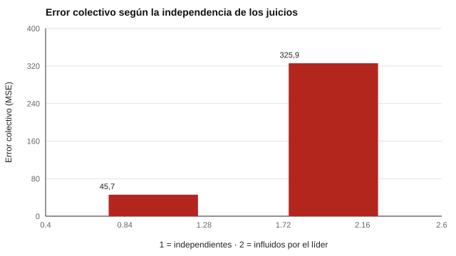

# 130 — Gestión de conflictos y toma de decisiones


<!-- NAV -->
[← 129 — Evaluación 360 y sesgos de los evaluadores](../129-evaluacion-360-y-sesgos-de-los-evaluadores/README.md) · [📚 Parte 12](../README.md) · [🗺️ Índice 001–200](../../../PROGRAMA.md) · [131 — Hitos del desarrollo y sus rangos normales →](../../part-13-desarrollo-infantil-y-evaluacion-psicoeducativa/131-hitos-del-desarrollo-y-sus-rangos-normales/README.md)
<!-- /NAV -->

**Parte 12 — Liderazgo, equipos y sociometría** · Nivel intermedio · 4 h · Estado `escrita`
**Pensada para:** quien diseña procesos de decisión en equipos, y quien participa en ellos.
**Prerrequisitos:** clases 122 y 124.

> Modelo simple: el sesgo del líder y la influencia son supuestos.

## ¿Para qué te sirve esto?

«Mejor discutámoslo todos juntos.» ¿Mejora siempre la decisión? Para estimaciones numéricas existe una identidad matemática, el **teorema de la predicción de la diversidad**, que explica por qué el promedio de un grupo puede ser mucho más exacto que casi cualquier individuo… **si los juicios son independientes**. Cuando una figura influyente alinea al grupo, la diversidad cae y se hereda su sesgo. Esta clase te permite verificarlo con números y diseñar procedimientos de decisión que conserven la diversidad.

## Al terminar esta clase podrás

- Verificar el teorema de la predicción de la diversidad.
- Comparar juicios independientes con juicios influidos.
- Relacionar procedimientos de decisión con la calidad del resultado.

## La idea en palabras simples

Para estimaciones numéricas (Page, 2007):

```
(media − verdad)² = media[(estimación_i − verdad)²] − varianza(estimaciones)
```

El error del promedio es igual al **error individual medio menos la diversidad**. Con juicios independientes los errores se cancelan (Surowiecki, 2004). Cuando la discusión alinea al grupo con una figura influyente, baja la diversidad y se hereda su sesgo (Janis, 1972, sobre pensamiento de grupo). Procedimientos como **Delphi** (Dalkey y Helmer, 1963) piden estimaciones independientes antes de discutir.

## Cómo funciona, paso a paso

**1. Simular** 9 integrantes que estiman un valor verdadero de 100 con error DE 20.

**2. Condición A:** estimaciones independientes. **Condición B:** el líder estima +25 y los demás se acercan 70 % a él.

**3. Medir** el error colectivo (MSE) y verificar la identidad.

**Ejemplo resuelto.** Estimaciones 90, 100 y 130 con verdad 100: media 106,67; error colectivo = 44,4; error individual medio = (100 + 0 + 900)/3 = 333,3; diversidad (varianza poblacional) = 288,9; 333,3 − 288,9 = 44,4.



*Figura 1.* La influencia de un líder sesgado multiplica por siete el error del grupo.

## Si construyes el instrumento

- Pide estimaciones independientes antes de discutir.
- Agrega las estimaciones con una regla clara (promedio, mediana).
- Documenta el procedimiento de decisión.
- No uses un cuestionario de «estilo de manejo de conflictos» como base única: son autoinformes con evidencia limitada.

## Si eres evaluado

- Si el grupo se alinea con la primera opinión, la decisión se parecerá más a esa opinión.
- Dar tu estimación antes de discutir aporta diversidad al grupo.
- La calidad de la relación también importa, no solo la exactitud.

## Qué muestra el laboratorio

| Condición | Error colectivo (MSE) | RMSE |
|---|---:|---:|
| Independientes | 45,7 | 6,8 |
| Influidos por el líder sesgado | 325,9 | 18,1 |

La identidad del teorema se cumple con diferencia máxima de 8·10⁻¹³.

**Análisis.** (1) Con juicios independientes el promedio es mucho más exacto que el individuo. (2) Con un líder sesgado, baja la diversidad y se hereda el sesgo. (3) Estimaciones independientes antes de discutir conservan la diversidad. (4) El modelo es simple.

## Errores frecuentes

- Suponer que discutir siempre mejora la decisión.
- Aplicar el teorema a decisiones no numéricas sin cuidado.
- Ignorar el conflicto afectivo.
- Dejar que la jefatura opine primero.

## Lo mínimo que debes llevarte

1. Error del promedio = error individual medio − diversidad.
2. La independencia de los juicios es clave.
3. La influencia reduce la diversidad.
4. Los procedimientos tipo Delphi conservan la diversidad.

## Ejercicios

- **Inicial.** ¿Qué es la diversidad en el teorema? *Solución: la varianza de las estimaciones.*
- **Intermedio.** Estimaciones 80, 100, 120 con verdad 100. *Solución: error colectivo 0; error individual 266,7; diversidad 266,7.*
- **Avanzado.** Reduce la influencia a 0,3 en `lab.py` y observa el error.
- **Aplicación.** Diseña una reunión donde se recojan estimaciones independientes antes de discutir.

## Glosario

- **Diversidad (en el teorema):** varianza de las estimaciones.
- **Delphi:** método de estimaciones independientes e iteradas.
- **Pensamiento de grupo:** presión a coincidir que reduce el juicio crítico.
- **MSE:** error cuadrático medio.

## Laboratorio

```bash
python classes/part-12-liderazgo-equipos-y-sociometria/130-gestion-de-conflictos-y-toma-de-decisiones/lab.py
python classes/part-12-liderazgo-equipos-y-sociometria/figuras.py
```

## Autoevaluación y criterios

1. ¿Cómo diseñarías una decisión que conserve la diversidad? 2. ¿Qué papel tiene la jefatura? 3. ¿Cómo evalúas la calidad de una decisión?
Se logra la clase si verificas el teorema y diseñas un procedimiento que conserve la diversidad.

## Bibliografía

- Page, S. E. (2007). *The Difference: How the Power of Diversity Creates Better Groups, Firms, Schools, and Societies*. Princeton University Press. 🔎 sin verificar (libro, norma o sitio no hallado en Crossref: comprobar a mano)
- Surowiecki, J. (2004). *The Wisdom of Crowds*. Doubleday. 🔎 sin verificar (libro, norma o sitio no hallado en Crossref: comprobar a mano)
- Janis, I. L. (1972). *Victims of Groupthink*. Houghton Mifflin. 🔎 sin verificar (libro, norma o sitio no hallado en Crossref: comprobar a mano)
- Dalkey, N., & Helmer, O. (1963). An experimental application of the Delphi method to the use of experts. *Management Science*, 9(3), 458-467. ✅ [DOI](https://doi.org/10.1287/mnsc.9.3.458)

Leyenda: ✅ existe en Crossref con título y año coincidentes (enlace al DOI); ⚠️ hay una obra de título parecido con otro año (no se enlaza: comprobar la edición); 🔎 no verificada automáticamente (libros sin DOI, normas y sitios web). Crossref confirma la existencia de la fuente, no que respalde cada afirmación de la clase. Ver [`docs/VERIFICACION_BIBLIOGRAFIA.md`](../../../docs/VERIFICACION_BIBLIOGRAFIA.md).

---

<!-- NAV -->
[← 129 — Evaluación 360 y sesgos de los evaluadores](../129-evaluacion-360-y-sesgos-de-los-evaluadores/README.md)  
[📚 Parte 12](../README.md) · [🗺️ Índice 001–200](../../../PROGRAMA.md)  
[131 — Hitos del desarrollo y sus rangos normales →](../../part-13-desarrollo-infantil-y-evaluacion-psicoeducativa/131-hitos-del-desarrollo-y-sus-rangos-normales/README.md)
<!-- /NAV -->
