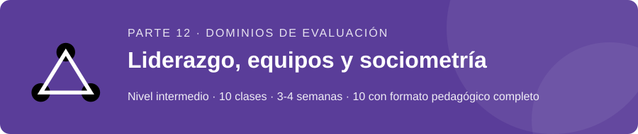
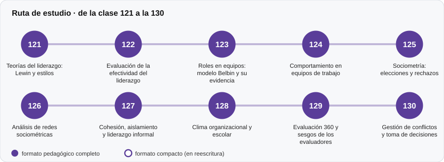

# 👥 Parte 12 — Liderazgo, equipos y sociometría

**Nivel:** intermedio · **Duración estimada:** 3-4 semanas · **Clases:** 10

## De qué trata

Evaluación del liderazgo, el trabajo en equipo y las relaciones sociales en grupos (sociometría, redes, clima, evaluación 360).

## Por qué importa

Estas evaluaciones tienen efectos directos en personas concretas dentro de grupos pequeños.

## Según tu papel

- **Si construyes o aplicas instrumentos:** Cómo medir con rigor sin exponer a nadie, y con qué sesgos hay que contar.
- **Si eres evaluado o recibes resultados:** Qué se mide cuando te evalúan en un equipo y cómo se protege tu identidad.

## Al terminar esta parte podrás

- Construir un sociograma y leerlo con cautela.
- Explicar los sesgos de una evaluación 360.

## Cómo estudiarla

Parte aplicada; los datos de los laboratorios son sintéticos.

## Ruta de estudio

## Clases en orden de estudio

Las clases están numeradas de forma consecutiva (001 a 200) en el orden de estudio: sigue el número.

| Orden | ID | Clase | Qué aprenderás | Formato | Horas |
|---:|---|---|---|---|---:|
| 1 | 121 | [Teorías del liderazgo: Lewin y estilos](121-teorias-del-liderazgo-lewin-y-estilos/README.md) | Distinguir la tipología de Lewin de los modelos de dos dimensiones. | ✅ pedagógico | 4 |
| 2 | 122 | [Evaluación de la efectividad del liderazgo](122-evaluacion-de-la-efectividad-del-liderazgo/README.md) | Calcular acuerdo dentro del equipo (rwg) y CCI(1) y CCI(2). | ✅ pedagógico | 4 |
| 3 | 123 | [Roles en equipos: modelo Belbin y su evidencia](123-roles-en-equipos-modelo-belbin-y-su/README.md) | Describir el modelo de roles de equipo y su estado de evidencia. | ✅ pedagógico | 4 |
| 4 | 124 | [Comportamiento en equipos de trabajo](124-comportamiento-en-equipos-de-trabajo/README.md) | Describir el modelo insumo–proceso–resultado de equipos. | ✅ pedagógico | 4 |
| 5 | 125 | [Sociometría: elecciones y rechazos](125-sociometria-elecciones-y-rechazos/README.md) | Calcular preferencia social e impacto social. | ✅ pedagógico | 4 |
| 6 | 126 | [Análisis de redes sociométricas](126-analisis-de-redes-sociometricas/README.md) | Calcular densidad, reciprocidad, centralización y componentes. | ✅ pedagógico | 4 |
| 7 | 127 | [Cohesión, aislamiento y liderazgo informal](127-cohesion-aislamiento-y-liderazgo-informal/README.md) | Estimar la estabilidad del aislamiento y del liderazgo informal en dos mediciones. | ✅ pedagógico | 4 |
| 8 | 128 | [Clima organizacional y escolar](128-clima-organizacional-y-escolar/README.md) | Tratar el clima como constructo de grupo (ICC). | ✅ pedagógico | 4 |
| 9 | 129 | [Evaluación 360 y sesgos de los evaluadores](129-evaluacion-360-y-sesgos-de-los-evaluadores/README.md) | Descomponer la varianza de una valoración 360. | ✅ pedagógico | 4 |
| 10 | 130 | [Gestión de conflictos y toma de decisiones](130-gestion-de-conflictos-y-toma-de-decisiones/README.md) | Verificar el teorema de la predicción de la diversidad. | ✅ pedagógico | 4 |

[← Volver al índice del programa](../../README.md) · [Índice numérico de las 200 clases](../../PROGRAMA.md)
