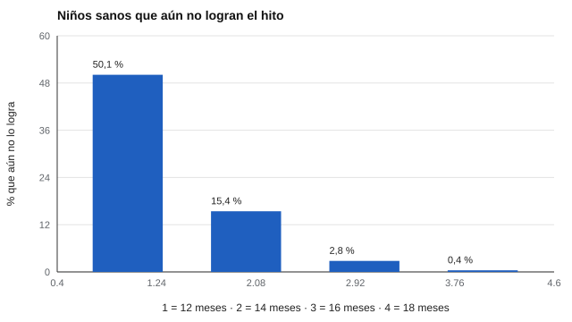

# 131 — Hitos del desarrollo y sus rangos normales


<!-- NAV -->
[← 130 — Gestión de conflictos y toma de decisiones](../../part-12-liderazgo-equipos-y-sociometria/130-gestion-de-conflictos-y-toma-de-decisiones/README.md) · [📚 Parte 13](../README.md) · [🗺️ Índice 001–200](../../../PROGRAMA.md) · [132 — Desarrollo cognitivo infantil: Piaget y Vygot… →](../132-desarrollo-cognitivo-infantil-piaget-y-vygotsky/README.md)
<!-- /NAV -->

**Parte 13 — Desarrollo infantil y evaluación psicoeducativa** · Nivel avanzado · 4 h · Estado `escrita`
**Pensada para:** quien interpreta hitos del desarrollo, y familias que reciben una lista de verificación.
**Prerrequisitos:** clases 061 y 100.

> Los parámetros del laboratorio son ilustrativos; las ventanas reales se consultan en las fuentes. Este material no sirve para diagnosticar.

## ¿Para qué te sirve esto?

«A los 12 meses ya debería caminar.» Muchas familias reciben listas de hitos con una edad única, y se preocupan si su hijo no los cumple justo a esa edad. Pero un hito no ocurre en una fecha: ocurre en una **ventana amplia y asimétrica**. Esta clase te enseña a leer un hito como una **distribución de edades**, y te muestra un efecto contraintuitivo: si se revisan 10 hitos, **4 de cada 10 niños típicos** tendrán al menos uno «atrasado» solo por azar.

## Al terminar esta clase podrás

- Entender los hitos como distribuciones de edad, no como edades únicas.
- Calcular la probabilidad de hallazgos aislados en una lista de verificación.
- Interpretar patrones y trayectorias, no ítems sueltos.

## La idea en palabras simples

Los hitos (sentarse, caminar, primeras palabras) se alcanzan en ventanas amplias (WHO Multicentre Growth Reference Study Group, 2006, para seis hitos motores). La edad «promedio» (mediana) no es un plazo: la mitad de los niños típicos lo logra **después**. Si una lista tiene *k* hitos y cada uno tiene un 5 % de que un niño típico quede sobre el percentil 95, la probabilidad de al menos uno «atrasado» es **1 − 0,95ᵏ**. Por eso la vigilancia del desarrollo mira el **patrón global** y la trayectoria (Lipkin y Macias, 2020).

## Cómo funciona, paso a paso

**1. Simular** la edad de logro de un hito (mediana 12 meses, asimétrica a la derecha).

**2. Calcular** percentiles y el porcentaje de niños sanos que aún no lo logra a cada edad.

**3. Calcular** el riesgo de hallazgos aislados al revisar 10 hitos.

**Ejemplo resuelto.** Con 10 hitos: 1 − 0,95¹⁰ = 0,401.



*Figura 1.* A los 14 meses, 15 de cada 100 niños sanos aún no lo logran.

## Si construyes el instrumento

- Presenta cada hito como un rango (percentiles), no como una edad.
- Indica cuántos hitos fuera de rango son esperables en niños típicos.
- Usa ventanas de la población de referencia correcta.
- Mira el patrón global y la trayectoria antes de derivar.

## Si eres evaluado (o eres la familia)

- La mediana no es una fecha límite.
- Un solo hito fuera del rango no es una alarma por sí solo.
- Si te preocupa, pide una evaluación del patrón completo.

## Qué muestra el laboratorio

| Percentil | 1 | 5 | 50 | 95 | 99 |
|---|---:|---:|---:|---:|---:|
| Edad (meses) | 8,5 | 9,4 | 12,0 | 15,4 | 17,1 |

Niños sanos que aún no lo logran a los 14 meses: 15,4 %; a los 16 meses: 2,8 %. Con 10 hitos independientes, 40,4 % de los niños típicos tiene al menos uno «atrasado» (≥ 2: 8,8 %).

**Análisis.** (1) La variación normal es amplia y asimétrica (cola a la derecha). (2) Un solo hito fuera del rango es esperable en 4 de cada 10 niños típicos al revisar 10. (3) Se interpreta el patrón y la trayectoria. (4) Parámetros ilustrativos.

## Errores frecuentes

- Tomar la mediana como fecha límite.
- Derivar por un solo hito sin considerar el patrón global.
- Aplicar ventanas de otra población o cultura sin evidencia.
- Asumir independencia entre hitos reales (aquí se supone por simplicidad).

## Lo mínimo que debes llevarte

1. Un hito es una distribución de edades.
2. La distribución es asimétrica.
3. Revisar muchos hitos produce hallazgos aislados por azar.
4. Se interpreta el patrón, no el ítem suelto.

## Ejercicios

- **Inicial.** ¿Por qué la distribución es asimétrica? *Solución: porque la edad no puede ser negativa y hay niños que tardan bastante más; la cola derecha es larga.*
- **Intermedio.** Con 6 hitos. *Solución: 1 − 0,95⁶ = 0,265.*
- **Avanzado.** Usa σ = 0,25 en `lab.py` y describe el cambio de la ventana.
- **Aplicación.** Escribe cómo explicarías a una familia que un hito está fuera del rango.

## Glosario

- **Hito del desarrollo:** logro esperable en una etapa (sentarse, caminar).
- **Ventana:** rango de edades en que ocurre un hito en niños típicos.
- **Percentil:** valor bajo el cual está un porcentaje de la población.
- **Vigilancia del desarrollo:** seguimiento continuo de patrones y trayectorias.

## Laboratorio

```bash
python classes/part-13-desarrollo-infantil-y-evaluacion-psicoeducativa/131-hitos-del-desarrollo-y-sus-rangos-normales/lab.py
python classes/part-13-desarrollo-infantil-y-evaluacion-psicoeducativa/figuras.py
```

## Autoevaluación y criterios

1. ¿Qué dirías a una familia preocupada por un solo hito? 2. ¿Qué es vigilancia del desarrollo? 3. ¿Cuándo derivarías?
Se logra la clase si interpretas hitos como rangos y calculas el efecto de revisar muchos.

## Bibliografía

- WHO Multicentre Growth Reference Study Group (2006). WHO Motor Development Study: Windows of achievement for six gross motor development milestones. *Acta Paediatrica*, Suppl. 450, 86-95.
- Lipkin, P. H., & Macias, M. M. (2020). Promoting optimal development: Identifying infants and young children with developmental disorders through developmental surveillance and screening. *Pediatrics*, 145(1), e20193449.

---

<!-- NAV -->
[← 130 — Gestión de conflictos y toma de decisiones](../../part-12-liderazgo-equipos-y-sociometria/130-gestion-de-conflictos-y-toma-de-decisiones/README.md)  
[📚 Parte 13](../README.md) · [🗺️ Índice 001–200](../../../PROGRAMA.md)  
[132 — Desarrollo cognitivo infantil: Piaget y Vygot… →](../132-desarrollo-cognitivo-infantil-piaget-y-vygotsky/README.md)
<!-- /NAV -->
