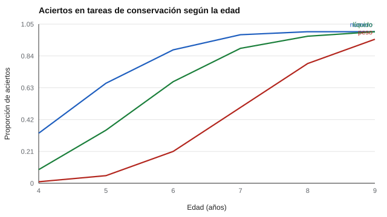

# 132 — Desarrollo cognitivo infantil: Piaget y Vygotsky


<!-- NAV -->
[← 131 — Hitos del desarrollo y sus rangos normales](../131-hitos-del-desarrollo-y-sus-rangos-normales/README.md) · [📚 Parte 13](../README.md) · [🗺️ Índice 001–200](../../../PROGRAMA.md) · [133 — Desarrollo del lenguaje →](../133-desarrollo-del-lenguaje/README.md)
<!-- /NAV -->

**Parte 13 — Desarrollo infantil y evaluación psicoeducativa** · Nivel avanzado · 4 h · Estado `escrita`
**Pensada para:** quien evalúa aprendizaje infantil, y familias o docentes que reciben una descripción de «etapa».
**Prerrequisitos:** clases 087 y 131.

> Datos sintéticos; el modelo no prueba una teoría.

## ¿Para qué te sirve esto?

«Está en la etapa de las operaciones concretas.» Piaget describió estadios del desarrollo cognitivo; Vygotsky propuso que lo que un niño logra **con ayuda** dice algo sobre su potencial. Dos ideas con consecuencias prácticas para evaluar: (1) si los estadios fueran rígidos, un niño debería resolver todas las tareas «de su estadio» a la vez; no es lo que se observa. (2) Evaluar solo sin ayuda pierde información. Esta clase te permite verlo con números.

## Al terminar esta clase podrás

- Contrastar estadios (Piaget) con desarrollo gradual dependiente de la tarea.
- Explicar la zona de desarrollo próximo (Vygotsky) y la evaluación con ayuda.
- Medir la consistencia entre tareas del «mismo estadio».

## La idea en palabras simples

Piaget (1952) describió estadios; los estudios posteriores muestran **desfases** (*décalage*) y un fuerte efecto de la tarea y el contexto (Siegler, 1996). Un niño puede conservar el número a los 6 años y el peso recién a los 8. Vygotsky (1978) propuso la **zona de desarrollo próximo**: la diferencia entre lo que el niño hace solo y lo que hace con ayuda. Esa ayuda (andamiaje) informa cosas distintas.

## Cómo funciona, paso a paso

**1. Simular** tareas de conservación (número, líquido, peso) con umbrales distintos.

**2. Calcular** el porcentaje de aciertos por edad y la consistencia entre dos tareas del «mismo estadio».

**3. Comparar** el desempeño solo y con andamiaje en niños de menor capacidad.

**Ejemplo resuelto.** A los 7 años el 98 % resuelve la tarea de número y solo el 50 % la de peso: un niño de 7 años no «está en el estadio X» para todas las tareas.



*Figura 1.* Las curvas están desfasadas: cada tarea tiene su propio calendario.

## Si construyes el instrumento

- Describe el desempeño por tarea, no por estadio.
- Evalúa con y sin ayuda, y registra el tipo de ayuda.
- Considera la cultura y la escolaridad en los tiempos de logro.
- No asignes un estadio a un niño con una sola tarea.

## Si eres evaluado (o eres la familia)

- Que tu hijo no resuelva una tarea no significa que esté «atrasado» en una etapa.
- Lo que logra con ayuda también es información valiosa.
- Pide que se describa qué hace solo y qué hace con apoyo.

## Qué muestra el laboratorio

| Edad | Conservación de número | Líquido | Peso |
|---:|---:|---:|---:|
| 5 | 0,66 | 0,35 | 0,05 |
| 7 | 0,98 | 0,89 | 0,50 |
| 9 | 1,00 | 1,00 | 0,95 |

Consistencia entre dos tareas del «mismo estadio» (φ de aciertos) = 0,52. Niños de menor capacidad: aciertan solos 9,9 %; con andamiaje del adulto, 29,5 %.

**Análisis.** (1) El desempeño cambia de forma gradual y depende de la tarea. (2) La consistencia entre tareas es moderada (0,52). (3) La ayuda del adulto cambia el resultado: lo que el niño hace solo y con apoyo informa cosas distintas. (4) Evaluar es describir ambos, no asignar un estadio.

## Errores frecuentes

- Asignar un estadio a un niño con una tarea.
- Interpretar el desempeño con ayuda como capacidad estable.
- Ignorar la cultura y la escolaridad.
- Usar los resultados simulados como prueba de una teoría.

## Lo mínimo que debes llevarte

1. El desarrollo cognitivo es gradual y depende de la tarea.
2. Existen desfases entre tareas.
3. La ayuda cambia el desempeño.
4. Se describe, no se etiqueta con un estadio.

## Ejercicios

- **Inicial.** ¿Qué es un desfase? *Solución: que tareas del «mismo» estadio se resuelvan a edades distintas.*
- **Intermedio.** Si 88 % aprueba una tarea a los 6 y 50 % otra, ¿qué concluyes? *Solución: tienen dificultades distintas.*
- **Avanzado.** Cambia la ayuda a +1,5 en `lab.py` y observa el efecto.
- **Aplicación.** Diseña una evaluación dinámica: tarea sola, ayuda graduada y nueva tarea.

## Glosario

- **Estadio:** etapa de desarrollo propuesta por Piaget.
- **Décalage:** desfase entre tareas del mismo estadio.
- **Zona de desarrollo próximo:** diferencia entre lo que se hace solo y con ayuda.
- **Andamiaje:** apoyo del adulto que se retira gradualmente.

## Laboratorio

```bash
python classes/part-13-desarrollo-infantil-y-evaluacion-psicoeducativa/132-desarrollo-cognitivo-infantil-piaget-y-vygotsky/lab.py
python classes/part-13-desarrollo-infantil-y-evaluacion-psicoeducativa/figuras.py
```

## Autoevaluación y criterios

1. ¿Qué evaluarías con ayuda y sin ayuda? 2. ¿Qué evidencia limita la idea de estadios? 3. ¿Cómo informarías a la familia?
Se logra la clase si describes el desempeño con y sin apoyo sin asignar etiquetas.

## Bibliografía

- Piaget, J. (1952). *The Origins of Intelligence in Children*. International Universities Press. [DOI](https://doi.org/10.1037/11494-000)
- Vygotsky, L. S. (1978). *Mind in Society*. Harvard University Press.
- Siegler, R. S. (1996). *Emerging Minds: The Process of Change in Children's Thinking*. Oxford University Press.

---

<!-- NAV -->
[← 131 — Hitos del desarrollo y sus rangos normales](../131-hitos-del-desarrollo-y-sus-rangos-normales/README.md)  
[📚 Parte 13](../README.md) · [🗺️ Índice 001–200](../../../PROGRAMA.md)  
[133 — Desarrollo del lenguaje →](../133-desarrollo-del-lenguaje/README.md)
<!-- /NAV -->
