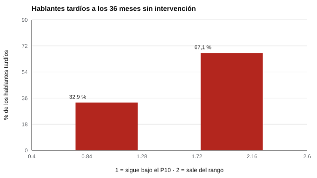

# 133 — Desarrollo del lenguaje


<!-- NAV -->
[← 132 — Desarrollo cognitivo infantil: Piaget y Vygot…](../132-desarrollo-cognitivo-infantil-piaget-y-vygotsky/README.md) · [📚 Parte 13](../README.md) · [🗺️ Índice 001–200](../../../PROGRAMA.md) · [134 — Observación sistemática y registros anecdótic… →](../134-observacion-sistematica-y-registros-anecdoticos/README.md)
<!-- /NAV -->

**Parte 13 — Desarrollo infantil y evaluación psicoeducativa** · Nivel avanzado · 4 h · Estado `escrita`
**Pensada para:** quien evalúa lenguaje temprano, y familias de niños que hablan «tarde».
**Prerrequisitos:** clases 061 y 131.

> La correlación de 0,5 entre 24 y 36 meses es un supuesto del laboratorio. Esto no es una evaluación clínica.

## ¿Para qué te sirve esto?

«A los 2 años dice pocas palabras.» Es una preocupación frecuente. A los 24 meses el vocabulario es muy variable, y existe la categoría de «hablante tardío» (por ejemplo, bajo el percentil 10). La pregunta práctica: **¿esos niños recuperan solos o mantienen la dificultad?** Esta clase te muestra un efecto estadístico que genera falsas esperanzas y falsas alarmas: la **regresión a la media**. Parte de la «mejora» de los hablantes tardíos ocurre sin intervención alguna.

## Al terminar esta clase podrás

- Describir la variabilidad del vocabulario temprano.
- Calcular qué parte de la recuperación de los «hablantes tardíos» es regresión a la media.
- Plantear criterios de apoyo más allá de un percentil.

## La idea en palabras simples

El vocabulario expresivo a los 24 meses es muy variable (Fenson et al., 1994). Un «hablante tardío» suele definirse por un percentil bajo, pero la evidencia sobre qué predice la evolución posterior es limitada (Rescorla, 2011). Con una estabilidad moderada entre mediciones (r = 0,5), quien tiene un puntaje extremo tiende a acercarse al promedio en la siguiente medición: el z esperado es **r × z inicial**.

## Cómo funciona, paso a paso

**1. Simular** el vocabulario a los 24 y a los 36 meses con correlación 0,5.

**2. Identificar** a los hablantes tardíos (< P10) a los 24 meses.

**3. Ver** cuántos siguen bajo el P10 a los 36 meses y qué z medio tienen.

**Ejemplo resuelto.** Con r = 0,5, el z esperado a los 36 meses de quien tuvo z = −1,75 es −0,5 · 1,75 = −0,88: coincide con el laboratorio.



*Figura 1.* Sin intervención, dos de cada tres salen del rango bajo (el z medio pasa de −1,75 a −0,88).

## Si construyes el instrumento

- Informa la variabilidad normal y los percentiles de la lengua y población correspondientes.
- Evalúa comprensión, gestos y juego, no solo producción de palabras.
- Repite la evaluación antes de concluir sobre la trayectoria.
- Considera el bilingüismo y el contexto familiar.

## Si eres evaluado (o eres la familia)

- Un percentil bajo a los 24 meses no predice por sí solo cómo seguirá el lenguaje.
- Aun así, un niño con dificultades merece apoyo: la decisión se basa en el cuadro completo.
- Pregunta cómo se evaluó la comprensión y los gestos.

## Qué muestra el laboratorio

| Percentil | 10 | 25 | 50 | 75 | 90 |
|---|---:|---:|---:|---:|---:|
| Palabras a los 24 meses | 36 | 58 | 100 | 172 | 279 |

Hablantes tardíos (< P10): z medio −1,75 a los 24 meses y −0,88 a los 36 (sin intervención); solo 32,9 % sigue bajo el P10.

**Análisis.** (1) Con estabilidad moderada, la mayoría de los «tardíos» se acerca al promedio sin intervención. (2) Evaluar una vez es insuficiente para predecir. (3) La decisión de apoyar se basa en la evaluación global, la trayectoria y el contexto. (4) Los baremos deben corresponder a la lengua y población.

## Errores frecuentes

- Predecir la evolución desde un percentil aislado.
- Usar baremos de otra lengua o de niños monolingües para niños bilingües.
- Equiparar «tardío» con trastorno.
- Atribuir toda mejora a una intervención sin considerar la regresión a la media.

## Lo mínimo que debes llevarte

1. El vocabulario temprano es muy variable.
2. La regresión a la media explica parte de la «recuperación».
3. Un percentil no basta para decidir.
4. Comprensión, gestos y juego importan.

## Ejercicios

- **Inicial.** ¿Qué es regresión a la media? *Solución: la tendencia de un valor extremo a acercarse al promedio en una nueva medición.*
- **Intermedio.** Con r = 0,7 y z = −2. *Solución: z esperado = −1,4.*
- **Avanzado.** Cambia RHO a 0,8 en `lab.py` y reporta cuántos siguen bajo el P10.
- **Aplicación.** Redacta qué le dirías a una familia cuyo hijo de 24 meses está bajo el P10.

## Glosario

- **Hablante tardío:** niño con vocabulario expresivo bajo para su edad.
- **Vocabulario expresivo:** palabras que el niño produce.
- **Regresión a la media:** acercamiento a la media de valores extremos.
- **Trayectoria:** evolución en el tiempo.

## Laboratorio

```bash
python classes/part-13-desarrollo-infantil-y-evaluacion-psicoeducativa/133-desarrollo-del-lenguaje/lab.py
python classes/part-13-desarrollo-infantil-y-evaluacion-psicoeducativa/figuras.py
```

## Autoevaluación y criterios

1. ¿Qué otra evidencia pedirías? 2. ¿Cómo orientarías a la familia mientras tanto? 3. ¿Cuándo repetirías la evaluación?
Se logra la clase si distingues recuperación estadística de recuperación real.

## Bibliografía

- Fenson, L., et al. (1994). Variability in early communicative development. *Monographs of the Society for Research in Child Development*, 59(5). [DOI](https://doi.org/10.2307/1166093)
- Rescorla, L. (2011). Late talkers: Do good predictors of outcome exist? *Developmental Disabilities Research Reviews*, 17(2), 141-150. [DOI](https://doi.org/10.1002/ddrr.1108)

---

<!-- NAV -->
[← 132 — Desarrollo cognitivo infantil: Piaget y Vygot…](../132-desarrollo-cognitivo-infantil-piaget-y-vygotsky/README.md)  
[📚 Parte 13](../README.md) · [🗺️ Índice 001–200](../../../PROGRAMA.md)  
[134 — Observación sistemática y registros anecdótic… →](../134-observacion-sistematica-y-registros-anecdoticos/README.md)
<!-- /NAV -->
