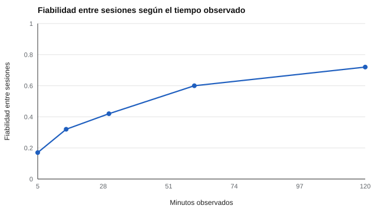

# 134 — Observación sistemática y registros anecdóticos


<!-- NAV -->
[← 133 — Desarrollo del lenguaje](../133-desarrollo-del-lenguaje/README.md) · [📚 Parte 13](../README.md) · [🗺️ Índice 001–200](../../../PROGRAMA.md) · [135 — Cribado frente a diagnóstico en la infancia →](../135-cribado-frente-a-diagnostico-en-la-infancia/README.md)
<!-- /NAV -->

**Parte 13 — Desarrollo infantil y evaluación psicoeducativa** · Nivel avanzado · 4 h · Estado `escrita`
**Pensada para:** quien observa conducta infantil (docentes, psicólogos), y familias que reciben esos registros.
**Prerrequisitos:** clases 029 y 111.

> Los registros con menores requieren consentimiento y custodia (parte 07).

## ¿Para qué te sirve esto?

«Pega mucho.» «Se distrae.» Muchas decisiones sobre un niño parten de una observación. Pero hay una gran diferencia entre una **anécdota** («el martes empujó a un compañero») y un **registro sistemático** (cuántas veces, en qué situaciones, con qué definición de «empujar»). Esta clase te enseña a diseñar una observación con definiciones operacionales, a calcular **cuánto tiempo observar** para obtener tasas fiables y a evitar un error clásico: informar **acuerdo total** cuando la conducta es rara.

## Al terminar esta clase podrás

- Distinguir registro sistemático (con definiciones operacionales) de registro anecdótico.
- Estimar cuánto tiempo observar para obtener tasas fiables.
- Interpretar el acuerdo entre observadores con conductas poco frecuentes.

## La idea en palabras simples

Un **registro sistemático** define la conducta de forma observable y usa un método de muestreo: de eventos, de intervalos o de tiempo (Altmann, 1974; Bakeman y Gottman, 1997). El **registro anecdótico** es descriptivo: sirve para generar hipótesis, no para comparar ni cuantificar. La fiabilidad de una tasa crece con el tiempo observado. Y el acuerdo entre dos observadores se informa con **kappa** (Cohen, 1960), porque con conductas raras el acuerdo total es engañosamente alto.

## Cómo funciona, paso a paso

**1. Definir** la conducta de forma observable (definición operacional).

**2. Elegir** el método de muestreo y el tiempo de observación.

**3. Registrar** con dos observadores independientes y calcular acuerdo total, kappa y acuerdo en la ocurrencia.

**Ejemplo resuelto.** Si ambos observadores registran 150 intervalos sin conducta de 180, el acuerdo ya es 83 % aunque no coincidan en ninguna ocurrencia.



*Figura 1.* Cinco minutos de observación no alcanzan para ordenar a los niños.

## Si construyes el instrumento

- Escribe definiciones operacionales con ejemplos y no ejemplos.
- Entrena a los observadores y verifica el acuerdo.
- Observa en varios contextos y varias sesiones.
- Informa kappa y acuerdo en la ocurrencia, no solo el acuerdo total.

## Si eres evaluado (o eres la familia)

- Pide que se te explique qué conductas se observaron, cuánto tiempo y en qué situaciones.
- Una decisión basada en 5 minutos de observación es frágil.
- Tienes derecho a conocer los registros que se guardan y quién los custodia.

## Qué muestra el laboratorio

`lab.py` simula 400 niños (Poisson) con dos sesiones independientes.

| Minutos observados | Fiabilidad entre sesiones |
|---:|---:|
| 5 | 0,17 |
| 30 | 0,42 |
| 60 | 0,60 |
| 120 | 0,72 |

Dos observadores, 180 intervalos de 10 s, conducta en 12 % de los intervalos: acuerdo total 0,87; kappa 0,54; acuerdo en la ocurrencia 0,45.

**Análisis.** (1) 5 minutos no bastan para ordenar a los niños; hace falta más tiempo o más sesiones. (2) Con conductas poco frecuentes, el acuerdo total es engañosamente alto. (3) Se informa kappa o el acuerdo en la ocurrencia. (4) Un registro anecdótico complementa, pero no reemplaza, un registro sistemático.

## Errores frecuentes

- Basar decisiones en 5 minutos de observación.
- Informar acuerdo total con conductas raras.
- Observar solo en un contexto (clase 136).
- Guardar registros sin consentimiento ni custodia.

## Lo mínimo que debes llevarte

1. Definir la conducta de forma observable.
2. Más tiempo de observación, más fiabilidad.
3. Con conductas raras, kappa y acuerdo en la ocurrencia.
4. Los registros con menores exigen protección.

## Ejercicios

- **Inicial.** ¿Qué es una definición operacional? *Solución: una descripción de la conducta en términos observables y medibles.*
- **Intermedio.** Calcula el acuerdo en la ocurrencia: ambos 8, solo uno 12. *Solución: 8 / (8 + 12) = 0,40.*
- **Avanzado.** Aumenta la prevalencia de la conducta a 40 % y compara acuerdo total y kappa.
- **Aplicación.** Escribe la definición operacional de «interrumpe en clase».

## Glosario

- **Definición operacional:** descripción observable de una conducta.
- **Muestreo de eventos / intervalos / tiempo:** formas de registrar la conducta.
- **Kappa:** acuerdo corregido por azar.
- **Registro anecdótico:** descripción narrativa de un episodio.

## Laboratorio

```bash
python classes/part-13-desarrollo-infantil-y-evaluacion-psicoeducativa/134-observacion-sistematica-y-registros-anecdoticos/lab.py
python classes/part-13-desarrollo-infantil-y-evaluacion-psicoeducativa/figuras.py
```

## Autoevaluación y criterios

1. ¿Cómo entrenarías observadores? 2. ¿Cuándo usar eventos y cuándo intervalos? 3. ¿Qué haces con un registro anecdótico preocupante?
Se logra la clase si diseñas una observación con tiempos y acuerdo justificados.

## Bibliografía

- Altmann, J. (1974). Observational study of behavior: Sampling methods. *Behaviour*, 49(3-4), 227-267. ✅ [DOI](https://doi.org/10.1163/156853974x00534)
- Bakeman, R., & Gottman, J. M. (1997). *Observing Interaction: An Introduction to Sequential Analysis* (2.ª ed.). Cambridge University Press. ⚠️ hay una obra de título parecido en Crossref con otro año (1999): comprobar la edición a mano
- Cohen, J. (1960). A coefficient of agreement for nominal scales. *Educational and Psychological Measurement*, 20(1), 37-46. ✅ [DOI](https://doi.org/10.1177/001316446002000104)

Leyenda: ✅ existe en Crossref con título y año coincidentes (enlace al DOI); ⚠️ hay una obra de título parecido con otro año (no se enlaza: comprobar la edición); 🔎 no verificada automáticamente (libros sin DOI, normas y sitios web). Crossref confirma la existencia de la fuente, no que respalde cada afirmación de la clase. Ver [`docs/VERIFICACION_BIBLIOGRAFIA.md`](../../../docs/VERIFICACION_BIBLIOGRAFIA.md).

---

<!-- NAV -->
[← 133 — Desarrollo del lenguaje](../133-desarrollo-del-lenguaje/README.md)  
[📚 Parte 13](../README.md) · [🗺️ Índice 001–200](../../../PROGRAMA.md)  
[135 — Cribado frente a diagnóstico en la infancia →](../135-cribado-frente-a-diagnostico-en-la-infancia/README.md)
<!-- /NAV -->
