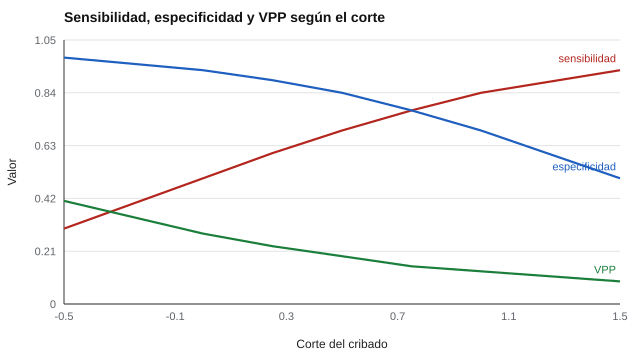

# 135 — Cribado frente a diagnóstico en la infancia


<!-- NAV -->
[← 134 — Observación sistemática y registros anecdótic…](../134-observacion-sistematica-y-registros-anecdoticos/README.md) · [📚 Parte 13](../README.md) · [🗺️ Índice 001–200](../../../PROGRAMA.md) · [136 — Evaluar con la familia: entrevista y devoluci… →](../136-evaluar-con-la-familia-entrevista-y-devolucion/README.md)
<!-- /NAV -->

**Parte 13 — Desarrollo infantil y evaluación psicoeducativa** · Nivel avanzado · 5 h · Estado `escrita`
**Pensada para:** quien usa o decide sobre pruebas de cribado, y familias que reciben un resultado de «riesgo».
**Prerrequisitos:** clases 100 y 131.

> Datos sintéticos. Un cribado no es un diagnóstico.

## ¿Para qué te sirve esto?

«El test salió en riesgo.» Esa frase asusta, pero un **cribado** no dice que haya un problema: dice que **conviene mirar con más detalle**. La diferencia entre cribado y diagnóstico es central, y tiene una sorpresa numérica: aun con un cribado razonable, **la mayoría de los derivados no tiene la condición** cuando esta es poco frecuente. Esta clase te enseña a leer sensibilidad, especificidad y valor predictivo, a elegir un corte según la capacidad del servicio y a **comunicar riesgo con honestidad**.

## Al terminar esta clase podrás

- Distinguir el propósito de un cribado del de un diagnóstico.
- Interpretar una curva ROC y elegir un punto de corte.
- Calcular cuántos niños se derivan por cada caso verdadero.

## La idea en palabras simples

El **cribado** identifica riesgo en una población aparentemente sana con pruebas breves; el **diagnóstico** es un proceso profesional, individual y más amplio (Glascoe, 2005; Lipkin y Macias, 2020). Un cribado se evalúa con **sensibilidad**, **especificidad**, **valor predictivo positivo (VPP)** y el **AUC** de la curva ROC (Hanley y McNeil, 1982). El **índice de Youden** (sensibilidad + especificidad − 1) sugiere un corte, pero el corte real se elige según cuántos niños se pueden evaluar después y cuánto cuesta no detectar un caso.

## Cómo funciona, paso a paso

**1. Simular** una prevalencia del 5 %; los casos puntúan ~N(0, 1) y los no casos ~N(1,5, 1).

**2. Calcular** sensibilidad, especificidad, VPP y derivados por cada 100 para varios cortes.

**3. Elegir** el corte según capacidad y costos.

**Ejemplo resuelto.** Con corte 0,75, por cada 100 niños se derivan 25; ≈ 3,9 son casos (77 % de 5) y ≈ 21 no lo son: 6,6 derivados por caso.



*Figura 1.* Bajar la exigencia gana sensibilidad pero deriva a muchos más niños sanos.

## Si construyes el instrumento

- Declara el propósito: cribado, no diagnóstico.
- Elige el corte según capacidad de evaluación posterior y costo de no detectar.
- Comunica «riesgo» con lenguaje claro, nunca «diagnóstico».
- Ofrece apoyo mientras se espera la evaluación y un seguimiento para los no derivados.

## Si eres evaluado (o eres la familia)

- «En riesgo» significa «hay que evaluar mejor», no «tiene un problema».
- Pregunta cuál fue el propósito del test y qué sigue.
- Con una condición poco frecuente, la mayoría de los derivados no la tiene.

## Qué muestra el laboratorio

| Corte | Sens. | Espec. | VPP | Derivar por cada 100 | Derivados por caso |
|---:|---:|---:|---:|---:|---:|
| 0,00 | 0,50 | 0,93 | 0,28 | 8,9 | 3,5 |
| 0,75 (Youden) | 0,77 | 0,77 | 0,15 | 25,3 | 6,6 |
| 1,50 | 0,93 | 0,50 | 0,09 | 52,1 | 11,2 |

AUC ≈ 0,86; corte de Youden = 0,75.

**Análisis.** (1) Aun con un cribado razonable y 5 % de prevalencia, la mayoría de los derivados no tiene la condición (VPP bajo). (2) Un cribado reparte la atención: el corte se elige según capacidad y costo. (3) El resultado positivo se llama «riesgo», nunca «diagnóstico». (4) El diagnóstico es un proceso profesional.

## Errores frecuentes

- Llamar «diagnóstico» a un resultado de cribado.
- Elegir el corte por estadística sin considerar capacidad y costos.
- No ofrecer apoyo mientras se espera la evaluación.
- Ignorar la baja prevalencia al interpretar un resultado positivo.

## Lo mínimo que debes llevarte

1. Cribado detecta riesgo; el diagnóstico es un proceso.
2. Sensibilidad y especificidad se compensan.
3. El VPP depende de la prevalencia.
4. El corte se elige con criterios prácticos y éticos.

## Ejercicios

- **Inicial.** ¿Qué es el índice de Youden? *Solución: sensibilidad + especificidad − 1.*
- **Intermedio.** Sens. 0,6 y esp. 0,9. *Solución: Youden 0,5.*
- **Avanzado.** Cambia la prevalencia a 15 % en `lab.py` y observa el VPP.
- **Aplicación.** Redacta cómo comunicarías un resultado de «riesgo» a una familia.

## Glosario

- **Cribado (screening):** prueba breve para detectar riesgo en población general.
- **Diagnóstico:** evaluación profesional individual y amplia.
- **VPP:** proporción de positivos que realmente tienen la condición.
- **Curva ROC:** gráfico de sensibilidad frente a 1 − especificidad según el corte.

## Laboratorio

```bash
python classes/part-13-desarrollo-infantil-y-evaluacion-psicoeducativa/135-cribado-frente-a-diagnostico-en-la-infancia/lab.py
python classes/part-13-desarrollo-infantil-y-evaluacion-psicoeducativa/figuras.py
```

## Autoevaluación y criterios

1. ¿Qué capacidad de derivación tiene tu servicio? 2. ¿Cómo comunicas «riesgo»? 3. ¿Qué seguimiento propones para los no derivados?
Se logra la clase si eliges un corte justificado y comunicas con lenguaje de riesgo.

## Bibliografía

- Glascoe, F. P. (2005). Screening for developmental and behavioral problems. *Mental Retardation and Developmental Disabilities Research Reviews*, 11(3), 173-179. ✅ [DOI](https://doi.org/10.1002/mrdd.20068)
- Hanley, J. A., & McNeil, B. J. (1982). The meaning and use of the area under a receiver operating characteristic (ROC) curve. *Radiology*, 143(1), 29-36. ✅ [DOI](https://doi.org/10.1148/radiology.143.1.7063747)
- Lipkin, P. H., & Macias, M. M. (2020). Promoting optimal development: Identifying infants and young children with developmental disorders through developmental surveillance and screening. *Pediatrics*, 145(1), e20193449. ✅ [DOI](https://doi.org/10.1542/9781610025034-part03-promoting)

Leyenda: ✅ existe en Crossref con título y año coincidentes (enlace al DOI); ⚠️ hay una obra de título parecido con otro año (no se enlaza: comprobar la edición); 🔎 no verificada automáticamente (libros sin DOI, normas y sitios web). Crossref confirma la existencia de la fuente, no que respalde cada afirmación de la clase. Ver [`docs/VERIFICACION_BIBLIOGRAFIA.md`](../../../docs/VERIFICACION_BIBLIOGRAFIA.md).

---

<!-- NAV -->
[← 134 — Observación sistemática y registros anecdótic…](../134-observacion-sistematica-y-registros-anecdoticos/README.md)  
[📚 Parte 13](../README.md) · [🗺️ Índice 001–200](../../../PROGRAMA.md)  
[136 — Evaluar con la familia: entrevista y devoluci… →](../136-evaluar-con-la-familia-entrevista-y-devolucion/README.md)
<!-- /NAV -->
