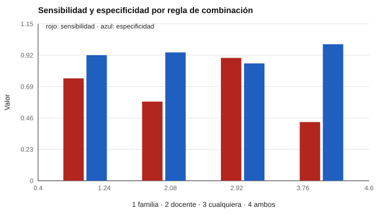

# 136 — Evaluar con la familia: entrevista y devolución


<!-- NAV -->
[← 135 — Cribado frente a diagnóstico en la infancia](../135-cribado-frente-a-diagnostico-en-la-infancia/README.md) · [📚 Parte 13](../README.md) · [🗺️ Índice 001–200](../../../PROGRAMA.md) · [137 — Atención temprana y apoyos →](../137-atencion-temprana-y-apoyos/README.md)
<!-- /NAV -->

**Parte 13 — Desarrollo infantil y evaluación psicoeducativa** · Nivel avanzado · 4 h · Estado `escrita`
**Pensada para:** quien entrevista a familias y entrega resultados, y familias que reciben una devolución.
**Prerrequisitos:** clases 073 y 135.

> Los parámetros son supuestos; el modelo no reemplaza el juicio profesional.

## ¿Para qué te sirve esto?

Los padres dicen una cosa; la docente, otra. ¿Quién tiene razón? Probablemente **ambos**: ven al niño en contextos distintos. Cuando se integran fuentes, la regla de combinación importa: «basta con que uno lo note» detecta más pero se equivoca con más niños sanos; «deben notarlo ambos» se equivoca menos pero pierde casos. Esta clase te enseña a comparar reglas y a planificar la **entrevista** (entender el contexto) y la **devolución** (una conversación, no un veredicto).

## Al terminar esta clase podrás

- Entender la discrepancia entre informantes.
- Comparar reglas de combinación de fuentes.
- Planificar la entrevista y la devolución como conversación.

## La idea en palabras simples

Padres, docentes y los propios niños informan de forma distinta, en parte por ver contextos diferentes (Achenbach, McConaughy y Howell, 1987; De Los Reyes et al., 2015). **Las discrepancias son información**, no solo error. Al integrar fuentes:

- **Cualquiera de los dos:** sube la sensibilidad y los falsos positivos.
- **Ambos:** sube la especificidad y se pierden casos de un solo contexto.

## Cómo funciona, paso a paso

**1. Simular** informes de familia y docente (prevalencia 15 %).

**2. Medir** la concordancia (acuerdo y kappa).

**3. Comparar** las cuatro reglas por sensibilidad, especificidad y VPP.

**Ejemplo resuelto.** Un niño que molesta en casa pero no en el aula: «ambos» no lo detecta; «cualquiera» sí. La decisión depende del costo de cada error y se acompaña de una conversación con ambos contextos.



*Figura 1.* «Cualquiera» detecta más; «ambos» se equivoca menos con niños sanos.

## Si construyes el instrumento

- Recoge información de varios informantes y contextos.
- Declara la regla de combinación y su costo.
- Prepara preguntas abiertas para la entrevista: qué observan, qué esperan y qué temen.
- Estructura la devolución: lo observado, lo que significa, lo que no significa y los pasos siguientes.

## Si eres evaluado (o eres la familia)

- Que tu relato difiera del de la escuela no significa que alguien mienta.
- Tienes derecho a una devolución comprensible y a hacer preguntas.
- Pregunta qué se hará con los resultados y cómo se resguardan.

## Qué muestra el laboratorio

| Regla | Sensibilidad | Especificidad | VPP |
|---|---:|---:|---:|
| Solo familia | 0,75 | 0,92 | 0,61 |
| Solo docente | 0,58 | 0,94 | 0,63 |
| Cualquiera de los dos | 0,90 | 0,86 | 0,53 |
| Ambos | 0,43 | 1,00 | 0,94 |

Concordancia entre informantes: acuerdo 0,82; kappa 0,32.

**Análisis.** (1) Padres y docentes concuerdan solo moderadamente, y no por ello uno «miente». (2) «Cualquiera» detecta más y deriva a más niños sin la condición. (3) «Ambos» pierde casos de un solo contexto. (4) La devolución integra fuentes; no es un veredicto.

## Errores frecuentes

- Descartar al informante que «discrepa».
- Entregar resultados sin preguntar qué espera y teme la familia.
- Usar lenguaje técnico sin explicar ni dejar espacio a preguntas.
- Elegir la regla de combinación sin considerar costos.

## Lo mínimo que debes llevarte

1. Los informantes ven contextos distintos.
2. La regla de combinación cambia sensibilidad y especificidad.
3. La entrevista busca entender el contexto.
4. La devolución es una conversación.

## Ejercicios

- **Inicial.** ¿Por qué discrepan padres y docentes? *Solución: porque ven al niño en contextos distintos y con expectativas distintas.*
- **Intermedio.** ¿Qué regla elegirías para un cribado amplio? *Solución: «cualquiera», con evaluación posterior.*
- **Avanzado.** Cambia la prevalencia a 5 % y compara los VPP.
- **Aplicación.** Escribe el guion de una devolución en cuatro partes.

## Glosario

- **Informante:** persona que describe la conducta del niño.
- **Discrepancia entre informantes:** diferencias entre lo que reportan distintas fuentes.
- **Devolución:** entrega y conversación de resultados.
- **Regla de combinación:** cómo integrar varias fuentes.

## Laboratorio

```bash
python classes/part-13-desarrollo-infantil-y-evaluacion-psicoeducativa/136-evaluar-con-la-familia-entrevista-y-devolucion/lab.py
python classes/part-13-desarrollo-infantil-y-evaluacion-psicoeducativa/figuras.py
```

## Autoevaluación y criterios

1. ¿Qué preguntas abrirías en la entrevista? 2. ¿Cómo estructuras la devolución? 3. ¿Cómo registras el consentimiento y los acuerdos?
Se logra la clase si integras fuentes con una regla justificada y planificas una devolución respetuosa.

## Bibliografía

- Achenbach, T. M., McConaughy, S. H., & Howell, C. T. (1987). Child/adolescent behavioral and emotional problems: Implications of cross-informant correlations for situational specificity. *Psychological Bulletin*, 101(2), 213-232. ✅ [DOI](https://doi.org/10.1037/0033-2909.101.2.213)
- De Los Reyes, A., et al. (2015). Informant discrepancies in the assessment of childhood psychopathology: A critical review, theoretical framework, and recommendations for further study. *Psychological Bulletin*, 141(4), 858-900. ⚠️ hay una obra de título parecido en Crossref con otro año (2005): comprobar la edición a mano

Leyenda: ✅ existe en Crossref con título y año coincidentes (enlace al DOI); ⚠️ hay una obra de título parecido con otro año (no se enlaza: comprobar la edición); 🔎 no verificada automáticamente (libros sin DOI, normas y sitios web). Crossref confirma la existencia de la fuente, no que respalde cada afirmación de la clase. Ver [`docs/VERIFICACION_BIBLIOGRAFIA.md`](../../../docs/VERIFICACION_BIBLIOGRAFIA.md).

---

<!-- NAV -->
[← 135 — Cribado frente a diagnóstico en la infancia](../135-cribado-frente-a-diagnostico-en-la-infancia/README.md)  
[📚 Parte 13](../README.md) · [🗺️ Índice 001–200](../../../PROGRAMA.md)  
[137 — Atención temprana y apoyos →](../137-atencion-temprana-y-apoyos/README.md)
<!-- /NAV -->
