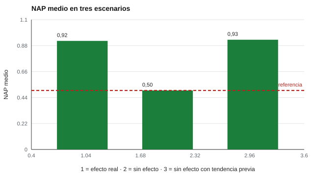

# 137 — Atención temprana y apoyos


<!-- NAV -->
[← 136 — Evaluar con la familia: entrevista y devoluci…](../136-evaluar-con-la-familia-entrevista-y-devolucion/README.md) · [📚 Parte 13](../README.md) · [🗺️ Índice 001–200](../../../PROGRAMA.md) · [138 — Evaluación en educación parvularia →](../138-evaluacion-en-educacion-parvularia/README.md)
<!-- /NAV -->

**Parte 13 — Desarrollo infantil y evaluación psicoeducativa** · Nivel avanzado · 4 h · Estado `escrita`
**Pensada para:** quien monitorea el progreso de un niño con apoyos, y familias que reciben esos informes.
**Prerrequisitos:** clases 087 y 134.

> Datos sintéticos.

## ¿Para qué te sirve esto?

Se inicia un apoyo (por ejemplo, un programa de lenguaje) y semanas después el niño mejora. ¿Fue el apoyo? Podría haber mejorado igual por maduración, por un cambio en casa o por otro profesional. Para decidir si un apoyo funciona en **un niño** se usa un **diseño de caso único**: se mide varias veces antes (línea base, A) y después (apoyo, B). Esta clase te enseña a calcular el **NAP** y, sobre todo, a ver cuándo una tendencia previa te engaña.

## Al terminar esta clase podrás

- Monitorear el progreso de un niño con un diseño de caso único.
- Calcular el NAP (no superposición de todos los pares).
- Reconocer cuándo una tendencia previa invalida la conclusión.

## La idea en palabras simples

En un diseño **AB** se compara la línea base (A) con la fase de apoyo (B). El **NAP** (Parker y Vannest, 2009) es la proporción de pares (a, b) en que b > a (los empates cuentan 0,5). Un NAP de 0,5 equivale a ningún efecto; 1,0, a superposición nula. Pero un diseño AB es débil; se fortalece con línea base estable, replicación (retirada, línea base múltiple) y registro de otros cambios (Kratochwill et al., 2010).

## Cómo funciona, paso a paso

**1. Medir** 8 puntos de línea base y 8 con apoyo.

**2. Formar** todos los pares (a, b) y contar los que favorecen a B.

**3. Interpretar** el NAP junto con la estabilidad de la línea base.

**Ejemplo resuelto.** Base 2, 3, 3; apoyo 4, 5, 3. Con a = 2, las tres comparaciones favorecen a B; cada 3 gana 2 veces y empata 1 (2,5): (3 + 2,5 + 2,5)/9 = 0,89.



*Figura 1.* Una tendencia previa produce un NAP alto sin que el apoyo haga nada.

## Si construyes el instrumento

- Define la conducta objetivo de forma observable y mídela con regularidad.
- Establece una línea base estable antes de comenzar el apoyo.
- Registra otros cambios simultáneos (nuevo docente, medicación, maduración).
- Replica el efecto (retirada o línea base múltiple) cuando sea posible.

## Si eres evaluado (o eres la familia)

- Mejorar tras un apoyo no prueba que el apoyo fue la causa.
- Ayuda anotar lo que cambió en casa en las mismas semanas.
- Pregunta cómo se medirá el progreso y cuándo se ajustará el apoyo.

## Qué muestra el laboratorio

`lab.py` simula 8 + 8 mediciones y 2 000 casos por escenario.

| Escenario | NAP medio | % con NAP ≥ 0,90 |
|---|---:|---:|
| Efecto real (+3), sin tendencia | 0,92 | 67,2 % |
| Sin efecto, sin tendencia | 0,50 | 0,4 % |
| Sin efecto, con tendencia previa | 0,93 | 75,0 % |

**Análisis.** (1) El NAP discrimina un efecto real. (2) Una tendencia de mejora previa produce «efectos grandes» sin que el apoyo haga nada. (3) Un diseño AB es débil. (4) Medir el progreso informa decisiones de apoyo; no demuestra eficacia por sí solo.

## Errores frecuentes

- Concluir eficacia de un diseño AB con línea base inestable.
- Ignorar otros cambios simultáneos.
- Usar un umbral de NAP como regla mecánica.
- No comunicar a la familia las limitaciones del diseño.

## Lo mínimo que debes llevarte

1. El caso único compara una línea base con una fase de apoyo.
2. El NAP es la proporción de pares que favorecen a B.
3. Una tendencia previa invalida la conclusión.
4. La replicación fortalece el diseño.

## Ejercicios

- **Inicial.** ¿Qué es la línea base? *Solución: las mediciones previas al apoyo que muestran el nivel y la tendencia habituales.*
- **Intermedio.** Calcula el NAP de A = 2, 4 y B = 5, 3. *Solución: ganan (2,5), (2,3), (4,5); pierde (4,3): 3/4 = 0,75.*
- **Avanzado.** Agrega una fase de retirada (ABAB) en `lab.py` y comenta la inferencia.
- **Aplicación.** Diseña un registro semanal para monitorear una conducta objetivo con la familia.

## Glosario

- **Diseño de caso único:** estudio de un sujeto con mediciones repetidas.
- **Línea base (A) / apoyo (B):** fases del diseño.
- **NAP:** no superposición de todos los pares.
- **Retirada:** suspender el apoyo para verificar su efecto.

## Laboratorio

```bash
python classes/part-13-desarrollo-infantil-y-evaluacion-psicoeducativa/137-atencion-temprana-y-apoyos/lab.py
python classes/part-13-desarrollo-infantil-y-evaluacion-psicoeducativa/figuras.py
```

## Autoevaluación y criterios

1. ¿Qué conducta objetivo elegirías y cómo la medirías? 2. ¿Cómo involucras a la familia en el registro? 3. ¿Cuándo cambias el apoyo?
Se logra la clase si analizas un caso único y declaras la debilidad del diseño.

## Bibliografía

- Parker, R. I., & Vannest, K. J. (2009). An improved effect size for single-case research: Nonoverlap of all pairs. *Behavior Therapy*, 40(4), 357-367. ✅ [DOI](https://doi.org/10.1016/j.beth.2008.10.006)
- Kratochwill, T. R., et al. (2010). *Single-Case Designs Technical Documentation*. What Works Clearinghouse. 🔎 sin verificar (libro, norma o sitio no hallado en Crossref: comprobar a mano)

Leyenda: ✅ existe en Crossref con título y año coincidentes (enlace al DOI); ⚠️ hay una obra de título parecido con otro año (no se enlaza: comprobar la edición); 🔎 no verificada automáticamente (libros sin DOI, normas y sitios web). Crossref confirma la existencia de la fuente, no que respalde cada afirmación de la clase. Ver [`docs/VERIFICACION_BIBLIOGRAFIA.md`](../../../docs/VERIFICACION_BIBLIOGRAFIA.md).

---

<!-- NAV -->
[← 136 — Evaluar con la familia: entrevista y devoluci…](../136-evaluar-con-la-familia-entrevista-y-devolucion/README.md)  
[📚 Parte 13](../README.md) · [🗺️ Índice 001–200](../../../PROGRAMA.md)  
[138 — Evaluación en educación parvularia →](../138-evaluacion-en-educacion-parvularia/README.md)
<!-- /NAV -->
